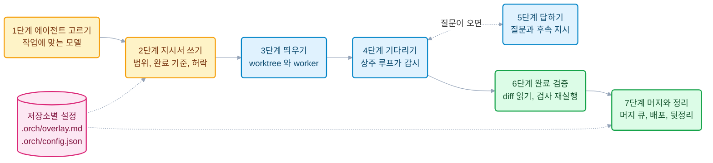
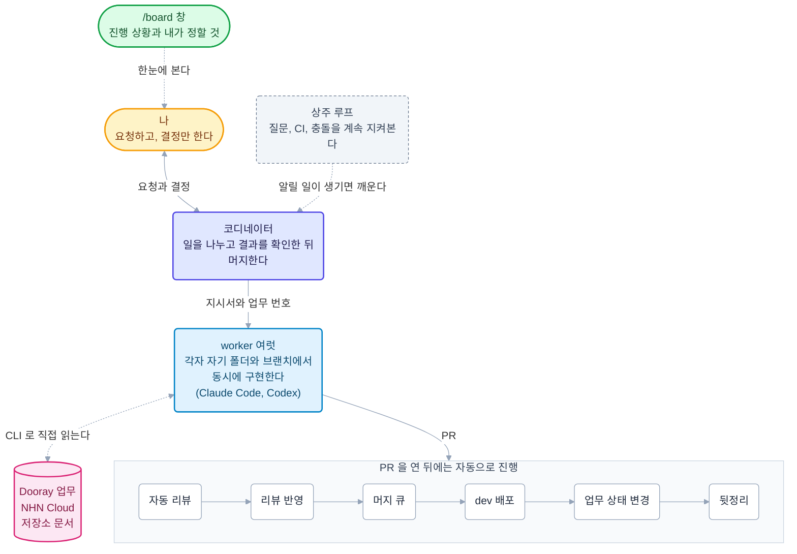
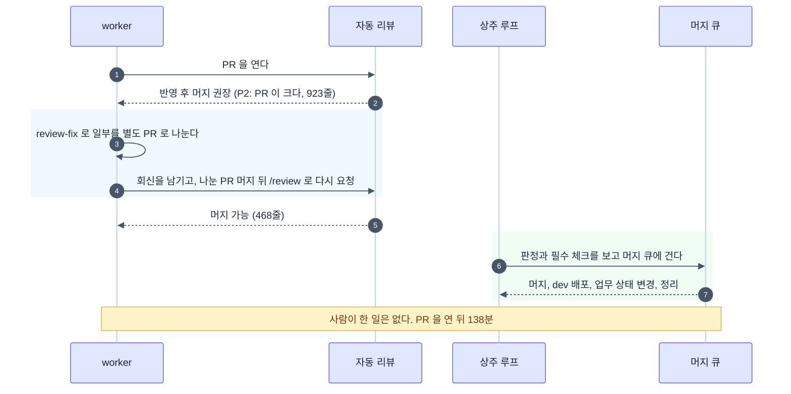

# Orca 로 나만의 멀티 에이전트 오케스트레이션을 만들어 개발 생산성 끌어올리기

NHN AI서비스개발팀에서 백엔드 개발을 하는 김병태다.
AI 코딩 에이전트를 여러 개 동시에 돌리면서 생긴 병목을 Orca 와 직접 만든 스킬로 풀어 온 과정을 정리한다.

## 들어가며: 에이전트 하나로는 부족해졌다

[Claude Code](https://code.claude.com/docs) 나 [Codex](https://developers.openai.com/codex) 같은 AI 코딩 에이전트를 쓰면서 생산성이 올랐다고 느끼는 개발자가 많을 것이다.
나도 그랬다.
에이전트는 채팅으로 답만 하는 것이 아니라, 터미널에서 저장소의 코드를 직접 읽고, 파일을 고치고, 빌드와 테스트를 돌린다.

그런데 쓰다 보니 새로운 아쉬움이 생겼다.
에이전트가 일하는 동안 나는 대부분 기다리고 있었다.
에이전트 하나가 끝나야 다음 일을 맡길 수 있으니, 결국 한 번에 한 가지 일만 진행됐다.

그래서 이런 생각을 하게 됐다.

- 에이전트를 여러 개 동시에 돌리면 더 빨라지지 않을까?
- 그렇다면 여러 에이전트를 어떻게 굴려야 서로 부딪히지 않고, 사람도 지치지 않을까?

이 글은 그 고민에서 시작해 지금의 개발 방식에 이르기까지의 과정이다.
AI 코딩 에이전트를 한 번쯤 써 본 개발자를 독자로 생각하고 썼다.

글은 아래 순서로 이어진다.

1. Orca 를 써 보다
2. Orca 를 쓰면서 느낀 한계
3. `/fos-skills:orch` 스킬을 만들다
4. 실제로는 이렇게 돌아간다
5. 새로 생긴 문제: 인지부하와 `/board` 창
6. 결과: 10월 한 달 동안 일어난 일
7. 한계와 비용
8. 따라 해 보기

스킬이 무엇인지는 [Claude Code의 Skill 시스템 - 개발자를 위한 AI 자동화의 새로운 차원](./claude-code-skill-system.md)에, Claude Code 안에서 에이전트 여럿을 부르는 기능은 [Claude Code Teams의 멀티 에이전트 구조](./claude-teams.md)에 따로 정리했다.
이 글은 그 위에서 여러 에이전트를 사람 한 명이 굴리는 방법을 다룬다.

## Orca 를 써 보다

### 에이전트 둘이 한 폴더에서 일하면 생기는 일

처음에는 터미널 탭을 여러 개 열고 에이전트를 하나씩 띄워 봤다.
바로 문제가 생겼다.
에이전트 둘이 같은 폴더에서 동시에 작업하니, 한쪽이 브랜치를 바꾸면 다른 쪽 작업이 엉키고 서로 파일을 덮어썼다.

이 문제는 [git worktree](https://git-scm.com/docs/git-worktree) 로 푼다.
git worktree 는 저장소 하나를 여러 폴더로 펼쳐, 폴더마다 다른 브랜치를 체크아웃하게 해 주는 git 기능이다.
에이전트마다 worktree 를 하나씩 주면 각자 자기 폴더와 자기 브랜치에서 일하므로 서로 부딪히지 않는다.

하지만 worktree 를 만들고, 그 폴더에서 에이전트를 띄우고, 어느 탭이 어느 일을 하는지 기억하는 일은 여전히 사람 몫이었다.

### Orca 는 무엇인가

[Orca](https://orca.dev)([GitHub](https://github.com/stablyai/orca))는 에이전트 여럿을 띄우고 관리하는 IDE 형태의 데스크톱 앱이다.
Claude Code 나 Codex 는 이미 구독한 계정으로 Orca 안에서 실행한다.

Orca 의 구조를 이 글에 필요한 만큼만 정리하면 이렇다.

- **프로젝트와 worktree:** 왼쪽 목록에 저장소가 있고, 그 아래에 worktree 가 나열된다. worktree 를 만들면 Orca 가 그 폴더를 등록하고 관리한다.
- **worktree 별 터미널:** worktree 마다 터미널을 열어 에이전트를 실행한다. 목록만 봐도 어느 에이전트가 어느 브랜치에서 일하는지 알 수 있다.
- **에이전트 사이의 메시지(orchestration):** 한 에이전트가 다른 에이전트를 「worker」 로 띄우고, 질문과 답, 진행 보고, 완료 보고를 메시지로 주고받을 수 있다.
- **사람이 끼어들기:** 어느 에이전트의 터미널이든 열어 직접 보고 입력할 수 있다.

이 글에서는 에이전트를 역할에 따라 둘로 나눠 부른다.

- **코디네이터:** 내가 대화하는 에이전트다. 따로 만든 프로그램이 아니라, 평소 쓰던 Claude Code 세션 하나가 이 역할을 맡는다. 일을 나누고, worker 를 띄우고, 결과를 확인한다. 직접 기능을 구현하지는 않는다.
- **worker:** 코디네이터가 맡긴 일 하나를 자기 worktree 에서 구현하는 에이전트다. 여러 개가 동시에 돈다.
- **지시서:** 코디네이터가 worker 에게 일을 맡길 때 주는 Markdown 파일이다. 할 일과 완료 기준, 해도 되는 일과 하면 안 되는 일을 적는다. 실제 예시는 「실제로는 이렇게 돌아간다」 절에서 본다.

## Orca 를 쓰면서 느낀 한계

Orca 덕분에 worker 여럿을 띄우고 메시지를 주고받는 것은 쉬워졌다.
그런데 막상 여러 worker 에게 일을 맡겨 보니, 사람이 해야 하는 일이 줄지 않고 오히려 늘었다.

Orca 가 주는 것은 「에이전트를 띄우고 대화하게 하는 기반」 이다.
그 위에서 무엇을 어떻게 맡길지, 결과를 무엇으로 믿을지, 언제 머지하고 무엇을 치울지는 정해져 있지 않았다.
그 빈자리를 내가 메우고 있었다.

- **맥락 전달:** worker 마다 업무 배경과 저장소 규칙을 설명해야 했다.
- **완료 확인:** 「끝났습니다」 라는 보고를 믿고 머지했는데, 테스트를 돌리지 않았거나 요구한 것 하나가 빠져 있던 일이 있었다.
- **결정의 경계:** 사람이 정해야 할 것을 worker 가 스스로 정하고 넘어가기도 했다.
- **머지 순서:** PR 여러 개를 어떤 순서로 머지할지, 충돌은 누가 풀지 내가 챙겨야 했다.
- **뒷정리:** 머지한 뒤 worktree, 브랜치, 터미널이 남아 화면과 디스크를 채웠다.
- **질문 놓치기:** worker 가 보낸 질문을 제때 보지 못해, worker 가 답을 기다리며 멈춰 있기도 했다.

에이전트를 여럿 띄우니, 느린 곳이 에이전트에서 사람으로 옮겨 갔다.
에이전트를 늘릴수록 확인하고 지시하고 정리할 일도 함께 늘었다.

## `/fos-skills:orch` 스킬을 만들다

### 계기: 사람이 하던 조율을 에이전트에게 맡기자

위의 일들은 대부분 매번 같은 순서로 반복된다.
반복되는 절차라면 에이전트에게 맡길 수 있다.
그래서 코디네이터 에이전트가 이 조율을 대신하도록, 절차와 규칙을 스킬로 만들었다.

[스킬](https://code.claude.com/docs/en/skills)은 에이전트가 특정 작업을 할 때 읽고 따르는 지침 문서다.
`SKILL.md` 라는 Markdown 파일에 절차와 규칙을 적고, 필요하면 스크립트를 함께 둔다.
팀 위키에 업무 매뉴얼을 적어 두는 것과 비슷한데, 사람 대신 에이전트가 그 매뉴얼을 읽고 그대로 실행한다는 점이 다르다.

그렇게 만든 것이 [`orch`](https://github.com/jon890/fos-skills/blob/main/orch/README.md) 스킬이다.
Claude Code 에서 `/fos-skills:orch` 로 부르거나 「worker 로 맡겨 줘」 라고 말하면 열린다.
Orca 의 메시지 기능 위에서 코디네이터가 무엇을 판단하고 어떤 순서로 움직일지를 정한다.

### 네 가지 원칙

1. **보고 대신 확인한다.** worker 의 완료 보고를 근거로 삼지 않고, 코디네이터가 diff 를 읽고 검사를 다시 돌린다.
2. **결정은 사람이 한다.** 사람이 정할 것은 배경과 권장안을 붙여 묻고, 고른 답만 worker 에게 전한다.
3. **흔적을 남기지 않는다.** 머지가 끝나면 worktree, 브랜치, worker 터미널, 다 쓴 지시서를 지운다.
4. **절차는 하나, 저장소별 차이는 설정으로 둔다.** 절차는 스킬 한 곳에만 두고, 저장소마다 다른 값은 그 저장소의 설정 파일에 둔다.

### 구조: 일곱 단계

`orch` 는 worker 하나에게 작업을 맡길 때마다 아래 일곱 단계를 따른다.



| 단계 | 코디네이터가 하는 일 |
| --- | --- |
| 1단계 에이전트 고르기 | 작업 성격(작은 수정, 큰 구현, 어려운 디버깅)에 맞춰 Claude Code 나 Codex 와 모델을 고른다 |
| 2단계 지시서 쓰기 | 할 일, 완료 기준, 허락한 범위를 적은 지시서를 쓰고, worker 끼리 같은 파일을 고치지 않는지 검사한다 |
| 3단계 띄우기 | 지시서의 브랜치 이름으로 worktree 를 만들고 그 안에 worker 를 띄운다 |
| 4단계 기다리기 | 저장소마다 상주 루프(백그라운드 프로그램)가 돌며 질문, CI 결과, 충돌을 지켜보고, 알릴 일이 생기면 코디네이터를 깨운다 |
| 5단계 답하기 | worker 의 질문에 답하거나 후속 지시를 보낸다. 사람이 정할 질문은 나에게 올린다 |
| 6단계 완료 검증 | diff 를 직접 읽고 검사를 다시 돌린다 |
| 7단계 머지와 정리 | 머지 큐로 차례대로 머지하고, 배포를 확인한 뒤 worktree, 브랜치, 터미널을 지운다 |

각 단계에서 반복되는 작업은 스크립트로 만들어 스킬에 함께 넣었다.
사람이 돌리는 것이 아니라 코디네이터가 단계마다 부른다.
매번 명령을 새로 조합하지 않고 같은 스크립트를 부르므로 결과가 일정하다.

- **2단계 지시서 검사(`spec-lint`):** 지시서마다 「담당:」 줄에 고칠 파일과 폴더를 적게 하고, 띄우기 전에 지시서끼리 그 목록을 비교한다. 겹치면 한쪽을 앞 PR 이 머지된 뒤로 미룬다.
- **3단계 띄우기(`launch-worker`):** 지시서의 브랜치 이름으로 worktree 를 만들고 그 안에 worker 를 띄운다.
- **4단계 상주 루프(`orch-loop`):** 저장소마다 하나씩 백그라운드에서 도는 감시 프로그램이다. 일정한 간격으로 GitHub 와 Orca 를 확인해서, worker 의 질문이나 CI 실패처럼 코디네이터가 처리할 일이 생기면 알린다. 코디네이터 쪽에서는 그 알림을 받아 주는 대기 명령이 함께 돌고, 알림이 오면 코디네이터가 깨어나 일한다. 그 전까지 코디네이터는 쉰다.
- **7단계 머지 큐(`merge-with-finish`):** PR 을 한 번에 하나씩 순서대로 머지하고, 배포 확인과 뒷정리까지 이어서 한다. 자세한 규칙은 「머지하기」 절에서 본다.

저장소마다 다른 값(기준 브랜치, 검증 명령, 필수 CI 체크, 배포 워크플로)은 그 저장소의 `.orch/config.json` 과 `.orch/overlay.md` 에 둔다.
`orch` 스킬 자체는 저장소마다 고치지 않는다.
이 코어와 오버레이 구조는 [여러 저장소가 쓰는 스킬은 도메인 중립 코어와 저장소별 오버레이로 나눈다](./shared-skill-core-overlay.md)에서 따로 다뤘다.

### 단계마다 원하는 작업 더하기: 훅

저장소마다 더 하고 싶은 일이 있으면 스킬을 고치지 않고 훅(hook)으로 더할 수 있다.
훅은 「이 시점이 되면 이 스크립트를 불러 달라」 고 걸어 두는 자리다.
`orch` 는 단계마다 정해진 시점에 그 저장소의 `.orch/hooks/<시점 이름>.ts` 파일이 있는지 보고, 있으면 실행한다.

| 단계 | 훅을 걸 수 있는 시점(예) |
| --- | --- |
| 3단계 띄우기 | worker 를 띄우기 직전(`before-launch`), 띄운 직후(`worker-launched`) |
| 4~5단계 기다리기와 답하기 | worker 가 질문했을 때(`worker-question`), 오래 멈춰 있을 때(`worker-stalled`), CI 가 실패했을 때(`ci-failed`) |
| 7단계 머지와 정리 | 머지 직전(`before-merge`), 머지 직후(`after-merge`), dev 배포 확인 뒤(`after-deploy`), 정리 전후(`before-cleanup`, `after-cleanup`) |

`before-` 로 시작하는 시점의 훅은 그 동작을 막을 수도 있다. 훅이 정해진 종료 코드로 끝나면 `orch` 가 그 동작을 하지 않고 이유를 코디네이터에게 알린다.
나머지 시점의 훅은 알림이나 기록처럼 곁들이는 일을 하고, 훅이 실패해도 본 절차는 그대로 이어진다.

실제로 이렇게 쓴다.

- **배포 뒤 업무 상태 바꾸기(`after-deploy`):** 이 저장소는 dev 배포가 끝나면 훅이 `dooray` CLI 로 업무를 「진행 중」 으로 바꾸고 「환경: DEV」 태그를 단다. 뒤에서 볼 업무 상태 변경이 이 훅이다.
- **동시에 띄울 worker 수 제한(`before-launch`):** 이미 떠 있는 worker 가 정한 수를 넘으면 새 worker 를 띄우지 않게 막을 수 있다. PC 한 대에서 감당할 수 있는 만큼만 돌리고 싶을 때 쓴다.

메신저 알림, 사내 다른 시스템 연동처럼 팀마다 다른 일도 같은 방식으로 더할 수 있다.

### fos-skills: 스킬을 묶은 플러그인

`orch` 는 혼자 쓰이지 않는다.
설계, 구현, 리뷰 반영 같은 다른 스킬과 함께 쓰인다.
이 스킬들을 묶어 둔 것이 내가 직접 만든 Claude Code 플러그인 [fos-skills](https://github.com/jon890/fos-skills) 다.
[Claude Code 플러그인](https://code.claude.com/docs/en/plugins)은 스킬, 훅, 명령, 화면 옆 창(mod) 같은 확장을 한 묶음으로 설치하고 갱신하는 단위다.
누구나 자기 플러그인을 만들 수 있고, GitHub 저장소에 올려 두면 다른 사람도 명령 한 줄로 설치할 수 있다.
fos-skills 도 공개 저장소에 있어서, 나는 회사 PC 와 개인 PC 에서 같은 플러그인을 설치해 똑같이 쓴다.
플러그인으로 설치하면 아래 스킬을 `/fos-skills:<스킬 이름>` 으로 부를 수 있고, 저장소에 새 버전이 올라가면 갱신 명령 한 번으로 받는다.

| 스킬 | 하는 일 |
| --- | --- |
| [`planning`](https://github.com/jon890/fos-skills/blob/main/planning/README.md) | 구현 전에 사용자와 범위와 검증 기준을 합의하고, 설계 문서와 작업 계획서를 남긴다 |
| [`build-with-teams`](https://github.com/jon890/fos-skills/blob/main/build-with-teams/README.md) | 작업 계획서를 읽고 구현부터 리뷰까지 끝낸다 |
| [`orch`](https://github.com/jon890/fos-skills/blob/main/orch/README.md) | worker 를 띄워 PR 머지까지 맡기고, 머지 뒤 worktree 와 브랜치, 터미널을 정리한다 |
| [`review-fix`](https://github.com/jon890/fos-skills/blob/main/review-fix/README.md) | PR 에 달린 리뷰를 읽고 코드에 반영한 뒤 댓글마다 답을 남긴다 |
| [`pr-review`](https://github.com/jon890/fos-skills/blob/main/pr-review/README.md) | 다른 사람의 PR 에 코드 리뷰를 써서 등록한다 |

뒤에서 소개할 `/board` 창도 이 플러그인에 함께 들어 있다.

## 실제로는 이렇게 돌아간다

이제 내가 개발하는 사내 AI 분석 서비스의 저장소에서 이 방식이 실제로 어떻게 돌아가는지 보자.



그림을 위에서부터 읽으면 이렇다.

1. **나는 코디네이터에게만 말한다.** 「이 업무 맡겨 줘」 처럼 요청하고, 코디네이터가 묻는 것에만 답한다.
2. **코디네이터는 일을 나눠 worker 에게 맡긴다.** worker 마다 지시서와 Dooray 업무 번호를 준다.
3. **worker 는 필요한 지식을 직접 찾아 읽는다.** Dooray 업무 본문, NHN Cloud 리소스, 저장소 문서를 CLI 로 읽는다.
4. **worker 가 PR 을 열면 그 뒤는 자동으로 진행된다.** 자동 리뷰, 리뷰 반영, 머지, dev 배포, Dooray 업무 상태 변경, 뒷정리까지 이어진다.
5. **상주 루프가 계속 지켜본다.** 코디네이터가 알아야 할 일이 생길 때만 깨운다.
6. **나는 `/board` 창으로 전체를 본다.** 무엇이 어디까지 진행됐는지, 내가 정할 것이 무엇인지 한 화면에서 본다.

worker 가 몇 개 떠 있든 내가 대화하는 창은 코디네이터 하나다.
worker 끼리는 서로 말하지 않고, 모든 질문과 보고는 코디네이터로 모인다.

실제 대화는 이 정도다.
코디네이터는 worker 를 띄우기 전에 저장소 코드와 Dooray 업무를 먼저 읽고, 사람이 정할 것이 있으면 그때 묻는다.
업무 이름과 번호는 바꿨다.

```text
[나]
주문 이력 조회 API 와 정산 내역 화면을 맡겨 줘. PR 까지 열어도 돼

[코디네이터]
코드를 확인했습니다. 부분 취소의 수수료 처리는 정해 주셔야 합니다.
  - 취소 금액에 비례해 돌려준다
  - 돌려주지 않는다
권장: 비례해 돌려준다. 전액 취소가 이미 그렇게 처리한다

[나]
권장대로

[코디네이터]
worker 둘을 띄웠습니다.
  - 주문 이력 조회 API: Claude, feature/SHOP/118-order-history
  - 정산 내역 화면: Codex, feature/SHOP/121-settlement-view

(그동안 worker 가 구현하고 PR 을 열고, 자동 리뷰와 CI 를 거친다. 내가 할 일은 없다)

[코디네이터]
두 PR 을 머지했습니다.
  - #301: 마이그레이션이 있어 머지 직전에 DB 를 백업했습니다
  - #302: #301 과 모듈이 겹치지 않아 develop 을 다시 합치지 않고 머지했습니다
  - 배포: dev 성공
  - 업무: SHOP/118, SHOP/121 에 DEV 태그를 달았습니다
  - 정리: worktree, 브랜치, worker 터미널, 지시서를 지웠습니다
```

내가 입력한 것은 요청 한 줄과 「권장대로」 한 마디다.
이제 각 단계를 순서대로 자세히 보자.

### 업무 지식을 에이전트에게 연결하기

에이전트는 처음에 아무 맥락도 모른다.
이 업무가 왜 생겼는지, 어떤 서버에서 무엇이 돌고 있는지, 이 저장소의 규칙이 무엇인지 알려 줘야 한다.
그때마다 사람이 설명을 붙여 넣으면 다시 사람이 느린 곳이 된다.
그래서 맥락을 대화로 전하지 않고, 이미 적혀 있는 곳에서 에이전트가 직접 읽게 했다.

**Dooray 업무는 `dooray` CLI 로 읽는다.**
[`dooray` CLI](https://github.com/jon890/dooray-cli) 는 내가 만들어 공개한 도구로, Dooray 업무, 댓글, 위키를 터미널에서 읽고 쓴다. 에이전트도 이 CLI 를 그대로 쓴다.

- worker 는 지시서에 적힌 업무 번호로 업무 본문, 태그, 상위 업무, 댓글을 직접 읽는다. 업무에 적힌 배경과 요구 사항이 그대로 맥락이 된다.
- 업무를 새로 만들거나 댓글을 남길 때는 팀 양식을 지키게 하는 스킬을 거치고, 등록 전에 나에게 미리보기를 보여 준다.
- dev 배포가 끝나면 저장소에 둔 스크립트가 `dooray` CLI 로 업무 상태를 「진행 중」 으로 바꾸고 「환경: DEV」 태그를 단다.

**인프라는 `nhncloud` CLI 로 다룬다.**
서비스는 NHN Cloud 에서 돌고 있다.
[`nhncloud` CLI](https://github.com/jon890/nhncloud-cli) 도 내가 만들어 공개한 도구로, NHN Cloud 리소스를 터미널에서 조회하고 변경한다.

- **비밀값:** DB 비밀번호 같은 값은 Secure Key Manager 에 두고, CLI 로 받아 셸 변수로만 쓴다. 에이전트가 `.env` 파일을 읽거나 비밀값을 화면에 출력하지 않게 했다.
- **CI 서버 장애:** CI 를 돌리는 서버가 응답하지 않으면 코디네이터가 `nhncloud` CLI 로 서버를 재부팅하고 끊긴 CI 를 다시 돌린다. 이 동작은 내가 미리 허락해 두었다.
- **로그:** 서비스 로그는 Log & Crash 에서 조회한다.

**저장소 규칙은 저장소 문서에서 읽는다.**
코드 규칙, PR 작성법, 리뷰 기준은 저장소의 `CLAUDE.md` 와 `docs/` 아래 문서에 있다.
worker 는 일을 시작하기 전에 이 문서부터 읽는다.
이 저장소의 문서는 이렇게 나뉘어 있다(일부만 옮겼다).

```text
CLAUDE.md                  에이전트가 가장 먼저 읽는 지침. 모듈 경계, 빌드와 검증 명령, 커밋 규칙
docs/
  prd.md                   제품 전체 요구. 만드는 것, 만들지 않는 것, 충족했는지 확인하는 방법
  code-architecture.md     디렉터리 책임, 의존 방향, 누가 무엇을 소유하는지
  flow.md                  여러 모듈을 지나는 처리 흐름
  code-rules/              코드 규칙. 규칙 하나가 파일 하나이고, INDEX.md 에 목록과 검사 방법이 있다
  contributing/            PR 작성법, 코드 리뷰 기준, Git 전략
  adr/                     결정 기록(ADR). INDEX.md 는 스크립트가 만든다
modules/<모듈>/docs/       그 모듈만의 설계(구조, 현재 스키마, 흐름, 모듈 ADR)
tasks/                     진행 중인 작업 계획서. 그 계획을 구현한 PR 에서 지운다
```

**에이전트는 문서를 그대로 믿고 움직인다.**
문서가 낡았거나 같은 내용이 두 곳에 다르게 적혀 있으면, 에이전트는 틀린 쪽을 근거로 구현한다.
그래서 문서도 코드처럼 규칙을 정해 관리해 왔다.

- **한 사실은 한 문서만 소유한다.** 같은 내용을 여러 문서에 쓰지 않고, 다른 문서는 그 문서를 가리킨다. 설정 값이나 엔드포인트처럼 코드에 있는 것은 문서에 다시 쓰지 않고 원본 파일을 가리킨다.
- **지금 상태만 적는다.** 예를 들어 스키마 문서에는 현재 스키마만 두고, 왜 바뀌었는지와 이력은 ADR 과 마이그레이션 주석에 둔다. 스키마 문서에 이력 표현이 들어가면 검사 스크립트가 경고한다.
- **결정은 ADR 로 남긴다.** 「왜 이렇게 했는가」 는 ADR 에 날짜와 함께 적는다. 이 저장소에는 ADR 이 60개 넘게 쌓였고, 에이전트는 목록(INDEX)을 먼저 읽고 필요한 것만 연다.
- **원본이 바뀌면 함께 낡는 숫자는 적지 않는다.** 「모듈 다섯 개」, 「다음 세 가지」 처럼 원본이 바뀔 때마다 고쳐야 하는 개수는 쓰지 않고 원본을 가리킨다.
- **규칙은 검사와 짝을 짓는다.** 코드 규칙 목록에는 규칙마다 검사 방법이 적혀 있고, 자동으로 검사할 수 있는 규칙은 빌드가 막는다. `docs/` 맨 위에 새 문서를 마구 만들지 못하게 허용 목록도 스크립트가 검사한다.
- **설계와 구현은 한 PR 에 담는다.** 설계 문서만 먼저 머지하면, 지금 상태를 적는 문서와 코드가 한동안 어긋난 채 남기 때문이다.
- **주기적으로 문서를 감사한다.** fos-skills 의 `docs-check` 스킬이 문서를 코드와 대조해 낡은 곳, 중복, 깨진 링크를 찾고, 내가 승인한 것만 고친다. 에이전트 지침(`CLAUDE.md`, 스킬)은 `harness-cleanup` 스킬이 같은 방식으로 감사한다.

한 번 적어 둔 지식은 다음 worker 도 같은 방식으로 읽는다.
업무 본문과 저장소 문서를 잘 적어 둘수록 에이전트의 질문이 줄어든다.

### 일을 나누고 지식을 전달하기

Dooray 에서는 큰 줄기를 상위 업무로 두고, 실제 작업은 그 아래 하위 업무로 나눈다.
예를 들어 분석 API 개발을 맡은 상위 업무 하나 아래에 하위 업무가 63개 있고, 그중 58개가 완료됐다.
하위 업무 하나(저장소 전체의 JSON 을 구체적인 클래스 타입으로 정리하는 일)에는 PR 이 28개 달렸다.

하위 업무 하나는 PR 하나가 아니라 기능 하나 정도의 일이라, 업무 하나에 PR 이 여러 개 달리는 것이 보통이다.

새로 할 일이 생기면 코디네이터가 하위 업무를 먼저 만들고, 그 번호를 브랜치 이름과 PR 제목에 쓴다.
예를 들어 브랜치 `feature/SHOP/118-order-history` 의 `SHOP/118` 이 Dooray 프로젝트와 업무 번호다.
PR 이 머지되면 스크립트가 이 번호로 업무를 찾아 상태를 바꾼다.
업무 범위를 넓혀야 하는 상황이면 코디네이터가 스스로 정하지 않고 나에게 묻는다.

코디네이터는 worker 를 띄울 때 지시서를 준다.
지시서는 「이 일을 어디까지 하면 끝인지」 를 적은 Markdown 파일이고, 두 겹으로 나뉜다.

- **공통 지시서:** 모든 worker 가 지키는 규칙이다. 먼저 읽을 문서, 커밋 규칙, push 전에 최신 develop 을 합치고 검증을 다시 돌리라는 규칙, 무엇을 묻고 무엇을 묻지 않을지가 들어 있다. 저장소마다 한 번 만들어 두고 계속 쓴다.
- **개별 지시서:** 이 작업만의 내용이다. 브랜치 이름, 업무 번호, 목표, 방법, 검증 명령, 완료 기준, 허락한 범위를 적는다.

아래 예시에는 몇 가지 이름이 나온다. 미리 풀어 두면 이렇다.

- **`ask`, `status`, `worker_done`:** worker 가 코디네이터에게 보내는 Orca 메시지 종류다. `ask` 는 답을 받을 때까지 기다리는 질문, `status` 는 기다리지 않는 진행 보고, `worker_done` 은 「일을 마쳤다」 는 완료 보고다.
- **`claude-review`:** PR 마다 도는 AI 자동 리뷰 작업의 이름이다. 「리뷰하기」 절에서 본다.
- **원격 HEAD:** worker 가 push 한 브랜치의 마지막 커밋이다. 코디네이터가 이 값으로 보고와 실제 커밋을 대조한다.

공통 지시서(`.orch/specs/spec-common.md`)의 일부를 일반화하면 이런 모양이다.

```markdown
## 공통 규칙 (모든 워커)
- 지정된 워크트리에서만 작업한다. 시작 전에 git fetch origin 후 origin/develop 최신 위에 지정 브랜치를 둔다.
- 먼저 CLAUDE.md, docs/code-rules/INDEX.md, docs/contributing/pull-request.md, docs/contributing/code-review.md 를 읽는다.
- 끝까지 진행하고 판단이 필요한 것만 ask 로 묻는다. 검증 명령을 실제로 실행한다.
- push 하기 직전에 최신 develop 을 로컬에서 받아 합치고 검증을 다시 돌린다.
- PR 을 연 뒤 claude-review 결과가 나오면 /fos-skills:review-fix 로 반영한다.
- 머지는 하지 않는다. 코디네이터가 한다.
- .env 를 읽지 않고 비밀값을 출력하지 않는다.
- 업무의 범위를 넓히지 않는다. 지시서의 두레이 업무 개요에 없는 일이 필요하면 구현 전에 status 로 알린다.

## 판단이 필요할 때
- 기술 판단은 묻지 않고 권장안으로 진행한다. 고른 안과 이유를 status 한 줄과 PR 본문 「결정」 절에 남긴다.
- 아래만 ask 로 묻는다. 화면이나 외부 API 계약 변경, 팀 결정을 뒤집는 것, 외부에 보이는 글, 서버나 DB 에 쓰기, 비용이 드는 작업, 데이터 삭제.
```

개별 지시서의 앞부분도 일반화해서 보이면 이렇다.
첫 줄의 「공통 지시서 ... 를 먼저 읽는다」 가 위 파일을 가리킨다.

```markdown
# 운영 배포 파이프라인 후속: 남은 phase(로그 수신 확인, 무중단 롤링, 롤백 리허설)

공통 지시서 .orch/specs/spec-common.md 를 먼저 읽는다.

브랜치: feature/<팀>/<업무 번호>-rollout-rehearsal
허락: push, PR 생성(base develop), review-fix 회신과 resolve. 머지는 하지 않는다.
      운영 서버, Deploy, LB 에 쓰는 일은 하지 않는다. 명령을 status 로 보내면 코디네이터가 사용자 확인을 받아 실행한다.
두레이 업무: <업무 번호> 「운영 환경 배포 파이프라인 구축」 의 남은 일이다.

## 완료 기준
- PR(base develop)이 열려 있고 필수 체크가 통과했다.
- worker_done 에 PR 번호, 원격 HEAD 를 적는다.
```

「허락」 줄이 중요하다.
worker 가 해도 되는 일(push, PR 생성)과 하면 안 되는 일(머지, 운영 서버 변경)을 지시서에 분명히 적는다.
운영 서버에 무언가 해야 하면 worker 는 명령을 코디네이터에게 보내고, 코디네이터가 나에게 확인을 받은 뒤 실행한다.

여러 화면이나 저장 구조를 바꾸는 큰 일은 지시서에 「`planning` 으로 설계를 확정한 뒤 `build-with-teams` 로 구현한다」 고 적는다.
worker 는 먼저 설계 문서와 작업 계획서를 만들고, 계획서에 나눈 작업 단계를 하나씩 커밋으로 구현한다.
계획서가 남아 있으므로 세션이 끊겨도 다음 worker 가 이어받을 수 있다.

에이전트가 사소한 것까지 물으면 사람이 다시 느린 곳이 된다.
반대로 아무것도 묻지 않으면 사람이 정해야 할 것을 에이전트가 정해 버린다.
그래서 그 경계를 공통 지시서에 적어 두었다.

| 묻지 않고 권장안으로 진행 | 반드시 묻기 |
| --- | --- |
| 패키지와 파일 위치, 테스트 방식 | 화면이나 외부 API 의 동작을 바꾸는 일 |
| 우선순위가 낮은 리뷰 지적의 반영 여부 | 설계 결정이나 팀 결정을 뒤집는 일 |
| PR 을 나누는 방법과 순서 | 외부에 보이는 글(Dooray 업무, 댓글) |
| 지시서 범위 안의 리팩터링 방식 | 서버나 DB 에 쓰는 일, 비용이 드는 일, 데이터 삭제 |

묻지 않고 고른 것은 PR 본문의 「결정」 절에 이유와 함께 남기게 한다.
물어야 할 것은 코디네이터가 배경과 권장안을 붙여 나에게 올린다.
나는 대부분 「권장대로」 라고 답하고, 필요할 때만 다른 선택지를 고른다.

### 작업이 끝났을 때 확인하기

**worker 의 「끝났습니다」 는 근거로 삼지 않는다.**
앞에서 말했듯이 테스트를 돌리지 않고 끝났다고 하거나, 완료 기준 하나를 빠뜨린 채 보고하는 일이 실제로 있었다.

worker 는 PR 을 열면 「준비됨, PR 번호, 마지막 커밋 SHA」 를 코디네이터에게 보내고, PR 이 머지돼 일을 모두 마치면 따로 `worker_done` 을 보낸다.
그러면 코디네이터가 다음을 직접 한다.

- PR 의 diff 를 직접 읽는다.
- 지시서에 적힌 검증 명령을 다시 돌린다. 이 저장소에서는 포맷 검사, `./gradlew :<모듈>:build`, 바꾼 영역의 통합 테스트다.
- worker 가 push 한 브랜치 이름과 마지막 커밋이 지시서와 보고 내용과 같은지 git 으로 대조한다.
- 「준비됨」 없이 `worker_done` 만 오면 PR 도 없이 끝났다고 보고한 것이라 「의심스러운 완료」 로 분류하고, worker 의 터미널과 커밋을 다시 본다.

검사를 다시 돌릴 때 조심할 점도 있었다.
worker 여럿이 한 PC 에서 무거운 테스트를 한꺼번에 돌리다 PC 가 꺼진 일이 있었다.
그 뒤로는 무거운 검사를 동시에 몇 개까지만 돌리도록 대기열을 두었다.

### 리뷰하기

이 저장소에는 PR 이 열리면 AI 가 리뷰를 다는 GitHub Actions 워크플로(`claude-review`)가 있다.
이 방식과 별개로 저장소에 먼저 만들어 둔 것이다.
자동 리뷰는 지적마다 P1부터 P5까지 우선순위를 매긴다.
숫자가 작을수록 먼저 고쳐야 하는 지적이다. P1 은 머지 전에 반드시 고쳐야 하는 결함이고, P5 는 참고만 해도 되는 의견이다.
그리고 마지막에 머지해도 되는지 판정을 하나 남긴다.

| 판정 | 뜻 |
| --- | --- |
| 머지 가능 | P1, P2 지적이 없다 |
| 반영 후 머지 권장 | P2 지적이 있지만 머지를 막을 정도는 아니다 |
| 머지 전 반영 필요 | 머지하면 안 된다 |

판정 문구 세 가지는 이 워크플로가 남기도록 우리가 정한 형식이다.
머지 큐가 이 문구를 읽고 자동으로 머지할지 정한다.

리뷰가 달리면 worker 가 `review-fix` 스킬로 지적을 코드에 반영하고, 댓글마다 어떻게 반영했는지 답을 남긴다.
반영하지 않을 지적이 있으면 답을 달기 전에 코디네이터에게 묻는다.
반영을 마치면 PR 에 `/review` 댓글을 달아 리뷰를 다시 받는다.

실제 사례로 PR 하나의 흐름을 보자.
센서 측정 항목의 정의를 모아 둔 사전에 데이터 수집 규칙을 처음 넣는 PR 이었다.



1. worker 가 PR 을 열었다.
2. 첫 자동 리뷰의 판정은 「반영 후 머지 권장」 이었다. P2 지적은 「PR 이 크다」(본 코드 923줄) 하나였다. 본 코드는 테스트, 문서, 생성 파일을 뺀 줄 수이고, 이 저장소는 PR 이 크면 나누는 규칙이 있다.
3. worker 가 그중 일부를 떼어 별도 PR 로 나눴다. 어떤 기준으로 나눴고 어떤 순서로 머지할지 답글로 남겼다.
4. 나눈 PR 이 먼저 머지된 뒤 develop 을 합치고 `/review` 로 리뷰를 다시 받았다.
5. 다시 받은 리뷰의 판정은 「머지 가능」 이었다. 본 코드는 468줄로 줄었다.
6. 상주 루프가 판정과 필수 CI 체크를 확인하고 머지 큐에 걸었다.
7. 머지, dev 배포, 업무 상태 변경, 뒷정리까지 끝났다. PR 을 연 뒤 138분 만으로, 리뷰를 두 번 받아 이 저장소에서는 느린 편에 속한다.

이 과정에서 내가 한 일은 없다.

### 머지하기

**머지는 코디네이터만 한다.**
worker 의 worktree 에는 `gh pr merge` 명령을 막는 권한 규칙이 들어간다.
지시서에 「머지하지 않는다」 고 적는 것만으로는 에이전트가 어길 수 있어서, Claude Code 의 권한 설정으로 명령 자체를 막는다.

머지 큐는 앞에서 본 `merge-with-finish` 스크립트다.
PR 이 여럿이면 한꺼번에 머지하지 않고 하나씩 순서대로 머지한다.
먼저 머지된 PR 이 develop 을 바꾸면, 뒤 PR 이 바뀐 develop 위에서도 통과하는지 다시 확인해야 하기 때문이다.
머지 큐는 PR 마다 차례가 오면 다음을 확인한다.

- 필수 CI 체크가 통과했는지
- 자동 리뷰의 마지막 판정이 「머지 가능」 이나 「반영 후 머지 권장」 인지
- 아직 답하지 않은 리뷰 댓글이 없는지, 확인한 뒤에 새 커밋이 올라오지 않았는지
- 앞서 머지된 PR 과 같은 모듈(저장소 안의 하위 프로젝트)을 고쳤는지

마지막 항목이 속도를 좌우한다.
최신 develop 을 합쳐 CI 를 다시 돌리면 확실하지만, PR 마다 CI 시간만큼 더 걸린다.
같은 모듈을 고친 PR 이면 최신 develop 을 합쳐 CI 를 다시 돌린 뒤 머지한다.
다른 모듈만 고친 PR 이면 다시 돌리지 않고 바로 머지한다.
공통 모듈이나 빌드 파일을 고친 PR 은 늘 같은 모듈을 고친 것으로 본다.
예전에 오래된 develop 위에서 통과한 PR 을 머지했다가 develop 이 깨진 일이 세 번 있어서 생긴 규칙이다.

DB 마이그레이션이 든 PR 은 마이그레이션 번호 순서대로 머지하고, 머지 직전에 dev DB 를 백업한다.

머지가 끝나면 이어서 이렇게 한다.

1. dev 배포가 성공할 때까지 기다린다.
2. Dooray 업무 상태를 바꾸고 「환경: DEV」 태그를 단다.
3. worktree, 로컬과 원격 브랜치, worker 터미널, 다 쓴 지시서를 지운다.
4. 방금 머지한 PR 때문에 develop 과 충돌하게 된 다른 PR 을 찾아, 그 PR 을 만든 worker 에게 develop 을 합치라고 알린다.

## 새로 생긴 문제: 인지부하와 `/board` 창

여기까지 오면 「사람은 결정만 하면 되니 편하겠다」 고 생각할 수 있다.
실제로 해 보면 다른 종류의 부담이 생긴다.
**동시에 진행되는 일이 많아질수록 머릿속에 들고 있어야 할 것이 늘어난다.**

- 지금 worker 가 몇 개 떠 있고, 각자 무엇을 하고 있는지
- 어느 PR 이 리뷰를 기다리고, 어느 PR 이 CI 에서 실패했는지
- worker 가 보낸 질문 중 아직 답하지 않은 것이 무엇인지
- 오늘 끝내려던 일이 어디까지 왔는지

이것을 터미널 탭을 오가며 기억으로 챙기다 보면 놓치는 것이 생긴다.
10월 21일에는 상주 루프의 알림을 받아 주는 대기 명령을 걸어 두지 않은 채 일하다가, 질문 33건이 답을 받지 못하고 쌓인 일도 있었다.
worker 들은 그동안 질문에 막혀 멈춰 있었다.

이 부담을 덜려고 만든 것이 `/board` 창이다.
`/board` 는 Claude Code 화면 옆에 진행 상황을 보여 주는 작은 창이다.
Claude Code 에는 화면 옆에 직접 만든 창을 붙일 수 있는 확장 기능(mod)이 있는데, 그 기능으로 만들었고 fos-skills 플러그인에 함께 들어 있다([work-board](https://github.com/jon890/fos-skills/blob/main/work-board/README.md)).
코디네이터 세션에서 `/board` 를 입력하면 열린다.

아래는 저장소에 넣어 둔 데모 화면이다.
전체 진행률, 단축키, 오늘 목표, 결정 필요 항목이 보인다.


창에는 위에서부터 아래가 보인다.

- **오늘 목표:** 오늘 끝내려는 일과 그 진행률이 맨 위에 보인다.
- **결정 필요:** worker 가 보낸 질문 가운데 아직 답하지 않은 것과, 내가 정해야 할 항목이 모인다. 창을 열면 가장 먼저 여기를 본다.
- **진행 중:** 업무마다 진행 막대, 지금 단계, 맡은 worker 와 그 PR 의 CI 상태가 보인다.
- **대기:** 다른 사람의 답이나 정해진 시각을 기다리는 일이다. 무엇을 기다리는지 한 줄로 적혀 있다.
- **완료:** 끝난 일은 접혀 있고, `d` 를 누르면 펼쳐진다.
- **열린 PR:** 열려 있는 PR 마다 머지 가능 여부와 CI 통과 수가 보인다.
- **단축키:** `s` 를 누르면 「오늘 시작」(보드를 최신 상태로 맞추고, 끝난 worktree 를 정리하고, 상주 루프가 도는지 확인한 뒤 보고), `u` 는 「보드 갱신」, `q` 는 「정할 것 묻기」 요청이 입력창에 채워진다. Enter 만 누르면 코디네이터에게 간다.

항목은 내가 적지 않아도 갱신된다.
코디네이터가 worker 를 띄우면 항목이 생기고, PR 이 열리면 PR 번호가 붙고, 머지되면 완료로 옮겨 간다.
지금 이 저장소의 보드에는 항목 82개가 있고, 그중 62개가 완료다.

나는 머릿속에 진행 상황을 들고 있지 않고, 창을 한 번 보고 결정 필요 칸만 처리한다.
동시에 진행하는 일이 늘어도 확인할 곳은 그대로 한 곳이다.

## 결과: 10월 한 달 동안 일어난 일

정리하면 이 방식은 사람이 하던 일을 아래처럼 바꿨다.

| 예전에 사람이 하던 일 | 지금 |
| --- | --- |
| 에이전트마다 맥락을 설명하기 | worker 가 업무 번호로 Dooray 와 저장소 문서를 직접 읽는다 |
| 에이전트 하나가 끝날 때까지 기다리기 | worker 여럿이 각자 worktree 에서 동시에 일한다 |
| 터미널을 돌며 질문과 CI 결과 확인하기 | 상주 루프가 지켜보고, 알릴 일이 있을 때만 코디네이터를 깨운다 |
| 완료 보고를 확인하고 리뷰 반영을 지시하기 | 코디네이터가 다시 검사하고, 자동 리뷰와 worker 의 리뷰 반영으로 이어진다 |
| 머지 순서를 정하고 충돌 난 PR 챙기기 | 머지 큐가 모듈이 겹치는지 보고, 충돌 난 PR 은 그 worker 에게 알린다 |
| 브랜치, worktree, 업무 상태 정리하기 | 머지 뒤 자동으로 정리하고 업무 상태를 바꾼다 |
| 진행 상황을 기억하기 | `/board` 창에서 한 번에 본다 |

사람은 정해야 할 것만 확인하고, 에이전트들은 그동안 각자 맡은 작업을 동시에 진행한다.

그래서 얼마나 달라졌을까.
아래는 내가 개발하는 사내 AI 분석 서비스의 저장소에서 10월 한 달 동안 내가 머지한 PR 이다.

| 지표 | 값 |
| --- | --- |
| 머지한 PR | **521건** |
| PR 이 연결된 서로 다른 Dooray 업무 | **97건** |
| PR 을 머지한 날 | 18일 |
| 하루에 가장 많이 머지한 PR | **97건** |
| PR 을 연 뒤 머지까지 (중앙값) | **35분** |
| PR 을 연 뒤 머지까지 (90분위) | 138분 |
| 되돌린(revert) PR | 0건 |
| dev 배포 성공 | 302건 중 280건 |

하루 평균으로 보면 머지한 날마다 PR 29건, 업무 5건 남짓을 끝낸 셈이다.
그 사이 내가 대화한 상대는 코디네이터 하나였다.

읽을 때 두 가지를 알아 두면 좋겠다.

- **PR 수보다 업무 수를 봐 달라.** PR 이 크면 나눌 수 있는지 먼저 검토하는 규칙이 있어, PR 수는 업무 수보다 많아진다. 업무 하나에 PR 이 여러 개 달리는 것이 보통이다.
- **35분에는 자동 리뷰와 CI 를 기다린 시간이 모두 들어 있다.** 이 저장소는 자동 리뷰의 판정이 달린 뒤에만 머지하고, 리뷰 한 번에 10분 남짓 걸린다.

## 한계와 비용

- **도구를 만드는 데 시간이 들었다.** 10월에 fos-skills 저장소에 쌓인 커밋이 830개이고, 그중 274개가 `orch` 다. 지금도 쓰다가 막힌 곳을 메모해 두었다가 스킬을 고친다.
- **구독과 사용 한도가 필요하다.** worker 를 여럿 띄우면 그만큼 모델 사용량이 는다. Claude Code 와 Codex 를 섞어 쓰는 이유 중 하나다.
- **사람이 정할 것은 여전히 사람이 정한다.** 화면이나 외부 API 의 동작 변경, 운영 서버 변경, 운영 환경 배포는 내가 승인한다.
- **문서가 바탕이다.** Dooray 업무 본문과 저장소 문서가 빈약하면 worker 가 읽을 것이 없어 질문이 늘어난다.

## 따라 해 보기

준비물은 아래와 같다.

- [Orca](https://orca.dev) 앱
- Claude Code (가능하면 Codex 도)
- `gh` CLI 로그인
- node 24 이상

fos-skills 플러그인은 Claude Code 에서 아래 명령으로 설치한다.

```bash
claude plugin marketplace add jon890/fos-skills
claude plugin install fos-skills@fos-skills
```

처음에는 이 순서로 해 보길 권한다.

1. 코디네이터 세션에서 `/fos-skills:orch` 를 부르고, 작은 작업 하나를 worker 하나에게 맡겨 본다.
2. 그 저장소의 검증 명령과 기준 브랜치를 `.orch/overlay.md` 에 적는다.
3. PR 을 열 때 도는 자동 리뷰가 없다면 하나 만든다. 판정 문구가 있어야 자동 머지를 켤 수 있다.
4. 익숙해지면 `.orch/config.json` 에 필수 CI 체크와 공통 모듈 경로를 적고 자동 머지를 켠다.
5. worker 가 둘 이상이 되면 `/board` 창을 띄워 둔다.

자세한 설정은 [`orch` README](https://github.com/jon890/fos-skills/blob/main/orch/README.md) 에 있다.

## 마치며

에이전트 하나를 쓸 때는 에이전트가 빨라지면 나도 빨라졌다.
에이전트를 여럿 쓰기 시작하자, 결과를 확인하고 다음 일을 지시하고 작업을 정리하는 데 시간이 더 들었다.

그래서 사람이 하던 조율을 스킬로 만들어 코디네이터에게 맡겼고, 사람에게는 결정만 남겼다.
늘어난 인지부하는 `/board` 창으로 덜었다.

이 글이 여러 에이전트를 함께 쓰는 방법을 고민하는 개발자에게 출발점이 되면 좋겠다.
