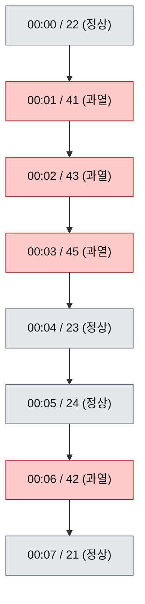

# gaps and islands: SQL 창 함수로 이어진 구간 찾기

시간순으로 정렬된 행에서 「끊김 없이 이어진 구간」을 SQL 한 문장으로 찾는 방법을 다룬다.
이 문제를 흔히 **gaps and islands**라 부른다. 이어진 구간이 섬(island), 구간 사이의 빈 곳이 틈(gap)이다.

`GROUP BY`는 알지만 창 함수(window function)는 낯선 Java 백엔드 개발자를 독자로 잡았다.
`OVER (PARTITION BY ... ORDER BY ...)`가 무엇인지, 누적 합계의 「프레임」이 왜 결과를 바꾸는지부터 시작해서, 같은 가상 데이터로 풀이 세 가지를 표로 한 단계씩 채워 가며 보인다.
마지막에는 같은 일을 하는 Java 루프와 SQL의 각 부분을 짝지어, 읽고 나면 이 기법을 다른 사람에게 설명할 수 있게 하는 것이 목표다.

> [!TIP]
> **더 읽을 글**: [PostgreSQL 쿼리 패턴과 실행 계획: LATERAL 최신 한 건, unnest와 Inner Unique, gaps and islands](./postgresql/lateral-unnest-window-query-plans.md)의 「창 함수로 연속 구간 찾기」 절.
> 이 글의 풀이 2(`lag()`)를 TimescaleDB 테이블에서 실행했을 때 `WindowAgg`와 `Sort`가 계획에 어떻게 나타나는지 다룬다. 이 글은 계획이 아니라 SQL이 구간을 만드는 원리를 설명한다.

## 적용 버전과 근거의 구분

| 대상 | 버전 |
| --- | --- |
| PostgreSQL | 17.11 (`postgres:17-alpine` 이미지) |
| MySQL | 8.4.11 (`mysql:8.4.11` 이미지) |
| Java | 21 (비교용 루프) |

- **출처**: PostgreSQL 17 공식 문서에서 확인한 사실이다.
- **확인**: 이 글의 예제를 로컬 컨테이너에서 직접 실행한 결과다. 표 옆에 「(확인)」을 붙였다.
- **추론**: 위 두 가지를 근거로 추정한 내용이다. 문장에 추론이라고 밝힌다.

예제 SQL은 PostgreSQL 문법이다. MySQL 8에서 달라지는 부분은 아래 「MySQL 8에서 실행하기」 절에 모았다.

## 문제 정의: 이어진 구간과 빈 곳

센서 한 대가 1분마다 온도를 보낸다고 하자. 40도 이상이면 과열(hot), 아니면 정상이다.
시간순으로 놓으면 과열이 연달아 나오는 덩어리가 보인다.



과열이 이어진 구간(island)은 두 개다. 00:01-00:03(3건)과 00:06(1건)이다.
정상 값이 끼어 있는 00:04-00:05는 과열 입장에서는 빈 곳이다.

실무에서 같은 모양으로 나타나는 문제는 다음과 같다.

| 문제 | 섬(island) | 틈(gap) | 구간을 가르는 기준 |
| --- | --- | --- | --- |
| 연속 출석일 | 빠짐없이 출석한 날들 | 출석하지 않은 날 | 날짜가 1일보다 벌어짐 |
| 기기 미수신 기간 | 데이터가 제때 들어온 시간 | 데이터가 들어오지 않은 시간 | 직전 수신과 시간 차이가 주기보다 큼 |
| 이상값이 연달아 나온 구간 | 조건을 만족한 행이 이어진 부분 | 정상 값이 낀 부분 | 정상 값이 나옴 |
| 연속 로그인 | 매일 로그인한 날들 | 로그인하지 않은 날 | 날짜가 1일보다 벌어짐 |

기준은 두 종류로 나뉜다.
**값의 조건**(정상 값이 나오면 끊김)이거나, **간격**(시간이나 날짜가 벌어지면 끊김)이다.
아래 풀이 1은 값의 조건, 풀이 2와 풀이 3은 간격에 맞는다.

### GROUP BY로는 왜 안 되나

`GROUP BY`는 칼럼 값이 같은 행을 한 묶음으로 모은다. 「00:01도 과열이고 00:06도 과열이니 같은 묶음」이 되어 버린다.
우리가 원하는 묶음은 「서로 이웃한 행끼리」다. 이웃은 정렬 순서에서 나온다.
행 하나를 볼 때 앞뒤 행을 참조해야 하는데, 이것이 창 함수가 하는 일이다.

## 창 함수 기초

### 행을 줄이지 않는 집계

같은 질문, 「기기별 최고 온도」를 두 방식으로 쓰면 차이가 보인다.

```sql
-- GROUP BY: 기기마다 한 행으로 줄어든다
SELECT device_id, max(value) AS max_value
FROM readings
WHERE device_id IN (1, 2)
GROUP BY device_id;
```

```sql
-- 창 함수: 행은 그대로 두고 기기별 최고 온도를 각 행에 붙인다
SELECT device_id, measured_at::time AS t, value,
       max(value) OVER (PARTITION BY device_id) AS device_max
FROM readings
WHERE device_id IN (1, 2)
ORDER BY device_id, measured_at;
```

앞의 결과는 2행이고, 뒤의 결과는 원래 12행이 모두 남는다(확인). 뒤 결과의 앞부분은 다음과 같다.

```text
 device_id |    t     | value | device_max
-----------+----------+-------+------------
         1 | 00:00:00 |    22 |         45
         1 | 00:01:00 |    41 |         45
         1 | 00:02:00 |    43 |         45
...
         2 | 00:00:00 |    20 |         46
```

Java로 빗대면 `GROUP BY`는 `stream.collect(groupingBy(...))`로 `Map`을 만들어 원소를 줄이는 것이고, 창 함수는 원소마다 「자기 그룹의 통계」 필드를 하나 더 붙이는 것이다.
창 함수는 행 수를 바꾸지 않으므로 `SELECT` 목록에서 원래 칼럼과 나란히 쓸 수 있다.

`OVER (...)` 괄호 안이 「어떤 행들을 보고 계산할지」를 정한다.

| 절 | 역할 | 생략하면 |
| --- | --- | --- |
| `PARTITION BY` | 행을 그룹으로 나눈다. 계산은 그룹 안에서만 한다 | 전체가 한 그룹 |
| `ORDER BY` | 그룹 안의 행 순서를 정한다 | 순서가 정해지지 않음 |
| 프레임(`ROWS ...`) | 각 행에서 계산에 쓸 앞뒤 범위를 정한다 | 아래 절 참고 |

### 누적 합계와 프레임

`OVER`에 `ORDER BY`를 넣고 `sum()`을 쓰면 누적 합계가 된다. 기기 1의 온도를 시간순으로 더해 보자.

```sql
SELECT measured_at::time AS t, value,
       sum(value) OVER (ORDER BY measured_at) AS running
FROM readings WHERE device_id = 1
ORDER BY measured_at;
```

```text
    t     | value | running
----------+-------+---------
 00:00:00 |    22 |      22
 00:01:00 |    41 |      63
 00:02:00 |    43 |     106
 00:03:00 |    45 |     151
 00:04:00 |    23 |     174
 00:05:00 |    24 |     198
 00:06:00 |    42 |     240
 00:07:00 |    21 |     261
```

각 행의 `running`은 「첫 행부터 지금 행까지의 합」이다(확인). 이 「첫 행부터 지금 행까지」가 **프레임**(frame)이다.
프레임은 지금 행을 기준으로 계산에 쓸 행의 범위를 정한다. Java의 `list.subList(0, i + 1)`에 해당한다.

프레임을 따로 쓰지 않으면 기본값이 적용되는데, 여기에 함정이 있다.
`ORDER BY`가 있을 때 기본 프레임은 `RANGE UNBOUNDED PRECEDING`이다(출처: PostgreSQL 17 Window Function Calls).
이것은 「첫 행부터, 지금 행과 정렬 값이 같은 마지막 행까지」를 뜻한다. 정렬 값이 같은 행끼리를 **피어**(peer)라 부르고, `RANGE`는 피어를 한꺼번에 포함한다.
`ROWS UNBOUNDED PRECEDING`은 피어를 구분하지 않고 문자 그대로 「첫 행부터 지금 행까지」만 센다.

차이를 보려고 시각이 같은 행이 있는 표를 만들었다.

```sql
CREATE TABLE scores (id int PRIMARY KEY, at_time time NOT NULL, points int NOT NULL);
INSERT INTO scores VALUES (1,'10:00',10), (2,'10:01',20), (3,'10:01',30), (4,'10:02',40);

SELECT id, at_time, points,
       sum(points) OVER (ORDER BY at_time)                           AS default_frame,
       sum(points) OVER (ORDER BY at_time RANGE UNBOUNDED PRECEDING) AS range_frame,
       sum(points) OVER (ORDER BY at_time ROWS UNBOUNDED PRECEDING)  AS rows_frame
FROM scores ORDER BY at_time, id;
```

```text
 id | at_time  | points | default_frame | range_frame | rows_frame
----+----------+--------+---------------+-------------+------------
  1 | 10:00:00 |     10 |            10 |          10 |         10
  2 | 10:01:00 |     20 |            60 |          60 |         30
  3 | 10:01:00 |     30 |            60 |          60 |         60
  4 | 10:02:00 |     40 |           100 |         100 |        100
```

| 열 | 왜 이 값인가 |
| --- | --- |
| `default_frame` | 프레임을 쓰지 않으면 `RANGE`와 같다. 열 이름만 다르고 값이 `range_frame`과 완전히 같다 |
| `range_frame` (id 2, 3) | 10:01이 같은 두 행은 피어라서 둘 다 `10 + 20 + 30 = 60`을 본다 |
| `rows_frame` (id 2) | 행 단위로 세므로 id 2는 `10 + 20 = 30`이다 |
| `rows_frame` (id 3) | id 3은 `10 + 20 + 30 = 60`이다 |

같은 시각의 두 행이 `RANGE`에서는 같은 값을 받고, `ROWS`에서는 서로 다른 값을 받는다.
이 글의 풀이는 모두 「한 행씩 차례로 번호를 올린다」는 성질에 기대므로 `ROWS UNBOUNDED PRECEDING`을 명시한다.

`ROWS`에서 피어끼리의 순서는 어떻게 정해질까. SQL은 `ORDER BY`가 같게 만든 행들의 순서를 보장하지 않는다(추론: SQL 정렬의 일반 원칙). 순서를 정해 주면 결과가 그대로 따라 움직인다.

```sql
SELECT id, at_time, points,
       sum(points) OVER (ORDER BY at_time, id ASC  ROWS UNBOUNDED PRECEDING) AS id_asc,
       sum(points) OVER (ORDER BY at_time, id DESC ROWS UNBOUNDED PRECEDING) AS id_desc
FROM scores ORDER BY at_time, id;
```

```text
 id | at_time  | points | id_asc | id_desc
----+----------+--------+--------+---------
  1 | 10:00:00 |     10 |     10 |      10
  2 | 10:01:00 |     20 |     30 |      60
  3 | 10:01:00 |     30 |     60 |      40
  4 | 10:02:00 |     40 |    100 |     100
```

id 2와 3의 누적 합계가 정렬 방향에 따라 서로 바뀐다(확인).
함정 절에서 이 현상이 구간 결과를 직접 바꾸는 것을 다시 본다.

### 창 함수는 WHERE보다 늦게 실행된다

창 함수는 `SELECT` 목록과 `ORDER BY`에서만 쓸 수 있다. `WHERE`, `GROUP BY`, `HAVING`에서는 쓸 수 없다. 이 절들이 처리된 뒤에 논리적으로 실행되기 때문이다(출처: PostgreSQL 17 Window Functions 튜토리얼).
번호를 먼저 매긴 뒤 과열 행만 남기려면 번호를 매기는 쿼리를 `WITH`(CTE)나 서브쿼리로 감싸고, 바깥 쿼리의 `WHERE`에서 행을 필터링한다. 아래 풀이가 모두 이 모양이다.

## 예제 데이터

세 풀이에 쓰는 가상 데이터다. 컨테이너 하나로 그대로 재현할 수 있다.

```bash
docker run -d --rm --name gi-pg -e POSTGRES_PASSWORD=pw -p 127.0.0.1:55432:5432 postgres:17-alpine
docker exec -it gi-pg psql -U postgres
```

```sql
CREATE TABLE readings (
  device_id   int       NOT NULL,
  value       int       NOT NULL,
  measured_at timestamp NOT NULL
);
INSERT INTO readings (device_id, value, measured_at) VALUES
  (1, 22, '2026-09-01 00:00'), (1, 41, '2026-09-01 00:01'), (1, 43, '2026-09-01 00:02'),
  (1, 45, '2026-09-01 00:03'), (1, 23, '2026-09-01 00:04'), (1, 24, '2026-09-01 00:05'),
  (1, 42, '2026-09-01 00:06'), (1, 21, '2026-09-01 00:07'),
  (2, 20, '2026-09-01 00:00'), (2, 44, '2026-09-01 00:01'), (2, 46, '2026-09-01 00:02'),
  (2, 21, '2026-09-01 00:03'),
  (3, 22, '2026-09-01 23:57'), (3, 41, '2026-09-01 23:58'), (3, 43, '2026-09-01 23:59'),
  (3, 44, '2026-09-02 00:00'), (3, 22, '2026-09-02 00:01');

CREATE TABLE pings (device_id int NOT NULL, received_at timestamp NOT NULL);
INSERT INTO pings VALUES
  (4, '2026-09-01 00:00'), (4, '2026-09-01 00:10'), (4, '2026-09-01 00:20'),
  (4, '2026-09-01 01:10'), (4, '2026-09-01 01:20'),
  (4, '2026-09-01 03:00'), (4, '2026-09-01 03:10');

CREATE TABLE logins (user_id int NOT NULL, login_date date NOT NULL, PRIMARY KEY (user_id, login_date));
INSERT INTO logins VALUES
  (1, '2026-09-01'), (1, '2026-09-02'), (1, '2026-09-03'), (1, '2026-09-05'),
  (1, '2026-09-06'), (1, '2026-09-09'),
  (2, '2026-09-02'), (2, '2026-09-03');
```

| 표 | 쓰임 |
| --- | --- |
| `readings` | 온도 측정값. 기기 1이 풀이 1의 주인공이다. 기기 3은 자정을 넘는 과열 구간을 담고 있다 |
| `pings` | 10분마다 오는 수신 기록. 중간에 끊긴 시간이 있다 |
| `logins` | 날짜별 로그인. 하루에 한 행이다 |

## 풀이 1: 값 조건이 끊기는 곳마다 번호 올리기

아이디어는 이렇다.
**정상 값이 나올 때마다 번호를 1 올리고, 과열 값은 번호를 올리지 않고 앞 행의 번호를 이어받는다.**
그러면 정상 값 하나와, 그 뒤에 이어지는 과열 값들이 같은 번호를 갖는다. 같은 번호로 묶은 뒤 과열 행만 남기면 과열이 이어진 구간이다.

```sql
sum(CASE WHEN value >= 40 THEN 0 ELSE 1 END)
  OVER (PARTITION BY device_id ORDER BY measured_at ROWS UNBOUNDED PRECEDING) AS grp
```

`CASE`가 행마다 0 또는 1을 만들고, 누적 합계가 그 값을 앞에서부터 더한다.
기기 1을 한 단계씩 따라가 보자(파티션이 기기 하나뿐이어서 `PARTITION BY`는 생략했다).

```sql
SELECT measured_at::time AS t, value,
       (value >= 40) AS is_hot,
       CASE WHEN value >= 40 THEN 0 ELSE 1 END AS step,
       sum(CASE WHEN value >= 40 THEN 0 ELSE 1 END)
         OVER (ORDER BY measured_at ROWS UNBOUNDED PRECEDING) AS grp
FROM readings WHERE device_id = 1
ORDER BY measured_at;
```

```text
    t     | value | is_hot | step | grp
----------+-------+--------+------+-----
 00:00:00 |    22 | f      |    1 |   1
 00:01:00 |    41 | t      |    0 |   1
 00:02:00 |    43 | t      |    0 |   1
 00:03:00 |    45 | t      |    0 |   1
 00:04:00 |    23 | f      |    1 |   2
 00:05:00 |    24 | f      |    1 |   3
 00:06:00 |    42 | t      |    0 |   3
 00:07:00 |    21 | f      |    1 |   4
```

| 열 | 왜 이 값인가 |
| --- | --- |
| `is_hot` | `value >= 40`이다. 00:01-00:03과 00:06이 참이다 |
| `step` | 정상이면 1, 과열이면 0이다. 번호를 올릴지 말지를 나타낸다 |
| `grp` (00:00) | 첫 행은 정상이라 `step = 1`이고, 지금까지의 합은 1이다 |
| `grp` (00:01-00:03) | 과열 행은 `step = 0`이라 합이 늘지 않는다. 앞 행의 번호 1을 이어받는다 |
| `grp` (00:04) | 정상이라 합이 2가 된다. 번호가 올랐으므로 과열 구간이 끊겼다는 표시다 |
| `grp` (00:05, 00:06) | 00:05가 정상이라 3이 되고, 00:06은 과열이라 3을 이어받는다 |
| `grp` (00:07) | 정상이라 4다 |

표에서 보면, `grp`가 같은 행 중 과열인 것들이 곧 「이어진 과열 구간」이다.
`grp = 1`에는 정상 행(00:00) 하나가 섞여 있지만 과열 행만 남기면 사라진다.

이제 `grp`로 묶어 구간을 만든다. 전체 기기에 적용하려고 `PARTITION BY device_id`를 넣었다.

```sql
WITH marked AS (
  SELECT device_id, measured_at, value,
         value >= 40 AS is_hot,
         sum(CASE WHEN value >= 40 THEN 0 ELSE 1 END)
           OVER (PARTITION BY device_id ORDER BY measured_at ROWS UNBOUNDED PRECEDING) AS grp
  FROM readings
)
SELECT device_id, grp,
       min(measured_at) AS started_at,
       max(measured_at) AS ended_at,
       count(*)         AS readings
FROM marked
WHERE is_hot
GROUP BY device_id, grp
ORDER BY device_id, grp;
```

```text
 device_id | grp |     started_at      |      ended_at       | readings
-----------+-----+---------------------+---------------------+----------
         1 |   1 | 2026-09-01 00:01:00 | 2026-09-01 00:03:00 |        3
         1 |   3 | 2026-09-01 00:06:00 | 2026-09-01 00:06:00 |        1
         2 |   1 | 2026-09-01 00:01:00 | 2026-09-01 00:02:00 |        2
         3 |   1 | 2026-09-01 23:58:00 | 2026-09-02 00:00:00 |        3
```

기기 1의 두 구간이 앞에서 본 그림과 같다(확인). 기기 3의 구간은 자정을 넘는데, 구간이 하나로 잡힌다. 날짜 경계는 함정 절에서 다시 본다.

`grp` 값 자체(1, 3)에는 의미가 없다. 「같은 값이면 같은 구간」이라는 라벨일 뿐이어서 1, 2가 아니라 1, 3으로 건너뛰어도 괜찮다.
파티션의 첫 행이 과열이면 앞에 정상 값이 없으므로 `grp`가 0에서 시작한다. 역시 라벨이라 문제가 없다.

## 풀이 2: 시간 간격이 벌어진 곳마다 번호 올리기

이번에는 값이 아니라 시간으로 가른다. 기기 4가 10분마다 신호를 보내야 하는데 중간이 끊긴 기록이다.
직전 수신과의 시간 차이가 10분보다 크면 「여기서 새 구간이 시작한다」고 표시하고, 표시를 누적 합계로 더한다.

`lag(x)`는 같은 파티션에서 정렬상 한 행 앞의 `x`를 돌려준다. 앞 행이 없으면 `NULL`이다(출처: PostgreSQL 17 Window Functions).
Java로는 루프에서 직전 원소를 변수에 들고 있는 것과 같다.

```sql
SELECT received_at::time AS t,
       lag(received_at) OVER (ORDER BY received_at)::time AS prev_t,
       received_at - lag(received_at) OVER (ORDER BY received_at) AS diff,
       CASE WHEN received_at - lag(received_at) OVER (ORDER BY received_at) > interval '10 minutes'
            THEN 1 ELSE 0 END AS is_start
FROM pings ORDER BY received_at;
```

```text
    t     |  prev_t  |   diff   | is_start
----------+----------+----------+----------
 00:00:00 |          |          |        0
 00:10:00 | 00:00:00 | 00:10:00 |        0
 00:20:00 | 00:10:00 | 00:10:00 |        0
 01:10:00 | 00:20:00 | 00:50:00 |        1
 01:20:00 | 01:10:00 | 00:10:00 |        0
 03:00:00 | 01:20:00 | 01:40:00 |        1
 03:10:00 | 03:00:00 | 00:10:00 |        0
```

| 열 | 왜 이 값인가 |
| --- | --- |
| `prev_t` | 정렬상 바로 앞 행의 시각이다. 첫 행에는 앞 행이 없어 비어 있다 |
| `diff` | 현재 시각에서 `prev_t`를 뺀 값이다. 첫 행은 `NULL`이다 |
| `is_start` (00:10, 00:20) | 차이가 정확히 10분이다. 기준(10분 초과)에 걸리지 않아 0이다 |
| `is_start` (01:10) | 차이가 50분이다. 10분을 넘으므로 1, 새 구간의 시작이다 |
| `is_start` (03:00) | 차이가 1시간 40분이라 1이다 |
| `is_start` (00:00) | `diff`가 `NULL`이라 비교가 참이 되지 못하고 `ELSE`로 가서 0이다 |

이제 `is_start`를 누적 합계로 더하면 풀이 1의 `grp`와 같은 역할을 하는 번호가 나온다.
시작 표시가 1인 행부터 번호가 올라가므로, 시작 행이 자기 구간의 첫 행이 된다.

```sql
WITH marked AS (
  SELECT device_id, received_at,
         CASE WHEN received_at - lag(received_at) OVER w > interval '10 minutes'
              THEN 1 ELSE 0 END AS is_start
  FROM pings
  WINDOW w AS (PARTITION BY device_id ORDER BY received_at)
), numbered AS (
  SELECT device_id, received_at,
         sum(is_start) OVER (PARTITION BY device_id ORDER BY received_at
                             ROWS UNBOUNDED PRECEDING) AS island
  FROM marked
)
SELECT device_id, island,
       min(received_at) AS started_at,
       max(received_at) AS ended_at,
       count(*)         AS pings
FROM numbered
GROUP BY device_id, island
ORDER BY device_id, island;
```

```text
 device_id | island |     started_at      |      ended_at       | pings
-----------+--------+---------------------+---------------------+-------
         4 |      0 | 2026-09-01 00:00:00 | 2026-09-01 00:20:00 |     3
         4 |      1 | 2026-09-01 01:10:00 | 2026-09-01 01:20:00 |     2
         4 |      2 | 2026-09-01 03:00:00 | 2026-09-01 03:10:00 |     2
```

수신이 이어진 구간이 셋이다(확인). `WINDOW w AS (...)`는 같은 창 정의에 이름을 붙여 `OVER w`로 재사용하는 문법이다.

풀이 1과 다른 점이 있다. 여기서는 과열 같은 「남길 행」과 「버릴 행」의 구분이 없고, 모든 행이 어떤 구간에 속한다.
풀이 1은 정상 값이 구간 밖이고, 풀이 2는 모든 수신이 구간 안이다.

**틈(gap) 자체가 궁금하면 번호를 매길 필요가 없다.** `lag()`만으로 충분하다.

```sql
WITH d AS (
  SELECT device_id, lag(received_at) OVER w AS gap_start, received_at AS gap_end
  FROM pings
  WINDOW w AS (PARTITION BY device_id ORDER BY received_at)
)
SELECT device_id, gap_start, gap_end, gap_end - gap_start AS gap_length
FROM d
WHERE gap_end - gap_start > interval '10 minutes'
ORDER BY device_id, gap_start;
```

```text
 device_id |      gap_start      |       gap_end       | gap_length
-----------+---------------------+---------------------+------------
         4 | 2026-09-01 00:20:00 | 2026-09-01 01:10:00 | 00:50:00
         4 | 2026-09-01 01:20:00 | 2026-09-01 03:00:00 | 01:40:00
```

수신하지 못한 시간은 두 번이고, 길이는 50분과 1시간 40분이다(확인). 틈의 시작은 앞 구간의 마지막 수신이고 끝은 다음 구간의 첫 수신이다.

## 풀이 3: row_number() 차이로 묶기

고전 풀이다. 연속 숫자나 연속 날짜에 쓸 수 있다.

`row_number()`는 파티션 안에서 정렬 순서대로 1, 2, 3...을 붙인다.
날짜가 하루씩 이어지면 날짜도 1씩 늘고 `row_number()`도 1씩 늘어서, **`날짜 - row_number()`는 일정한 값**이 된다.
날짜가 하루 이상 건너뛰면 날짜만 더 많이 늘고 `row_number()`는 1만 늘어서, 뺀 값이 커진다.
빼서 나온 값이 같은 행끼리가 이어진 날짜의 구간이다.

```sql
SELECT user_id, login_date,
       row_number() OVER (PARTITION BY user_id ORDER BY login_date) AS rn,
       login_date - (row_number() OVER (PARTITION BY user_id ORDER BY login_date))::int AS anchor
FROM logins
ORDER BY user_id, login_date;
```

```text
 user_id | login_date | rn |   anchor
---------+------------+----+------------
       1 | 2026-09-01 |  1 | 2026-08-31
       1 | 2026-09-02 |  2 | 2026-08-31
       1 | 2026-09-03 |  3 | 2026-08-31
       1 | 2026-09-05 |  4 | 2026-09-01
       1 | 2026-09-06 |  5 | 2026-09-01
       1 | 2026-09-09 |  6 | 2026-09-03
       2 | 2026-09-02 |  1 | 2026-09-01
       2 | 2026-09-03 |  2 | 2026-09-01
```

| 열 | 왜 이 값인가 |
| --- | --- |
| `rn` | 사용자별 로그인 순서다. 9월 1일이 1번이다 |
| `anchor` (9/1-9/3) | `9/1 - 1`, `9/2 - 2`, `9/3 - 3`이 모두 8월 31일이다. 날짜와 `rn`이 같은 속도로 늘기 때문이다 |
| `anchor` (9/5, 9/6) | 9/4가 비어서 날짜가 2 늘 때 `rn`은 1만 늘었다. `9/5 - 4`가 9월 1일로 바뀐다 |
| `anchor` (9/9) | 9/7, 9/8이 비어 또 달라져 9월 3일이다 |

`anchor`는 실제 의미가 있는 날짜가 아니라 같은 구간을 나타내는 라벨이다. 같은 `anchor`끼리 묶으면 구간이 된다.

```sql
WITH x AS (
  SELECT user_id, login_date,
         login_date - (row_number() OVER (PARTITION BY user_id ORDER BY login_date))::int AS anchor
  FROM logins
)
SELECT user_id,
       min(login_date) AS first_day,
       max(login_date) AS last_day,
       count(*)        AS days
FROM x
GROUP BY user_id, anchor
ORDER BY user_id, first_day;
```

```text
 user_id | first_day  |  last_day  | days
---------+------------+------------+------
       1 | 2026-09-01 | 2026-09-03 |    3
       1 | 2026-09-05 | 2026-09-06 |    2
       1 | 2026-09-09 | 2026-09-09 |    1
       2 | 2026-09-02 | 2026-09-03 |    2
```

사용자 1의 최대 연속 로그인은 3일이다(확인).

이 풀이는 **하루에 한 행**이라는 전제에 기댄다. 같은 날 로그인이 두 번이면 `rn`이 하루에 2 늘어서 연속 구간이 쪼개진다.
`SELECT DISTINCT user_id, login_date`로 날짜를 먼저 하나로 만든 뒤 번호를 붙인다. 이 예제의 `logins`는 기본 키가 `(user_id, login_date)`라 중복이 없다.

### 값 조건에도 쓸 수 있다: row_number() 두 개의 차

풀이 1 문제를 풀이 3 방식으로도 풀 수 있다. 전체 순서의 `row_number()`에서, **상태(과열 여부)별 순서의 `row_number()`를 뺀다.**
같은 상태가 연달아 이어지는 동안은 두 번호가 함께 1씩 늘어 뺀 값이 일정하고, 다른 상태가 끼면 전체 번호만 늘어서 값이 달라진다.

```sql
SELECT measured_at::time AS t, value, (value >= 40) AS is_hot,
       row_number() OVER (ORDER BY measured_at) AS rn_all,
       row_number() OVER (PARTITION BY (value >= 40) ORDER BY measured_at) AS rn_in_state,
       row_number() OVER (ORDER BY measured_at)
         - row_number() OVER (PARTITION BY (value >= 40) ORDER BY measured_at) AS diff
FROM readings WHERE device_id = 1
ORDER BY measured_at;
```

```text
    t     | value | is_hot | rn_all | rn_in_state | diff
----------+-------+--------+--------+-------------+------
 00:00:00 |    22 | f      |      1 |           1 |    0
 00:01:00 |    41 | t      |      2 |           1 |    1
 00:02:00 |    43 | t      |      3 |           2 |    1
 00:03:00 |    45 | t      |      4 |           3 |    1
 00:04:00 |    23 | f      |      5 |           2 |    3
 00:05:00 |    24 | f      |      6 |           3 |    3
 00:06:00 |    42 | t      |      7 |           4 |    3
 00:07:00 |    21 | f      |      8 |           4 |    4
```

과열 행만 보면 `diff`가 1, 1, 1, 3이어서 00:01-00:03과 00:06이 나뉜다(확인).
`diff = 3`이 정상 행(00:04, 00:05)에도 나타나므로 `GROUP BY`에는 반드시 `is_hot`과 `diff`를 함께 넣는다.

```sql
SELECT diff, min(measured_at)::time AS first_t, max(measured_at)::time AS last_t, count(*)
FROM s WHERE is_hot GROUP BY is_hot, diff;
-- s = 위 쿼리를 감싼 CTE
```

결과는 풀이 1과 같은 두 구간이다(확인).

## 풀이 고르기

| 기준 | 풀이 1: 조건 끊김마다 번호 | 풀이 2: `lag()` 간격 | 풀이 3: `row_number()` 차이 |
| --- | --- | --- | --- |
| 구간을 가르는 기준 | 행의 값(정상 값이 나오면 끊김) | 이웃한 행 사이의 간격 | 순번과 값(날짜, 번호)의 어긋남 |
| 잘 맞는 문제 | 이상값이 연달아 나온 구간 | 주기적 신호의 끊김, 세션 나누기 | 연속 출석일, 연속 번호 |
| 전제 | 정렬 순서만 있으면 된다 | 간격 기준(10분)을 정할 수 있어야 한다 | 값이 1씩 늘어야 하고 중복이 없어야 한다 |
| 간격의 기준을 바꾸기 | 해당 없음 | 기준 상수만 바꾼다 | 어렵다. 1씩 늘어나는 값이 전제다 |
| 틈 자체 찾기 | 정상 행이 곧 틈이다 | `lag()`만으로 가능 | 앞 구간의 마지막과 다음 구간의 처음으로 계산 |

고르는 요령은 다음과 같다.

- 구간의 경계가 「값이 조건을 벗어나는 순간」이면 풀이 1이다.
- 경계가 「시간이 벌어지는 순간」이고 기준(10분, 30분)이 있으면 풀이 2다. 일 단위처럼 정확히 하루씩이면 풀이 3도 된다.
- 날짜나 정수가 하루 또는 1씩 이어지는지가 질문이면 풀이 3이 짧다. 다만 중복을 먼저 없애야 한다.
- 어느 풀이든 번호 열을 `SELECT`에 꺼내 한 단계씩 확인할 수 있다. 결과가 이상하면 이 글처럼 중간 표를 먼저 출력해 본다.

## 구간 요약: min, max, count와 길이

구간을 만든 뒤에는 구간마다 한 행으로 요약한다. 풀이 1의 구간에 길이를 더해 보자.

```sql
WITH marked AS (
  SELECT device_id, measured_at, value >= 40 AS is_hot,
         sum(CASE WHEN value >= 40 THEN 0 ELSE 1 END)
           OVER (PARTITION BY device_id ORDER BY measured_at ROWS UNBOUNDED PRECEDING) AS grp
  FROM readings
), islands AS (
  SELECT device_id, grp,
         min(measured_at) AS started_at,
         max(measured_at) AS ended_at,
         count(*)         AS readings,
         max(measured_at) - min(measured_at) AS span
  FROM marked WHERE is_hot
  GROUP BY device_id, grp
)
SELECT * FROM islands ORDER BY device_id, grp;
```

```text
 device_id | grp |     started_at      |      ended_at       | readings |   span
-----------+-----+---------------------+---------------------+----------+----------
         1 |   1 | 2026-09-01 00:01:00 | 2026-09-01 00:03:00 |        3 | 00:02:00
         1 |   3 | 2026-09-01 00:06:00 | 2026-09-01 00:06:00 |        1 | 00:00:00
         2 |   1 | 2026-09-01 00:01:00 | 2026-09-01 00:02:00 |        2 | 00:01:00
         3 |   1 | 2026-09-01 23:58:00 | 2026-09-02 00:00:00 |        3 | 00:02:00
```

| 열 | 왜 이 값인가 |
| --- | --- |
| `started_at`, `ended_at` | 구간의 첫 과열 행 시각과 마지막 과열 행 시각이다. `min`과 `max`다 |
| `readings` | 구간 안의 과열 행 수다 |
| `span` | `ended_at - started_at`이다. 첫 행과 마지막 행 사이의 시간이다 |
| `span` (기기 1, grp 3) | 구간에 행이 하나라 처음과 마지막이 같고, 길이가 0이다 |

하루마다 가장 긴 구간은 구간 요약 위에 한 번 더 창 함수를 얹어 구한다.
구간을 시작 날짜로 하루에 귀속시키고, 날짜마다 `span`이 큰 순서로 번호를 매겨 1번만 남긴다.

```sql
-- islands 는 위 쿼리의 CTE
), ranked AS (
  SELECT *,
         row_number() OVER (PARTITION BY device_id, started_at::date
                            ORDER BY span DESC, started_at) AS rk
  FROM islands
)
SELECT device_id, started_at::date AS day, started_at, ended_at, span AS longest_span
FROM ranked
WHERE rk = 1
ORDER BY device_id, day;
```

```text
 device_id |    day     |     started_at      |      ended_at       | longest_span
-----------+------------+---------------------+---------------------+--------------
         1 | 2026-09-01 | 2026-09-01 00:01:00 | 2026-09-01 00:03:00 | 00:02:00
         2 | 2026-09-01 | 2026-09-01 00:01:00 | 2026-09-01 00:02:00 | 00:01:00
         3 | 2026-09-01 | 2026-09-01 23:58:00 | 2026-09-02 00:00:00 | 00:02:00
```

기기 1은 00:01-00:03(2분)이 길이 0인 00:06 구간을 이긴다(확인). 기기 3의 구간은 9월 1일에 시작했으므로 9월 1일에 귀속되고 `ended_at`이 9월 2일로 넘어간다.
`ORDER BY span DESC, started_at`의 `started_at`은 길이가 같을 때 어느 쪽을 1번으로 할지를 정하는 보조 정렬이다.

## 함정

### 정렬 순서가 결과를 정한다

시각이 같은 행이 있으면, `ORDER BY measured_at`만으로는 그 행들의 순서가 정해지지 않는다.
시각이 같은 정상 행과 과열 행이 있는 두 표를 만들어 보았다. 행을 넣은 순서만 다르다.

```sql
CREATE TABLE ties_a (id serial, value int NOT NULL, measured_at timestamp NOT NULL);
CREATE TABLE ties_b (id serial, value int NOT NULL, measured_at timestamp NOT NULL);
INSERT INTO ties_a (value, measured_at) VALUES
  (22,'2026-09-01 00:00'), (41,'2026-09-01 00:01'), (23,'2026-09-01 00:01'), (42,'2026-09-01 00:02');
INSERT INTO ties_b (value, measured_at) VALUES
  (22,'2026-09-01 00:00'), (23,'2026-09-01 00:01'), (41,'2026-09-01 00:01'), (42,'2026-09-01 00:02');
```

같은 풀이 1 쿼리를 두 표에 `ORDER BY measured_at`만으로 돌리면 `grp` 열은 이렇게 나왔다(확인).

```text
ties_a                              ties_b
 id |    t     | value | grp         id |    t     | value | grp
----+----------+-------+-----        ----+----------+-------+-----
  1 | 00:00:00 |    22 |   1          1 | 00:00:00 |    22 |   1
  2 | 00:01:00 |    41 |   1          2 | 00:01:00 |    23 |   2
  3 | 00:01:00 |    23 |   2          3 | 00:01:00 |    41 |   2
  4 | 00:02:00 |    42 |   2          4 | 00:02:00 |    42 |   2
```

| 표 | 00:01의 두 행 순서 | 결과 |
| --- | --- | --- |
| `ties_a` | 과열 41이 먼저 | 과열 구간 두 개(41 하나, 42 하나) |
| `ties_b` | 정상 23이 먼저 | 과열 구간 한 개(41과 42, 2건) |

같은 데이터인데 행이 들어간 순서에 따라 과열 구간 수가 2개와 1개로 달라졌다(확인).
이 쿼리의 결과가 실행할 때마다 같을지는 SQL이 보장하지 않는다. 입력 순서와 실행 계획에 따라 바뀔 수 있다(추론: 위 두 표에서 확인한 현상과 SQL 정렬의 일반 원칙).

해결은 정렬 칼럼을 하나 더 붙여 순서를 완전히 정하는 것이다.

```sql
sum(CASE WHEN value >= 40 THEN 0 ELSE 1 END)
  OVER (PARTITION BY device_id ORDER BY measured_at, (value >= 40) ROWS UNBOUNDED PRECEDING)
```

`false`가 `true`보다 앞서므로 시각이 같으면 정상 행을 먼저 본다.
이 쿼리는 두 표에서 같은 결과, 즉 구간 하나(00:01-00:02, 2건)를 낸다(확인).
어느 쪽이 맞는지는 업무 규칙이다. 「같은 시각이면 정상이 먼저」가 맞는지는 데이터를 만든 쪽이 정해야 하고, 중요한 것은 **정해서 항상 같게 만드는 것**이다.
고유한 `id`가 있으면 `ORDER BY measured_at, id`처럼 붙여도 된다.

기본 프레임(`RANGE`)을 쓰면 이 문제가 겉으로는 사라진다.
`ties_a`에 프레임을 쓰지 않은 `sum(...) OVER (ORDER BY measured_at)`를 돌리면 시각이 같은 두 행이 둘 다 `grp = 2`를 받는다(확인).
피어는 같은 프레임을 보므로 같은 시각의 정상 행이 번호를 올리면 과열 행도 올라간 번호를 받는다. 결과적으로 「같은 시각이면 정상을 먼저 본다」는 규칙과 같은 결과가 나온다.
다만 이 규칙이 코드에 드러나지 않고 프레임의 부작용으로만 존재한다. 이 글에서는 의도를 읽을 수 있도록 `ROWS`와 명시적 보조 정렬을 함께 쓴다.

### PARTITION BY를 빼면 기기끼리 섞인다

기기 1과 기기 2의 풀이 1을 `PARTITION BY device_id` 없이 돌리면 이렇다.

```sql
WITH marked AS (
  SELECT device_id, measured_at, value >= 40 AS is_hot,
         sum(CASE WHEN value >= 40 THEN 0 ELSE 1 END)
           OVER (ORDER BY measured_at ROWS UNBOUNDED PRECEDING) AS grp   -- PARTITION BY 없음
  FROM readings WHERE device_id IN (1, 2)
)
SELECT grp, min(measured_at) AS started_at, max(measured_at) AS ended_at,
       count(*), array_agg(DISTINCT device_id) AS devices
FROM marked WHERE is_hot GROUP BY grp ORDER BY grp;
```

```text
 grp |     started_at      |      ended_at       | count | devices
-----+---------------------+---------------------+-------+---------
   2 | 2026-09-01 00:01:00 | 2026-09-01 00:02:00 |     4 | {1,2}
   3 | 2026-09-01 00:03:00 | 2026-09-01 00:03:00 |     1 | {1}
   5 | 2026-09-01 00:06:00 | 2026-09-01 00:06:00 |     1 | {1}
```

시각순으로 두 기기를 한 줄로 세우면 기기 1의 과열 행과 기기 2의 과열 행이 같은 구간으로 합쳐진다(`devices = {1,2}`, 4건)(확인).
기기 1은 00:01-00:03이 하나의 구간이어야 하는데, 기기 2의 정상 값(00:03)이 사이에 끼어 00:03이 따로 떨어져 나갔다.
`PARTITION BY`는 「이 그룹 안에서만 이웃을 찾는다」는 선언이다. 구간을 가르는 대상(기기, 항목, 사용자)을 모두 넣어야 한다.

### 날짜 경계

「하루 요약」을 만들려고 `PARTITION BY device_id, measured_at::date`로 날짜를 파티션에 넣는 방식은 자정을 넘는 구간을 쪼갠다.
기기 3의 과열은 9월 1일 23:58부터 9월 2일 00:00까지 이어진다.

```sql
WITH marked AS (
  SELECT device_id, measured_at, value >= 40 AS is_hot,
         sum(CASE WHEN value >= 40 THEN 0 ELSE 1 END)
           OVER (PARTITION BY device_id, measured_at::date ORDER BY measured_at
                 ROWS UNBOUNDED PRECEDING) AS grp
  FROM readings WHERE device_id = 3
)
SELECT measured_at::date AS day, grp, min(measured_at) AS started_at, max(measured_at) AS ended_at, count(*)
FROM marked WHERE is_hot GROUP BY measured_at::date, grp ORDER BY day, grp;
```

```text
    day     | grp |     started_at      |      ended_at       | count
------------+-----+---------------------+---------------------+-------
 2026-09-01 |   1 | 2026-09-01 23:58:00 | 2026-09-01 23:59:00 |     2
 2026-09-02 |   0 | 2026-09-02 00:00:00 | 2026-09-02 00:00:00 |     1
```

한 구간이어야 하는 3건이 2건과 1건으로 갈라졌고 구간 수는 2개로 늘었다(확인). 둘째 날의 `grp`가 0인 것은 그 날 첫 행이 과열이라 앞에 정상 행이 없기 때문이다.

권장하는 방식은 **날짜를 파티션에 넣지 않고** 기기별로 구간을 먼저 만든 뒤, 요약 단계에서 구간의 시작 날짜로 귀속시키는 것이다. 앞 절의 하루 요약이 이 방식이다.
시작 날짜 기준이면 자정을 넘는 구간 하나가 시작한 날에만 한 번 세어진다. 날짜별로 걸친 시간을 나눠 합산해야 하면 구간을 날짜 경계에서 직접 자르는 별도 쿼리가 필요하다(추론).

### 1건짜리 구간의 길이는 0

앞 요약에서 기기 1의 00:06 구간이 그렇다. 과열이 한 번만 찍힌 구간은 `max - min`이 0이다.
실제로는 그 1분 동안 과열이었을 수 있다. `max - min`은 「첫 측정과 마지막 측정 사이의 시간」이지 「과열이었던 시간」이 아니다.
측정 주기가 1분이라는 사실을 알면 `max - min + 주기`로 근사할 수 있다. 구간의 길이를 정의하는 일은 SQL이 아니라 업무 규칙이다(추론).

## Java로 옮기면

앞의 SQL을 Java로 번역하면 정렬된 리스트를 한 번 훑는 루프가 된다.
SQL의 각 부분이 코드의 어디에 해당하는지 주석으로 짝지었다.

```java
record Reading(int deviceId, int value, LocalDateTime measuredAt) {
    boolean isHot() { return value >= 40; }
}
record Island(int deviceId, LocalDateTime start, LocalDateTime end, int count) {}

static List<Island> hotIslands(List<Reading> all) {
    List<Island> result = new ArrayList<>();
    Map<Integer, List<Reading>> byDevice = all.stream()                  // PARTITION BY device_id
            .collect(Collectors.groupingBy(Reading::deviceId, TreeMap::new, Collectors.toList()));

    for (var entry : byDevice.entrySet()) {
        List<Reading> rows = new ArrayList<>(entry.getValue());
        rows.sort(Comparator.comparing(Reading::measuredAt)               // ORDER BY measured_at
                .thenComparing(Reading::isHot));                          //   , (value >= 40) 같은 시각이면 정상 먼저

        int grp = 0;                                                      // sum(...) 의 누적값
        Map<Integer, List<Reading>> islands = new LinkedHashMap<>();
        for (Reading r : rows) {                                          // ROWS UNBOUNDED PRECEDING: 앞에서부터 한 번 훑는다
            grp += r.isHot() ? 0 : 1;                                     // CASE WHEN value >= 40 THEN 0 ELSE 1 END
            if (r.isHot()) {                                              // WHERE is_hot
                islands.computeIfAbsent(grp, k -> new ArrayList<>()).add(r); // GROUP BY grp
            }
        }
        for (List<Reading> g : islands.values()) {
            result.add(new Island(entry.getKey(), g.get(0).measuredAt(),
                    g.get(g.size() - 1).measuredAt(), g.size()));         // min, max, count
        }
    }
    return result;
}
```

| SQL | Java |
| --- | --- |
| `PARTITION BY device_id` | `groupingBy(Reading::deviceId)`로 기기별 리스트를 나눈다 |
| `ORDER BY measured_at, (value >= 40)` | `Comparator`의 `comparing(...).thenComparing(...)` |
| `sum(CASE ... END) OVER (... ROWS UNBOUNDED PRECEDING)` | 앞에서부터 한 번 돌며 `grp`에 0 또는 1을 더하는 누적 변수 |
| `WHERE is_hot` | 과열 행만 구간 목록에 담는 `if` |
| `GROUP BY device_id, grp` + `min`, `max`, `count` | 같은 `grp`의 리스트에서 첫 원소, 마지막 원소, 크기 |

위 코드를 같은 데이터(기기 1, 2)로 실행하면 SQL과 같은 세 구간이 나온다(확인: Java 21).

```text
Island[deviceId=1, start=2026-09-01T00:01, end=2026-09-01T00:03, count=3]
Island[deviceId=1, start=2026-09-01T00:06, end=2026-09-01T00:06, count=1]
Island[deviceId=2, start=2026-09-01T00:01, end=2026-09-01T00:02, count=2]
```

Java를 처음부터 새로 짠다면 번호 대신 「현재 구간」을 열고 닫는 루프가 더 자연스럽다.
정상 값을 만나면 현재 구간을 닫는다는 뜻이다.

```java
LocalDateTime start = null, last = null;
int count = 0;
for (Reading r : rows) {                                  // rows 는 한 기기의 정렬된 리스트
    if (r.isHot()) {
        if (start == null) { start = r.measuredAt(); count = 0; }   // 구간 열기
        last = r.measuredAt();
        count++;
    } else if (start != null) {                           // 정상 값을 만나면 현재 구간을 닫는다
        result.add(new Island(deviceId, start, last, count));
        start = null;
    }
}
if (start != null) result.add(new Island(deviceId, start, last, count));  // 끝까지 열려 있던 구간
```

이 루프는 변수 `start`, `last`, `count`로 「열린 구간」이라는 상태를 직접 들고 다닌다.
SQL은 상태를 들고 다니는 대신 누적 합계 번호를 행마다 붙여 두고 `GROUP BY`로 한꺼번에 모은다.
번호가 행마다 값으로 남기 때문에, 중간 결과를 `SELECT`로 꺼내 한 단계씩 확인할 수 있다는 점도 SQL 쪽의 장점이다.

## MySQL 8에서 실행하기

MySQL은 8.0부터 창 함수를 지원한다(출처: MySQL Reference Manual, Window Functions). 이 글의 세 풀이를 `mysql:8.4.11` 컨테이너에서 실행해 PostgreSQL과 같은 결과를 확인했다. 8.0 계열에서는 실행하지 않았다.

달라지는 부분만 고치면 된다.

| PostgreSQL | MySQL 8 |
| --- | --- |
| `timestamp` | `datetime` |
| `x::time`, `x::date` | `TIME(x)`, `DATE(x)` |
| `a - b > interval '10 minutes'` | `TIMESTAMPDIFF(SECOND, b, a) > 600` |
| `max(t) - min(t)` | `TIMESTAMPDIFF(SECOND, min(t), max(t))` |
| `login_date - rn::int` | `DATE_SUB(login_date, INTERVAL rn DAY)` |
| `array_agg(DISTINCT ...)` | `GROUP_CONCAT(DISTINCT ...)` |

풀이 1은 불리언 비교 `value >= 40 AS is_hot`과 `WHERE is_hot`이 그대로 동작한다. 같은 쿼리에서 길이만 `TIMESTAMPDIFF`로 바꿨다.

```sql
WITH marked AS (
  SELECT device_id, measured_at, value,
         value >= 40 AS is_hot,
         sum(CASE WHEN value >= 40 THEN 0 ELSE 1 END)
           OVER (PARTITION BY device_id ORDER BY measured_at ROWS UNBOUNDED PRECEDING) AS grp
  FROM readings
)
SELECT device_id, grp, min(measured_at) AS started_at, max(measured_at) AS ended_at, count(*) AS readings,
       TIMESTAMPDIFF(SECOND, min(measured_at), max(measured_at)) AS span_sec
FROM marked WHERE is_hot
GROUP BY device_id, grp ORDER BY device_id, grp;
```

```text
+-----------+------+---------------------+---------------------+----------+----------+
| device_id | grp  | started_at          | ended_at            | readings | span_sec |
+-----------+------+---------------------+---------------------+----------+----------+
|         1 |    1 | 2026-09-01 00:01:00 | 2026-09-01 00:03:00 |        3 |      120 |
|         1 |    3 | 2026-09-01 00:06:00 | 2026-09-01 00:06:00 |        1 |        0 |
|         2 |    1 | 2026-09-01 00:01:00 | 2026-09-01 00:02:00 |        2 |       60 |
|         3 |    1 | 2026-09-01 23:58:00 | 2026-09-02 00:00:00 |        3 |      120 |
+-----------+------+---------------------+---------------------+----------+----------+
```

PostgreSQL 결과와 구간과 건수가 같다(확인). 풀이 2의 `lag()`와 `WINDOW w AS (...)`, 풀이 3의 `row_number()`도 같은 구간을 냈다(확인). 프레임 예제의 `scores` 테이블도 같은 누적 값을 보였다(확인).

## 정리

- 구간 찾기는 「정렬한 뒤 경계 표시를 만들고, 표시를 누적 합계로 더해 같은 번호로 묶는다」는 세 단계다. 풀이 1과 풀이 2가 이 구조이고, 풀이 3은 순번과의 차이로 같은 번호를 만든다.
- `OVER (PARTITION BY ... ORDER BY ...)`는 행을 줄이지 않고 그룹 안에서 순서대로 계산한다. Java 루프의 「정렬된 리스트를 한 번 훑으며 변수에 누적한다」에 해당한다.
- 누적 합계에는 `ROWS UNBOUNDED PRECEDING`을 명시한다. 기본 프레임 `RANGE`는 정렬 값이 같은 행을 한꺼번에 묶는다.
- 정렬 칼럼으로 순서를 완전히 정하고, `PARTITION BY`에 구간을 가르는 대상을 모두 넣고, 날짜는 파티션에 넣지 않고 요약 단계에서 귀속시킨다.
- 구간 길이는 `max - min`이어서 1건짜리는 0이다. 길이를 어떻게 정의할지는 업무 규칙이다.

## 참고 자료

- [PostgreSQL 17: Window Functions (튜토리얼)](https://www.postgresql.org/docs/17/tutorial-window.html) — `OVER`, `PARTITION BY`, 창 함수가 쓰이는 위치
- [PostgreSQL 17: Window Function Calls](https://www.postgresql.org/docs/17/sql-expressions.html#SYNTAX-WINDOW-FUNCTIONS) — 프레임, `ROWS`와 `RANGE`, 기본 프레임
- [PostgreSQL 17: Window Functions (함수 목록)](https://www.postgresql.org/docs/17/functions-window.html) — `lag()`, `row_number()`
- [MySQL 8.4 Reference Manual: Window Functions](https://dev.mysql.com/doc/refman/8.4/en/window-functions.html) — MySQL의 창 함수
