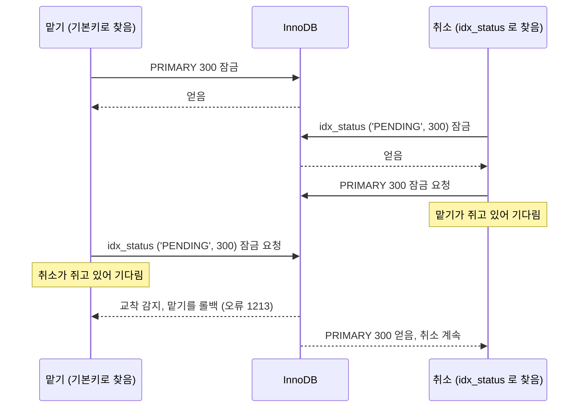

# InnoDB 실행 계획이 바꾸는 잠금 순서: 같은 행을 고치는 두 UPDATE 가 가끔만 교착하는 이유

같은 행을 고치는 두 UPDATE 중 하나는 기본키로, 다른 하나는 보조 인덱스로 그 행을 찾는다고 하자.
보조 인덱스로 찾은 쪽은 「보조 인덱스 레코드 → 기본키 레코드」 순서로 잠근다.
기본키로 찾은 쪽이 그 보조 인덱스의 값을 바꾸면 「기본키 레코드 → 보조 인덱스 레코드」 순서로 잠근다.
두 순서가 엇갈리면 두 트랜잭션은 서로가 쥔 잠금을 기다리게 되고, InnoDB 가 한쪽을 롤백한다.
어느 인덱스로 찾을지는 옵티마이저가 데이터 분포를 보고 그때그때 정한다.
그래서 이 교착은 그 계획이 골라진 때, 그리고 두 문장이 같은 행에서 겹친 때에만 난다.
고치는 방법은 대상 id 를 먼저 읽고 기본키로 한 행씩, id 순서대로 갱신해 두 쪽의 잠금 순서를 맞추는 것이다.

Java 로 옮기면 `synchronized` 두 개를 반대 순서로 잡는 교착과 같은 모양이다.

```java
// 스레드 1: 기본키 → 보조 인덱스
synchronized (pk) { synchronized (secondary) { ... } }

// 스레드 2: 보조 인덱스 → 기본키
synchronized (secondary) { synchronized (pk) { ... } }
```

다른 점은 두 가지다.
잠그는 순서를 개발자가 코드에 쓰지 않고 옵티마이저가 실행 계획으로 정한다.
그리고 JVM 은 교착을 풀지 않고 멈춰 있지만, InnoDB 는 교착을 찾아내 한 트랜잭션을 롤백하고 오류 1213 을 돌려준다.

이 글은 작업 테이블에서 「작업 맡기」와 「취소」가 간헐적으로 교착한 실제 경험을 일반화한 예로 설명한다.
MySQL 8.4 컨테이너에서 두 세션으로 재현한 출력, 데이터 분포에 따라 바뀌는 `EXPLAIN`, 교착 로그 읽는 법, 해결 방법 비교와 회귀 테스트까지 다룬다.

> [!TIP]
> **더 읽을 글**: [MySQL 데드락 실전 분석](./deadlock-analysis.md)
> 잠금 종류, 교착 탐지 도구, 재시도 전략 같은 일반론은 그 글에 있다. 이 글은 실행 계획이 잠금 순서를 바꾸는 경우 하나만 깊게 다룬다.

## 적용 버전과 근거의 구분

| 대상 | 버전 |
| --- | --- |
| MySQL | 8.4.11 (`mysql:8.4.11` 이미지), 기본 격리 수준 REPEATABLE READ |
| 재현 클라이언트 | Python 3, PyMySQL 2.2.8 |
| Spring Framework, Hibernate ORM | GitHub `main` 브랜치 소스 (2026-11 확인) |

- **출처**: MySQL 8.4 Reference Manual 과 Spring, Hibernate 소스에서 확인한 사실이다.
- **확인**: 이 글의 예제를 로컬 컨테이너에서 직접 실행한 결과다. 출력 블록 앞에 「(확인)」을 붙였다.
- **추론**: 위 두 가지를 근거로 추정한 내용이다. 문장에 추론이라고 밝힌다.

## 예제 상황: 작업 맡기와 취소

작업을 한 행씩 쌓아 두고 여러 서버가 나눠 처리하는 테이블을 생각한다.
실행(run) 하나가 시도(attempt) 여러 개를 만들고, 각 시도는 `PENDING` 에서 `RUNNING` 을 거쳐 끝난다.

```sql
CREATE TABLE attempt (
  id     BIGINT PRIMARY KEY,
  run_id BIGINT NOT NULL,
  status VARCHAR(16) NOT NULL,
  KEY idx_run (run_id),
  KEY idx_status (status)
) ENGINE=InnoDB;
```

`idx_run` 은 실행별 조회에, `idx_status` 는 대기 중인 시도를 찾는 주기 작업에 쓰는 인덱스다.
이 테이블에 두 종류의 UPDATE 가 동시에 들어온다.

| 동작 | SQL | 행을 찾는 경로 |
| --- | --- | --- |
| 작업 맡기 (이하 맡기) | `UPDATE attempt SET status='RUNNING' WHERE id=? AND status='PENDING'` | 항상 기본키 |
| 취소 | `UPDATE attempt SET status='CANCELLED' WHERE run_id=? AND status IN ('PENDING','RUNNING')` | 옵티마이저가 `idx_run` 과 `idx_status` 중에서 고른다 |

맡기는 주기 작업이 대기 시도 하나를 자기가 처리하겠다고 표시할 때 쓰고, 취소는 사용자가 실행 전체를 멈출 때 쓴다.
`status='PENDING'` 조건 덕분에 두 문장이 같은 행을 다퉈도 결과는 하나로 정해진다.
맡기가 먼저면 그 시도는 `RUNNING` 이 됐다가 취소된다.
취소가 먼저면 맡기는 0행을 돌려받는다.
논리로는 문제가 없는 설계인데, 실제로는 가끔 오류 1213 이 났다.

## 한 행은 인덱스마다 따로 잠긴다

InnoDB 의 행 잠금은 「행」이 아니라 **인덱스 레코드**에 걸린다.
테이블 데이터는 기본키 순서로 정렬된 클러스터드 인덱스 자체이고, 보조 인덱스 레코드는 `(인덱스 컬럼 값, 기본키)` 쌍이다.
그래서 위 테이블의 시도 한 행은 잠금 대상이 셋이다.

| 인덱스 | id=300 행의 레코드 |
| --- | --- |
| `PRIMARY` | `300` (행 전체) |
| `idx_run` | `(3, 300)` |
| `idx_status` | `('PENDING', 300)` |

MySQL 8.4 매뉴얼은 UPDATE 가 거는 잠금을 이렇게 설명한다(출처).

- UPDATE 는 처리하면서 훑은 인덱스 레코드마다 잠금을 건다. WHERE 조건에 맞지 않아 제외될 행인지는 따지지 않는다.
- 보조 인덱스로 찾았고 배타 잠금이 필요하면, 그 보조 인덱스 레코드에 이어 클러스터드 인덱스 레코드도 잠근다.
- UPDATE 가 클러스터드 인덱스 레코드를 고치면, 값이 바뀌는 보조 인덱스 레코드에도 잠금이 걸린다.

이 세 문장을 두 UPDATE 에 대입하면 잠그는 순서가 나온다.

| 동작 | 첫 번째 잠금 | 두 번째 잠금 |
| --- | --- | --- |
| 맡기 (기본키로 찾음) | `PRIMARY` 300 | 값이 바뀌는 `idx_status` `('PENDING', 300)` |
| 취소 (`idx_status` 로 찾음) | `idx_status` `('PENDING', 300)` | `PRIMARY` 300 |
| 취소 (`idx_run` 으로 찾음) | `idx_run` `(3, 300)` | `PRIMARY` 300 |

취소가 `idx_status` 로 찾으면 맡기와 정확히 반대 순서가 된다.
취소가 `idx_run` 으로 찾으면 순서가 엇갈리지 않는다.
맡기는 `run_id` 를 바꾸지 않으므로 `idx_run` 레코드를 잠그지 않기 때문이다.
즉 **보조 인덱스로 찾는 것 자체가 문제가 아니라, 찾는 데 쓴 인덱스를 상대 문장이 고칠 때 순서가 엇갈린다.**



## 옵티마이저가 고른 인덱스를 EXPLAIN 으로 보기

취소가 어느 인덱스를 쓸지는 SQL 에 적혀 있지 않다.
옵티마이저가 각 인덱스로 읽을 행 수를 추정해 싼 쪽을 고른다.
다른 실행 99개(각 100행, 모두 `DONE`)가 있는 테이블에서, 대상 실행의 분포만 바꿔 같은 취소 문장의 `EXPLAIN` 을 봤다(확인).

| 대상 실행의 시도 | `key` | `rows` | `Extra` |
| --- | --- | --- | --- |
| `PENDING` 100, `DONE` 0 (막 시작한 실행) | `idx_run` | 100 | `Using where` |
| `PENDING` 5, `DONE` 95 (거의 끝난 실행) | `idx_status` | 6 | `Using where; Using temporary` |
| `PENDING` 2, `DONE` 998 (큰 실행이 거의 끝남) | `idx_status` | 3 | `Using where; Using temporary` |

막 시작한 실행은 `run_id` 로 찾는 쪽이 100행이라 `idx_run` 을 고른다.
거의 끝난 실행은 테이블 전체의 `PENDING` 행이 적어 `idx_status` 로 찾는 쪽이 싸다고 본다.
**같은 코드, 같은 SQL 이 데이터 분포에 따라 잠금 순서가 다른 두 계획 사이를 오간다.**
실행을 처음 만들어 테스트할 때는 `idx_run` 이 골라져 문제가 드러나지 않는다.

`Using temporary` 는 `status` 를 바꾸는 문장이 `idx_status` 로 찾을 때만 붙었다(확인).
훑는 인덱스의 값을 바꾸면서 같은 행을 다시 만나지 않도록 대상 행을 먼저 모은 뒤 갱신하는 것으로 보인다(추론).
「찾는 데 쓴 인덱스를 이 문장이 고친다」 는 뜻이므로, 그 인덱스를 다른 문장도 고친다면 이 글의 패턴을 의심할 단서가 된다.

> [!TIP]
> **더 읽을 글**: [MySQL EXPLAIN / EXPLAIN ANALYZE 완전 정복](./explain-plan.md)
> `type`, `key`, `rows`, `Extra` 각 컬럼을 읽는 법은 그 글에 있다.

## 두 세션으로 재현하기

### 준비

```bash
docker run -d --name innodb-lockorder-lab \
  -e MYSQL_ROOT_PASSWORD=root -e MYSQL_DATABASE=lab \
  mysql:8.4.11 --innodb_print_all_deadlocks=ON
```

실행 10개를 각 100행으로 만들고, 실행마다 마지막 두 시도만 `PENDING` 으로 둔다.
실행 3 의 대기 시도는 id 299 와 300 이다.

```sql
-- id 1~1000, run_id = (id - 1) DIV 100 + 1
-- id % 100 이 99 나 0 이면 PENDING, 나머지는 DONE
ANALYZE TABLE attempt;

EXPLAIN UPDATE attempt SET status='CANCELLED'
 WHERE run_id=3 AND status IN ('PENDING','RUNNING');
```

```text
(확인)
type  key         rows  Extra
range idx_status  21    Using where; Using temporary
```

### 경합 구간 넓히기

실제 교착은 맡기 한 문장 안에서 기본키를 잠근 직후와 `idx_status` 를 고치기 직전 사이에 취소가 끼어들 때 난다.
이 틈은 너무 짧아 두 세션으로는 맞출 수 없다.
그래서 맡기 쪽이 같은 기본키 잠금을 `SELECT ... FOR UPDATE` 로 먼저 잡아 그 틈을 벌려 둔다.
잠그는 대상과 순서는 맡기 UPDATE 와 같고, 첫 잠금과 두 번째 잠금 사이에 멈춰 있을 뿐이다.

| 순서 | 세션 A (맡기) | 세션 B (취소) |
| --- | --- | --- |
| 1 | `BEGIN;` `SELECT id FROM attempt WHERE id=300 FOR UPDATE;` | |
| 2 | | `BEGIN;` `UPDATE attempt SET status='CANCELLED' WHERE run_id=3 AND status IN ('PENDING','RUNNING');` 대기 |
| 3 | `UPDATE attempt SET status='RUNNING' WHERE id=300 AND status='PENDING';` | |
| 4 | `ERROR 1213 (40001): Deadlock found when trying to get lock` | 2행 갱신 완료 |

### 2단계에서 본 잠금

세션 B 가 기다리는 동안 `performance_schema.data_locks` 를 조회했다(확인).

```sql
SELECT ENGINE_TRANSACTION_ID AS trx, INDEX_NAME, LOCK_MODE, LOCK_STATUS, LOCK_DATA
  FROM performance_schema.data_locks
 WHERE OBJECT_NAME = 'attempt' AND LOCK_TYPE = 'RECORD';
```

```text
(확인) trx 4254803 = 세션 A, 4254804 = 세션 B
trx      INDEX_NAME  LOCK_MODE      LOCK_STATUS  LOCK_DATA
4254803  PRIMARY     X,REC_NOT_GAP  GRANTED      300
4254804  idx_status  X              GRANTED      'PENDING', 99
4254804  idx_status  X              GRANTED      'PENDING', 100
4254804  idx_status  X              GRANTED      'PENDING', 199
4254804  idx_status  X              GRANTED      'PENDING', 200
4254804  idx_status  X              GRANTED      'PENDING', 299
4254804  idx_status  X              GRANTED      'PENDING', 300
4254804  PRIMARY     X,REC_NOT_GAP  GRANTED      99
4254804  PRIMARY     X,REC_NOT_GAP  GRANTED      100
4254804  PRIMARY     X,REC_NOT_GAP  GRANTED      199
4254804  PRIMARY     X,REC_NOT_GAP  GRANTED      200
4254804  PRIMARY     X,REC_NOT_GAP  GRANTED      299
4254804  PRIMARY     X,REC_NOT_GAP  WAITING      300
```

세 가지가 보인다.

1. 세션 B 는 `idx_status` 의 `('PENDING', 300)` 을 쥐고 기본키 300 을 기다린다. 세션 A 는 기본키 300 을 쥐고 있다. 3단계에서 세션 A 가 `('PENDING', 300)` 을 요청하는 순간 서로 기다리는 고리가 닫힌다.
2. 세션 B 는 실행 3 만 취소하는데, 실행 1 과 2 의 대기 시도(99, 100, 199, 200)까지 보조 인덱스와 기본키 양쪽에서 잠갔다. 「범위 UPDATE 와 넥스트 키 잠금」 절에서 다시 다룬다.
3. 보조 인덱스 쪽 `LOCK_MODE` 는 `X` 로 넥스트 키 잠금이고, 기본키 쪽은 `X,REC_NOT_GAP` 으로 레코드만 잠근다.

## LATEST DETECTED DEADLOCK 읽기

교착이 난 직후 `SHOW ENGINE INNODB STATUS` 의 `LATEST DETECTED DEADLOCK` 절을 봤다.
아래는 실제 출력이다(확인).
지면을 줄이려고 스레드 정보 줄, 같은 모양으로 반복되는 레코드 4개, 기본키 레코드의 나머지 컬럼 줄을 `(생략)` 으로 바꿨다.

```text
*** (1) TRANSACTION:
TRANSACTION 4254804, ACTIVE 1 sec fetching rows
mysql tables in use 1, locked 1
LOCK WAIT 5 lock struct(s), heap size 1128, 12 row lock(s)
(생략)
UPDATE attempt SET status='CANCELLED' WHERE run_id=3 AND status IN ('PENDING','RUNNING')

*** (1) HOLDS THE LOCK(S):
RECORD LOCKS space id 19 page no 13 n bits 632 index idx_status of table `lab`.`attempt` trx id 4254804 lock_mode X
Record lock, heap no 424 PHYSICAL RECORD: n_fields 2; compact format; info bits 0
 0: len 7; hex 50454e44494e47; asc PENDING;;
 1: len 8; hex 8000000000000063; asc        c;;
(생략: id 100, 199, 200, 299 레코드)
Record lock, heap no 429 PHYSICAL RECORD: n_fields 2; compact format; info bits 0
 0: len 7; hex 50454e44494e47; asc PENDING;;
 1: len 8; hex 800000000000012c; asc        ,;;

*** (1) WAITING FOR THIS LOCK TO BE GRANTED:
RECORD LOCKS space id 19 page no 8 n bits 456 index PRIMARY of table `lab`.`attempt` trx id 4254804 lock_mode X locks rec but not gap waiting
Record lock, heap no 109 PHYSICAL RECORD: n_fields 5; compact format; info bits 0
 0: len 8; hex 800000000000012c; asc        ,;;
(생략)

*** (2) TRANSACTION:
TRANSACTION 4254803, ACTIVE 1 sec updating or deleting
mysql tables in use 1, locked 1
LOCK WAIT 3 lock struct(s), heap size 1128, 2 row lock(s), undo log entries 1
(생략)
UPDATE attempt SET status='RUNNING' WHERE id=300 AND status='PENDING'

*** (2) HOLDS THE LOCK(S):
RECORD LOCKS space id 19 page no 8 n bits 456 index PRIMARY of table `lab`.`attempt` trx id 4254803 lock_mode X locks rec but not gap
Record lock, heap no 109 PHYSICAL RECORD: n_fields 5; compact format; info bits 0
 0: len 8; hex 800000000000012c; asc        ,;;
(생략)

*** (2) WAITING FOR THIS LOCK TO BE GRANTED:
RECORD LOCKS space id 19 page no 13 n bits 632 index idx_status of table `lab`.`attempt` trx id 4254803 lock_mode X locks rec but not gap waiting
Record lock, heap no 429 PHYSICAL RECORD: n_fields 2; compact format; info bits 0
 0: len 7; hex 50454e44494e47; asc PENDING;;
 1: len 8; hex 800000000000012c; asc        ,;;

*** WE ROLL BACK TRANSACTION (2)
```

읽는 순서는 이렇다.

1. **두 트랜잭션의 SQL 을 확인한다.** (1) 은 취소, (2) 는 맡기다.
2. **`index` 이름을 HOLDS 와 WAITING 에 걸쳐 짝짓는다.** (1) 은 `idx_status` 를 쥐고 `PRIMARY` 를 기다리고, (2) 는 `PRIMARY` 를 쥐고 `idx_status` 를 기다린다. 같은 두 인덱스가 반대 방향으로 나타나면 이 글의 패턴이다.
3. **레코드 값을 hex 로 확인한다.** 보조 인덱스 레코드는 필드 0 이 `status`, 필드 1 이 기본키다. `50454e44494e47` 은 ASCII `PENDING` 이다. InnoDB 는 부호 있는 정수의 부호 비트를 뒤집어 저장하므로 `800000000000012c` 의 앞자리 8 을 떼면 `0x12c`, 즉 300 이다. 두 트랜잭션이 같은 행 300 의 두 레코드, `PRIMARY` 300 과 `idx_status` `('PENDING', 300)` 을 두고 엇갈렸다는 것이 확인된다.
4. **`lock_mode` 를 본다.** `locks rec but not gap` 은 레코드 잠금, 수식어 없는 `X` 는 넥스트 키 잠금이다.
5. **롤백된 쪽을 본다.** MySQL 매뉴얼은 InnoDB 가 작은 트랜잭션을 골라 롤백하려 한다고 설명한다(출처). 이 재현에서는 맡기가 롤백됐다. 다만 어느 쪽이 희생될지에 기대는 설계는 하지 않는다.

`innodb_print_all_deadlocks=ON` 이면 같은 내용이 매번 에러 로그에 남는다.
`SHOW ENGINE INNODB STATUS` 는 마지막 하나만 보여 주므로, 간헐적인 교착은 에러 로그로 모아 같은 인덱스 쌍이 반복되는지 본다.

## 가끔만 나는 이유

교착이 나려면 두 조건이 동시에 맞아야 한다.

1. **취소가 `idx_status` 계획으로 실행된다.** 대기 시도가 적게 남은 실행을 취소할 때 골라진다.
2. **두 문장이 같은 행을 거의 같은 순간에 다룬다.** 맡기가 기본키를 잡고 보조 인덱스를 고치기 전 그 짧은 사이에 취소가 같은 행의 보조 인덱스 레코드를 먼저 잡아야 한다.

두 번째 조건이 얼마나 드문지 측정했다.
회차마다 실행 하나의 100행을 `PENDING` 으로 되돌린 뒤, 맡기 스레드 8개(각자 100행을 무작위 순서로 한 문장씩 맡음)와 취소 1개를 동시에 출발시켰다.
취소 문장은 인덱스 힌트로 계획을 고정했다(확인).

| 취소가 쓰는 접근 경로 | 1000회차 중 교착 난 회차 |
| --- | --- |
| `FORCE INDEX (idx_status)` | 12 |
| `FORCE INDEX (idx_run)` | 0 |
| `(run_id, status)` 복합 인덱스 추가 후 `FORCE INDEX` 로 고정 | 18 |
| id 를 읽고 기본키로 한 행씩 갱신 (뒤에서 설명할 해결 방법) | 0 |

`idx_status` 계획이어도 1% 남짓한 회차에서만 교착이 났다.
이 수치는 이 실험 조건에서의 빈도이고 운영 환경의 빈도가 아니다.
실제로는 계획 조건까지 겹쳐야 하므로 더 드물다(추론).
드물기 때문에 개발 환경과 통합 테스트에서는 잘 보이지 않고, 동시성 테스트가 가끔 깨지는 모양으로 처음 드러나기 쉽다.

## 범위 UPDATE 와 넥스트 키 잠금

재현에서 본 두 번째 관찰을 다시 본다.
기본 격리 수준 REPEATABLE READ 에서 취소는 실행 3 을 취소하면서 실행 1 과 2 의 대기 시도까지 잠갔다.
`idx_status` 에는 `run_id` 가 없으니 InnoDB 는 `'PENDING'` 범위를 처음부터 훑으며 레코드마다 잠그고, 기본키 레코드까지 읽은 뒤에야 `run_id` 조건을 확인한다.
매뉴얼 설명대로 WHERE 조건에 맞지 않는 행이어도 훑은 레코드의 잠금은 커밋할 때까지 남는다.
그 결과 다른 실행의 시도를 맡는 문장까지 취소를 기다리게 되고, 교착에 엮일 수 있는 행도 늘어난다.

같은 재현을 READ COMMITTED 로 돌리면 잠금이 달라진다(확인).

```text
(확인) READ COMMITTED, 세션 B 대기 중
trx      INDEX_NAME  LOCK_MODE      LOCK_STATUS  LOCK_DATA
4254834  PRIMARY     X,REC_NOT_GAP  GRANTED      300
4254835  idx_status  X,REC_NOT_GAP  GRANTED      'PENDING', 299
4254835  idx_status  X,REC_NOT_GAP  GRANTED      'PENDING', 300
4254835  PRIMARY     X,REC_NOT_GAP  GRANTED      299
4254835  PRIMARY     X,REC_NOT_GAP  WAITING      300
```

조건에 맞지 않은 다른 실행의 행은 잠금이 풀렸고, 넥스트 키 잠금 대신 레코드 잠금만 남았다.
**그래도 3단계에서 세션 A 는 똑같이 1213 을 받았다.**
대상 행 300 의 잠금 순서는 격리 수준과 상관없이 「보조 인덱스 → 기본키」 대 「기본키 → 보조 인덱스」 이기 때문이다.
격리 수준을 낮추면 잠금 범위는 줄지만 순서 문제는 그대로 남는다.

> [!TIP]
> **더 읽을 글**: [InnoDB Gap Lock & Next-Key Lock 심층 분석](./innodb-gap-next-key-lock.md)
> 넥스트 키 잠금의 구간과 격리 수준별 차이는 그 글에서 실습으로 다룬다.

## 해결 방법 비교

| 방법 | 교착 | 부작용 |
| --- | --- | --- |
| id 를 읽고 기본키로 한 행씩 id 순서대로 갱신 | 없음 (1000회차 중 0) | 행 수만큼 문장이 늘어난다 |
| `FORCE INDEX (idx_run)` 으로 계획 고정 | 없음 (1000회차 중 0) | 인덱스 구성이 바뀌면 다시 생긴다 |
| `FORCE INDEX (PRIMARY)` 로 계획 고정 | 순서는 맞음 | 테이블 전체를 잠근다 |
| `(run_id, status)` 복합 인덱스 추가 | 남음 (1000회차 중 18) | 맡기도 이 인덱스를 고친다 |
| READ COMMITTED 로 낮추기 | 남음 (두 세션 재현에서 1213) | 잠금 범위만 준다 |
| 1213 을 받으면 재시도 | 남음 | 원인을 가린다 |

### 순서 맞추기: id 를 먼저 읽고 기본키로 갱신

취소를 두 단계로 나눈다.

```sql
-- 1단계: 잠그지 않는 일관된 읽기로 대상 id 만 모은다
SELECT id FROM attempt
 WHERE run_id = ? AND status IN ('PENDING','RUNNING')
 ORDER BY id;

-- 2단계: 같은 트랜잭션에서 id 순서대로 한 행씩 갱신한다
UPDATE attempt SET status = 'CANCELLED'
 WHERE id = ? AND status IN ('PENDING','RUNNING');
```

1단계 SELECT 도 `idx_status` 를 쓸 수 있지만 잠금을 걸지 않는 읽기라 잠금 순서와 관계가 없다.
2단계 UPDATE 는 기본키로 찾으므로 맡기와 똑같이 「기본키 → 보조 인덱스」 순서로 잠근다.
`WHERE` 에 `status` 조건을 그대로 두는 이유는, 1단계와 2단계 사이에 상태가 바뀐 행을 2단계가 최신 값으로 다시 확인하게 하기 위해서다.

같은 두 세션 재현에 적용하면 이렇게 끝났다(확인).

```text
(확인) 세션 A 가 기본키 300 을 FOR UPDATE 로 쥔 상태에서 시작
B ids=[299, 300]
B id=299 rows=1
                      ← B 가 기본키 300 에서 기다림 (idx_status 는 아무것도 쥐지 않음)
A rows=1              ← A 의 맡기 UPDATE 가 막히지 않고 끝남
A commit
B id=300 rows=1       ← A 가 RUNNING 으로 바꾼 행을 B 가 CANCELLED 로 바꿈
B commit
```

기다림은 생기지만 고리가 생기지 않는다.
두 쪽이 같은 순서로 줄을 서기 때문이다.
`synchronized` 비유로 돌아가면 모든 스레드가 `pk` 를 먼저, `secondary` 를 나중에 잡도록 맞춘 것이다.
취소가 여러 행을 한 트랜잭션에서 잠그므로 id 오름차순으로 정렬하는 것도 지킨다.
맡기가 한 트랜잭션에서 여러 행을 다루게 되더라도 같은 순서를 따르면 고리가 생기지 않는다.

Spring Data JPA 로 옮기면 다음과 같다.

```java
public interface AttemptRepository extends JpaRepository<Attempt, Long> {

    @Query("select a.id from Attempt a where a.runId = :runId and a.status in :statuses order by a.id")
    List<Long> findIdsByRunId(@Param("runId") Long runId, @Param("statuses") List<AttemptStatus> statuses);

    @Modifying
    @Query("update Attempt a set a.status = :to where a.id = :id and a.status in :from")
    int updateStatusById(@Param("id") Long id, @Param("from") List<AttemptStatus> from, @Param("to") AttemptStatus to);
}

@Service
@RequiredArgsConstructor
public class AttemptCancelService {

    private static final List<AttemptStatus> CANCELLABLE = List.of(AttemptStatus.PENDING, AttemptStatus.RUNNING);

    private final AttemptRepository attempts;

    /** 맡기와 같은 순서(기본키 → 보조 인덱스)로 잠그도록 id 순서대로 한 행씩 갱신한다. */
    @Transactional
    public int cancelRun(Long runId) {
        int cancelled = 0;
        for (Long id : attempts.findIdsByRunId(runId, CANCELLABLE)) {
            cancelled += attempts.updateStatusById(id, CANCELLABLE, AttemptStatus.CANCELLED);
        }
        return cancelled;
    }
}
```

이 방법에는 전제가 하나 있다.
1단계에서 읽은 id 목록에 없는, 그 뒤에 새로 생긴 행은 취소되지 않는다.
실행을 시작할 때 시도 행을 모두 만드는 구조라면 문제가 없다.
행이 계속 추가되는 테이블이라면 실행 상태를 먼저 「취소됨」 으로 바꿔 새 시도가 만들어지지 않게 한 뒤 이 순서로 정리한다.

비용은 대상 행 수만큼 UPDATE 가 나가는 것이다.
수백 행 단위라면 왕복 비용이 크지 않다.
행이 많으면 id 목록을 나눠 `WHERE id IN (...) AND status IN (...)` 로 묶을 수 있다.
이 실습에서 `id IN (299, 300)` 문장의 `EXPLAIN` 은 `PRIMARY` 를 골랐다(확인).
다만 목록 크기와 분포에 따라 옵티마이저가 다른 인덱스를 고를 여지가 남으므로, 묶을 때도 `EXPLAIN` 으로 `key` 를 확인한다(추론).

### 계획 고정: 인덱스 힌트

`FORCE INDEX (idx_run)` 을 붙이면 측정에서도 교착이 사라졌다.
하지만 이 방법은 「`idx_run` 에는 맡기가 고치는 컬럼이 없다」 는 사실에 기대고 있다.
나중에 누군가 조회 성능을 위해 `idx_run` 을 `(run_id, status)` 로 바꾸면 힌트는 그대로인데 교착이 돌아온다.
위 측정에서 복합 인덱스로 고정한 경우가 그 상황이다.
SQL 만 보고는 이 의존 관계가 드러나지 않는다는 점이 약점이다.

`FORCE INDEX (PRIMARY)` 는 기본키를 처음부터 끝까지 훑는 계획이다.
잠금 순서는 맡기와 같아지지만, REPEATABLE READ 에서 1000행 테이블을 대상으로 실행하자 `PRIMARY` 레코드 잠금이 1004개 걸렸다(확인).
취소 하나가 커밋할 때까지 다른 실행의 맡기가 모두 멈춘다.

> [!TIP]
> **더 읽을 글**: [MySQL 옵티마이저 힌트](./optimizer-hints.md)
> 인덱스 힌트와 optimizer hint 의 차이, 힌트가 무시되는 조건은 그 글에 있다.

### 복합 인덱스 추가

「`run_id` 와 `status` 를 함께 담은 인덱스를 만들면 취소가 정확한 행만 훑으니 해결된다」 고 생각하기 쉽다.
잠그는 행 수는 줄지만 순서 문제는 남는다.
`status` 가 들어 있으므로 맡기도 이 인덱스 레코드를 고치고, 취소는 이 인덱스로 찾아 기본키로 가기 때문이다.
측정에서 1000회차 중 18회차에 교착이 났다.

### 재시도

MySQL 매뉴얼은 교착으로 실패한 트랜잭션을 다시 실행할 준비를 항상 해 두라고 권한다(출처).
교착은 데이터를 망가뜨리지 않고, 롤백된 쪽을 다시 실행하면 대개 성공한다.
그래서 재시도는 안전망으로는 맞다.

그러나 이 사례의 첫 대응으로는 쓰지 않았다.
원인이 잠금 순서인데 재시도를 붙이면 교착은 계속 나고 로그와 지연만 남는다.
취소가 다른 실행의 행까지 잠그는 문제도 그대로다.
재시도가 있으면 「가끔 깨지는 테스트」 가 조용해져 같은 패턴을 다른 곳에서 다시 만들었을 때도 알아채기 어렵다.
순서를 먼저 맞추고, 재시도는 순서로 막을 수 없는 경합에 대한 마지막 방어로 둔다.

> [!TIP]
> **더 읽을 글**: [MySQL 데드락 실전 분석](./deadlock-analysis.md)의 「Spring Retry와 트랜잭션을 이용한 데드락 재시도 전략」 절.
> 재시도를 트랜잭션 바깥에 두는 이유와 백오프 설정을 다룬다.

## Spring 에서 보이는 예외

같은 오류 1213 도 데이터 접근 경로에 따라 다른 예외로 보인다.
소스에서 확인한 변환 경로는 다음과 같다(출처).

| 경로 | 변환 | 애플리케이션이 받는 예외 |
| --- | --- | --- |
| `JdbcTemplate` (`SQLErrorCodeSQLExceptionTranslator`) | `sql-error-codes.xml` 의 MySQL `deadlockLoserCodes` 에 1213 이 있다 | `DeadlockLoserDataAccessException` |
| JPA (Hibernate) | Hibernate `MySQLDialect` 가 SQLState `40001` 을 `LockAcquisitionException` 으로, Spring `HibernateExceptionTranslator` 가 이를 변환한다 | `CannotAcquireLockException` |

둘 다 `PessimisticLockingFailureException` 의 하위 클래스다.
`CannotAcquireLockException` 은 이름만 보면 잠금 대기 시간 초과(오류 1205)처럼 읽힌다.
실제 사례에서도 JPA `@Modifying` 쿼리에서 교착이 이 예외로 보였다.
예외 이름만으로 판단하지 말고 원인 예외의 SQL 오류 코드(1213 인지 1205 인지)와 에러 로그의 교착 기록을 함께 본다.

## 회귀 테스트로 순서 고정하기

간헐적인 교착은 「동시에 돌려 보고 실패하는지 보는」 테스트로는 고쳤는지 판단하기 어렵다.
위 측정처럼 1000번 중 12번 나는 문제는 20번 돌려서 통과해도 근거가 되지 않는다.
그래서 경합 순간을 테스트 안에서 고정하는 결정적 테스트를 따로 만든다.
두 세션 재현과 같은 구조를 `CountDownLatch` 로 옮긴 것이다.

```java
@Test
void 맡기가_기본키를_쥔_채_취소가_기다려도_교착하지_않는다() throws Exception {
    // 준비 단계에서 실행의 시도를 대부분 끝내 두어 취소가 idx_status 를 고르게 하고, 남은 대기 시도 하나를 쥔다
    Long held = pendingAttemptId;
    CountDownLatch locked = new CountDownLatch(1);
    CountDownLatch release = new CountDownLatch(1);
    ExecutorService executor = Executors.newFixedThreadPool(2);

    // 1) 맡기: 기본키를 먼저 잡고 멈춘다
    Future<Integer> claimer = executor.submit(() -> transactionTemplate.execute(status -> {
        jdbcTemplate.queryForObject("SELECT id FROM attempt WHERE id = ? FOR UPDATE", Long.class, held);
        locked.countDown();
        await(release);   // 테스트 도우미: 신호가 올 때까지 기다린다
        return attemptRepository.claim(held);
    }));
    assertThat(locked.await(10, SECONDS)).isTrue();

    // 2) 취소: 맡기가 쥔 행을 기다리는 상태가 될 때까지 기다린다
    Future<Integer> canceller = executor.submit(() -> cancelService.cancelRun(runId));
    // awaitUntil 은 테스트 도우미: 조건이 참이 될 때까지 짧게 반복 확인한다
    awaitUntil(() -> jdbcTemplate.queryForObject(
        "SELECT COUNT(*) FROM performance_schema.data_lock_waits", Integer.class) > 0);

    // 3) 맡기 쪽을 이어 실행해 보조 인덱스를 고치게 한다
    release.countDown();

    assertThat(claimer.get(10, SECONDS)).isEqualTo(1);
    canceller.get(10, SECONDS);
}
```

테스트의 요점은 세 가지다.

- **전제를 단언한다.** 취소가 `idx_status` 계획을 고르는 데이터 분포를 준비 단계에서 만들고, 그 분포가 맞는지 확인한다. 분포가 바뀌어 `idx_run` 이 골라지면 고치기 전 코드도 통과해 테스트가 아무것도 지키지 못한다.
- **기다림을 상태로 확인한다.** `sleep` 대신 `data_lock_waits` 에 대기 행이 생길 때까지 기다린다. 대기를 볼 수 없는 계정이면 `SHOW FULL PROCESSLIST` 에서 취소 UPDATE 가 실행 중인지 본다.
- **고치기 전 코드로 실패를 먼저 본다.** 실제 사례에서 고치기 전 코드는 이 테스트에서 간헐적으로 보던 것과 같은 `CannotAcquireLockException` 을 냈고, 고친 뒤에는 통과했다. 맡기와 취소를 동시에 출발시키는 경합을 20회 반복하는 테스트도 함께 통과했다. 이 반복 테스트만으로는 근거가 약하므로 결정적 테스트와 짝을 지어 둔다.

## 점검 목록

비슷한 구조의 테이블을 만들거나 리뷰할 때 확인한다.

- 같은 행을 고치는 문장들이 행을 찾는 경로를 적어 본다. 하나는 기본키, 하나는 보조 인덱스라면 그 보조 인덱스의 컬럼을 상대 문장이 바꾸는지 본다.
- 상태 컬럼처럼 자주 바뀌는 컬럼이 든 인덱스로 찾는 범위 UPDATE 는 특히 의심한다.
- `EXPLAIN` 은 데이터가 적은 개발 환경 한 번이 아니라, 대상 행이 거의 끝난 상태처럼 분포가 다른 경우에도 본다.
- 교착 로그에서 같은 두 인덱스가 HOLDS 와 WAITING 에 반대 방향으로 반복되면 이 패턴이다.
- 해결은 잠금 순서를 맞추는 쪽을 먼저 고르고, 재시도는 안전망으로 둔다.

## 참고 자료

- [MySQL 8.4 Reference Manual: Locks Set by Different SQL Statements in InnoDB](https://dev.mysql.com/doc/refman/8.4/en/innodb-locks-set.html)
- [MySQL 8.4 Reference Manual: How to Minimize and Handle Deadlocks](https://dev.mysql.com/doc/refman/8.4/en/innodb-deadlocks-handling.html)
- [MySQL 8.4 Reference Manual: Deadlock Detection](https://dev.mysql.com/doc/refman/8.4/en/innodb-deadlock-detection.html)
- [Spring Framework `sql-error-codes.xml`](https://github.com/spring-projects/spring-framework/blob/main/spring-jdbc/src/main/resources/org/springframework/jdbc/support/sql-error-codes.xml)
- [Spring Framework `HibernateExceptionTranslator`](https://github.com/spring-projects/spring-framework/blob/main/spring-orm/src/main/java/org/springframework/orm/jpa/hibernate/HibernateExceptionTranslator.java)
- [Hibernate ORM `MySQLDialect`](https://github.com/hibernate/hibernate-orm/blob/main/hibernate-core/src/main/java/org/hibernate/dialect/MySQLDialect.java)

## 관련 문서

- [MySQL 데드락 실전 분석](./deadlock-analysis.md): 잠금 종류, 교착 탐지 도구, 재시도 전략
- [InnoDB Gap Lock & Next-Key Lock 심층 분석](./innodb-gap-next-key-lock.md): 넥스트 키 잠금 구간과 격리 수준별 차이
- [MySQL EXPLAIN / EXPLAIN ANALYZE 완전 정복](./explain-plan.md): 실행 계획 읽기
- [MySQL 옵티마이저 힌트](./optimizer-hints.md): 인덱스 힌트로 계획 고정하기
