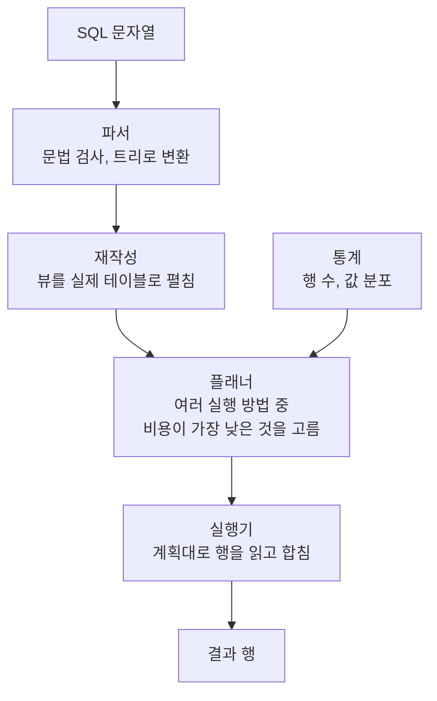
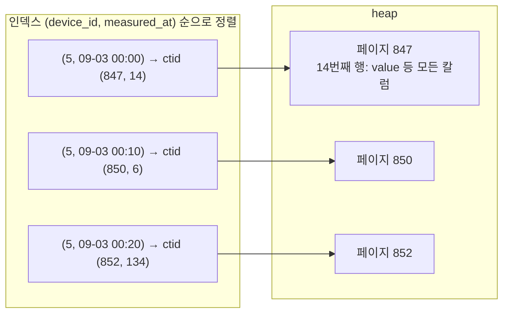

# PostgreSQL 실행 계획 기초: 쿼리가 실행되는 순서부터 스캔, 조인, 통계까지

실행 계획은 DB가 SQL 한 문장을 「어떤 순서로, 어떤 방법으로 읽고 합칠지」 적어 둔 작업 지시서다.
이 글은 SQL은 매일 쓰지만 DB 안에서 그 SQL이 어떻게 실행되는지는 잘 모르는 Java 백엔드 개발자를 위해, 실행 계획을 읽는 데 필요한 기초를 그림과 비유로 정리한다.
수식과 내부 구현의 세부는 뺐다.

이 시리즈의 다음 두 편은 이 글의 용어를 그대로 쓴다.
이 글을 먼저 읽고 넘어가면 다음 편의 출력이 훨씬 쉽게 읽힌다.
각 절 끝의 「다음 편에서는」 줄이 그 개념이 아래 두 편의 어느 절에 다시 나오는지 알려 준다.

- 2편: [PostgreSQL 실행 계획 읽기: Index Cond와 Filter, heap 접근, generic plan과 TimescaleDB 청크 제외](./explain-index-cond-generic-plan-chunks.md)
- 3편: [PostgreSQL 쿼리 패턴과 실행 계획: LATERAL 최신 한 건, unnest와 Inner Unique, gaps and islands](./lateral-unnest-window-query-plans.md)

## 적용 버전과 근거의 구분

| 대상 | 버전 |
| --- | --- |
| PostgreSQL | 17.10 (`timescale/timescaledb:2.27.2-pg17` 이미지) |
| TimescaleDB | 2.27.2 |

- **출처**: PostgreSQL 17 공식 문서에서 확인한 사실이다.
- **확인**: 아래 예제를 로컬 컨테이너에서 직접 실행한 결과다. 긴 줄은 일부 생략했다.
- **추론**: 위 두 가지를 근거로 추정한 내용이다. 문장에 추론이라고 밝힌다.

예제를 단순하게 보이려고 대부분의 실습에서 병렬 쿼리를 껐다(`SET max_parallel_workers_per_gather = 0`).
병렬 쿼리를 켜 두면 같은 쿼리에 `Gather`와 `Parallel Seq Scan` 노드가 더 붙는다(확인).

## 예제 테이블

기기 200대가 온도(`temp`)와 누적 전력량(`energy`)을 10분마다 보내는 7일치 측정 테이블이다.
기기 4대가 한 사이트에 속한다.

```sql
CREATE TABLE devices (device_id int PRIMARY KEY, site_id int NOT NULL, name text NOT NULL);
INSERT INTO devices SELECT d, d / 4 + 1, 'device-' || d FROM generate_series(0, 199) d;

CREATE TABLE readings (
  site_id int NOT NULL, device_id int NOT NULL, metric text NOT NULL,
  value double precision NOT NULL, measured_at timestamptz NOT NULL
);
INSERT INTO readings
SELECT d / 4 + 1, d, m, random() * 100,
       timestamptz '2026-09-01 00:00+00' + make_interval(mins => 10 * t)
FROM generate_series(0, 7 * 144 - 1) t,
     generate_series(0, 199) d,
     unnest(ARRAY['temp', 'energy']) m;
CREATE INDEX readings_device_time_idx ON readings (device_id, measured_at);
VACUUM ANALYZE devices;
VACUUM ANALYZE readings;
```

`readings`는 40만 3,200행이고 2,965페이지를 차지한다(확인).
시간 순서로 넣었기 때문에 같은 기기의 행은 테이블 곳곳에 흩어져 있다.

컨테이너는 다음처럼 띄우고 끝나면 지운다.

```bash
docker run -d --name pgplan-basics -e POSTGRES_PASSWORD=pw timescale/timescaledb:2.27.2-pg17
docker exec -it pgplan-basics psql -U postgres
docker rm -f pgplan-basics
```

## 쿼리가 실행되는 순서

### 무엇인가

SQL 문장 하나는 PostgreSQL 안에서 다음 단계를 거친다(출처: Overview of PostgreSQL Internals).



핵심은 플래너다. 같은 SQL도 실행 방법이 여러 가지다.
테이블을 처음부터 끝까지 읽을 수도 있고 인덱스로 찾아갈 수도 있으며, 두 테이블을 합칠 때도 방법이 셋이다.
플래너는 가능한 방법마다 비용을 추정해 가장 싼 것을 고른다. 이 플래너를 흔히 옵티마이저라고 부른다.
비용을 추정할 때 쓰는 재료가 통계다.

고른 결과가 **실행 계획**이다.
실행 계획은 노드가 나무 모양으로 연결된 구조이고, 아래쪽 노드가 행을 만들어 위쪽 노드로 올려 보낸다.
`EXPLAIN`을 SQL 앞에 붙이면 이 나무를 글자로 보여 준다(출처: Using EXPLAIN).

### 왜 보나

SQL은 「무엇을」 원하는지만 적고 「어떻게」는 DB에 맡기는 언어다.
그래서 느린 쿼리의 원인은 SQL 문장만 봐서는 알 수 없고, DB가 고른 「어떻게」를 봐야 한다.
실행 계획을 보면 인덱스를 썼는지, 몇 행을 읽고 몇 행을 버렸는지, 어느 단계에서 시간이 걸렸는지 알 수 있다.

### Java에 빗대면

Java 코드를 JIT 컴파일러가 실행 시점에 기계어로 바꾸는 것처럼, PostgreSQL은 SQL을 실행할 때마다 실행 계획으로 바꾼다.
SQL은 인터페이스이고 실행 계획은 DB가 고른 구현체라고 보면 된다.

**다음 편에서는**: 2편의 「EXPLAIN과 EXPLAIN (ANALYZE, BUFFERS)」 절이 이 나무를 실제 실행 결과와 함께 읽는다.

## 테이블이 디스크에 놓이는 모양

### 무엇인가

PostgreSQL의 테이블과 인덱스는 고정 크기 **페이지**의 배열로 저장된다. 페이지 크기는 보통 8KB다(출처: Database Page Layout).
테이블의 행은 정렬 없이 빈 자리가 있는 페이지에 차례로 쌓인다. 이렇게 행이 쌓인 테이블 본체를 **heap**이라고 부른다.

행마다 **ctid**라는 물리 위치가 있다. `(페이지 번호, 페이지 안의 순번)` 쌍이다(출처: Database Page Layout).

```sql
SELECT ctid, device_id, metric, round(value::numeric, 1) AS value, measured_at FROM readings LIMIT 4;
```

```text
 ctid  | device_id | metric | value |      measured_at
-------+-----------+--------+-------+------------------------
 (0,1) |         0 | temp   |  85.7 | 2026-09-01 00:00:00+00
 (0,2) |         1 | temp   |  99.2 | 2026-09-01 00:00:00+00
 (0,3) |         2 | temp   |  97.7 | 2026-09-01 00:00:00+00
 (0,4) |         3 | temp   |  22.9 | 2026-09-01 00:00:00+00
```

`(0,1)`은 0번 페이지의 첫 번째 행이라는 뜻이다(확인).
`UPDATE`를 하면 PostgreSQL은 행을 제자리에서 고치지 않고 새 버전을 다른 자리에 쓰므로, ctid는 바뀔 수 있다. 행을 영구히 가리키는 키로 쓰면 안 된다.

### 왜 성능에 영향을 주나

디스크와 메모리 사이에서 데이터는 행 단위가 아니라 페이지 단위로 오간다.
한 행만 필요해도 그 행이 든 8KB 페이지 전체를 읽는다.
그래서 실행 계획의 읽기 양은 「몇 행」보다 「몇 페이지」로 세는 것이 정확하고, `Buffers` 숫자도 페이지 수다.

### Java에 빗대면

heap은 `ArrayList<Page>`이고, 페이지는 행 몇십 개가 든 `Row[]`다.
ctid는 `pages.get(페이지 번호).rows[순번]`의 두 인덱스다.
`ArrayList`처럼 순서대로 훑기는 빠르지만, 원하는 값을 찾으려면 처음부터 다 봐야 한다.

**다음 편에서는**: 2편의 「heap 접근과 커버링 인덱스」 절이 행 하나를 읽으려고 heap 페이지를 찾아가는 비용을 다룬다.

## 인덱스는 정렬된 목차다

### 무엇인가

**B-tree 인덱스**는 키 값으로 정렬된 목차다.
목차의 각 항목에는 키와 그 행의 ctid가 들어 있다. 행의 나머지 칼럼은 없다.



그림의 ctid는 기기 5의 `temp` 행을 실제로 조회한 값이다(확인). 시간 순서로 이웃한 행이 서로 다른 페이지에 흩어져 있다.
인덱스로 키를 찾은 뒤 `value`처럼 인덱스에 없는 칼럼이 필요하면 ctid를 따라 heap 페이지를 다시 읽는다.
키가 정렬돼 있으므로 `device_id = 5 AND measured_at BETWEEN ...`처럼 정렬 순서의 앞쪽 칼럼부터 조건을 주면 목차에서 시작 위치를 바로 찾고 끝 위치까지만 훑는다.

### 왜 성능에 영향을 주나

인덱스 탐색 자체는 수십만 행에서도 페이지 몇 개면 끝난다.
비용이 커지는 쪽은 찾은 행마다 heap을 다시 읽는 단계다.
찾은 행이 heap 곳곳에 흩어져 있으면 행마다 다른 페이지를 읽어야 한다.

### Java와 MySQL에 빗대면

인덱스는 `TreeMap<Key, Ctid>`다. `subMap(from, to)`로 범위를 빠르게 꺼내지만, 값은 ctid뿐이라 실제 행은 `heap.get(ctid)`로 다시 가져와야 한다.
MySQL InnoDB의 보조 인덱스가 행 위치 대신 PK를 담아 PK로 한 번 더 찾아가는 것과 같은 구조다.

> [!TIP]
> **더 읽을 글**: [MySQL / InnoDB 인덱스 허브](../mysql/b-tree-index.md), [MySQL 복합 인덱스 완전 정복](../mysql/composite-index.md).
> B-tree 구조와 복합 인덱스의 칼럼 순서는 MySQL과 PostgreSQL이 같은 원리를 따른다.

**다음 편에서는**: 2편의 「Index Cond와 Filter」 절이 조건이 목차로 처리되는지, 읽은 뒤 버려지는지를 구분한다.

## 스캔 방법 네 가지

### 무엇인가

테이블에서 행을 꺼내는 방법을 책 읽기에 빗대면 다음과 같다.

| 노드 | 책에 빗대면 | 언제 고르나 |
| --- | --- | --- |
| `Seq Scan` | 책을 처음부터 끝까지 읽는다 | 조건이 없거나, 많은 행을 읽어야 하거나, 맞는 인덱스가 없을 때 |
| `Index Scan` | 목차에서 찾아 그 쪽으로 바로 간다. 한 항목마다 한 번씩 | 조건에 맞는 행이 적을 때 |
| `Index Only Scan` | 목차만 보고 답한다. 본문을 펴지 않는다 | 필요한 칼럼이 모두 인덱스에 있을 때 |
| `Bitmap Index Scan` + `Bitmap Heap Scan` | 목차에서 쪽 번호를 먼저 다 모은 뒤 쪽 순서대로 읽는다 | 맞는 행이 중간 정도로 많고 흩어져 있을 때 |

### 실행 계획에서 어떻게 보이나

인덱스가 없는 `value` 조건은 `Seq Scan`이다(확인).

```sql
EXPLAIN (ANALYZE, BUFFERS) SELECT * FROM readings WHERE value > 99.9;
```

```text
Seq Scan on readings  (cost=0.00..8005.00 rows=379 width=29) (actual time=0.024..12.275 rows=424 loops=1)
  Filter: (value > '99.9'::double precision)
  Rows Removed by Filter: 402776
  Buffers: shared hit=2965
```

2,965페이지를 모두 읽고 424행만 남겼다.

기기 하나의 한 시간 범위는 `Index Scan`이다(확인).

```sql
EXPLAIN (ANALYZE, BUFFERS) SELECT value FROM readings
WHERE device_id = 5 AND measured_at >= '2026-09-03 00:00+00' AND measured_at < '2026-09-03 01:00+00';
```

```text
Index Scan using readings_device_time_idx on readings  (cost=0.42..14.99 rows=12 width=8) (actual time=0.011..0.017 rows=12 loops=1)
  Index Cond: ((device_id = 5) AND (measured_at >= ...) AND (measured_at < ...))
  Buffers: shared hit=15
```

12행에 15페이지를 읽었다. 인덱스 몇 페이지와 행마다 heap 한 페이지씩이다(추론: 12행이 서로 다른 페이지에 흩어져 있다는 점과 읽은 페이지 수를 맞춘 해석이다).

같은 조건에서 `value` 대신 인덱스에 있는 `measured_at`만 고르면 `Index Only Scan`이 된다(확인).

```text
Index Only Scan using readings_device_time_idx on readings  (cost=0.42..1.79 rows=12 width=8) (actual time=0.013..0.014 rows=12 loops=1)
  Index Cond: ((device_id = 5) AND (measured_at >= ...) AND (measured_at < ...))
  Heap Fetches: 0
  Buffers: shared hit=4
```

heap을 펴지 않아 4페이지로 끝났다.

기기 하나의 7일치 전체(2,016행)는 `Bitmap` 두 단계로 읽는다(확인).

```text
Bitmap Heap Scan on readings  (cost=23.70..1594.12 rows=2010 width=30) (actual time=0.310..1.457 rows=2016 loops=1)
  Recheck Cond: (device_id = 5)
  Heap Blocks: exact=2016
  Buffers: shared hit=2025
  ->  Bitmap Index Scan on readings_device_time_idx  (cost=0.00..23.20 rows=2010 width=0) (actual time=0.183..0.184 rows=2016 loops=1)
        Index Cond: (device_id = 5)
        Buffers: shared hit=9
```

아래쪽 `Bitmap Index Scan`이 목차에서 쪽 번호 2,016개를 모으고, 위쪽 `Bitmap Heap Scan`이 그 페이지를 페이지 순서대로 읽었다.
같은 페이지를 두 번 읽지 않고, 디스크에서도 앞에서 뒤로 읽게 된다.

### 왜 성능에 영향을 주나

인덱스가 늘 빠른 것은 아니다.
맞는 행이 많으면 행마다 heap을 따로 찾아가는 비용이 처음부터 다 읽는 비용보다 커진다.
플래너는 맞는 행 수를 추정해 그 경계를 판단하므로, 추정이 틀리면 스캔 방법도 틀리게 고른다.

### Java에 빗대면

| 노드 | Java 코드 |
| --- | --- |
| `Seq Scan` | `for (Row r : heap) if (조건) ...` |
| `Index Scan` | `for (Ctid c : index.subMap(from, to).values()) heap.get(c)` |
| `Index Only Scan` | `index.subMap(from, to).keySet()`만 쓴다 |
| `Bitmap Scan` | ctid를 모아 페이지 번호로 정렬한 뒤 `heap.get()`을 페이지 순서대로 호출한다 |

**다음 편에서는**: 2편의 「heap 접근과 커버링 인덱스」 절이 `Index Scan`을 `Index Only Scan`으로 바꿔 읽는 페이지를 줄이고, `Heap Fetches`가 0이 아닐 때의 이유를 다룬다.

## 조인 방법 세 가지

### 무엇인가

두 테이블을 합치는 방법은 세 가지다. Java 코드로 쓰면 바로 이해된다.

```java
// Nested Loop: 바깥 행마다 안쪽을 찾는다
for (Device d : devices)
    for (Reading r : readingIndex.find(d.deviceId()))   // 안쪽은 보통 인덱스로 찾는다
        out.add(join(d, r));

// Hash Join: 작은 쪽으로 HashMap을 만들고 큰 쪽을 훑으며 찾는다
Map<Integer, Device> map = new HashMap<>();
for (Device d : devices) map.put(d.deviceId(), d);
for (Reading r : readings) {
    Device d = map.get(r.deviceId());
    if (d != null) out.add(join(d, r));
}

// Merge Join: 둘 다 키로 정렬된 리스트를 나란히 걷는다
int i = 0, j = 0;
while (i < devices.size() && j < readings.size()) {
    int c = Integer.compare(devices.get(i).deviceId(), readings.get(j).deviceId());
    if (c < 0) i++;
    else if (c > 0) j++;
    else out.add(join(devices.get(i), readings.get(j++)));
}
```

| 방법 | 빠른 경우 | 느린 경우 |
| --- | --- | --- |
| Nested Loop | 바깥 행이 적고 안쪽을 인덱스로 찾을 수 있다 | 바깥 행이 많다. 안쪽을 그만큼 반복한다 |
| Hash Join | 한쪽이 메모리에 들어갈 만큼 작고, 큰 쪽을 한 번 훑으면 된다 | 해시 테이블이 메모리를 넘는다 |
| Merge Join | 양쪽이 이미 키 순서로 정렬돼 있다. 인덱스 순서가 그렇다 | 정렬부터 해야 하고 그 양이 많다 |

### 실행 계획에서 어떻게 보이나

사이트 하나(기기 4대)의 한 시간 측정값은 `Nested Loop`다(확인).

```text
Nested Loop (actual time=0.024..0.063 rows=48 loops=1)
  Buffers: shared hit=62
  ->  Seq Scan on devices d (actual time=0.011..0.015 rows=4 loops=1)
        Filter: (site_id = 2)
  ->  Index Scan using readings_device_time_idx on readings r (actual time=0.007..0.011 rows=12 loops=4)
        Index Cond: ((device_id = d.device_id) AND (measured_at >= ...) AND (measured_at < ...))
```

바깥 `devices`에서 4행이 나왔고, 안쪽 `Index Scan`이 `loops=4`로 네 번 실행됐다.
안쪽의 `rows=12`는 한 번 실행의 평균이므로 모두 48행이다.

값이 99를 넘는 측정값 전체에 기기 이름을 붙이면 `Hash Join`이다(확인).

```text
Hash Join (actual time=0.061..13.283 rows=4089 loops=1)
  Hash Cond: (r.device_id = d.device_id)
  ->  Seq Scan on readings r (actual time=0.016..12.763 rows=4089 loops=1)
        Filter: (value > '99'::double precision)
  ->  Hash (actual time=0.032..0.033 rows=200 loops=1)
        Buckets: 1024  Batches: 1  Memory Usage: 18kB
        ->  Seq Scan on devices d (actual time=0.008..0.017 rows=200 loops=1)
```

작은 `devices` 200행으로 해시 테이블(18kB)을 만들고, 큰 `readings`를 한 번 훑으며 찾았다.
`Batches: 1`은 해시 테이블이 메모리에 한 번에 들어갔다는 뜻이다.

`Merge Join`은 이 데이터에서 자연스럽게 나오지 않아 다른 두 방법을 끄고 확인했다(확인).

```sql
SET enable_hashjoin = off;
SET enable_nestloop = off;
```

```text
Merge Join (actual time=0.043..4.461 rows=2400 loops=1)
  Merge Cond: (d.device_id = r.device_id)
  ->  Index Scan using devices_pkey on devices d (actual time=0.012..0.041 rows=200 loops=1)
  ->  Index Scan using readings_device_time_idx on readings r (actual time=0.011..4.201 rows=2400 loops=1)
        Index Cond: ((measured_at >= ...) AND (measured_at < ...))
```

양쪽 모두 `device_id` 순서로 정렬된 인덱스를 읽어 `Sort` 없이 나란히 걸었다.
`enable_*` 설정은 실습과 진단용이다. 운영 쿼리에 걸어 두는 설정이 아니다.

### 왜 성능에 영향을 주나

세 방법의 비용은 입력 크기에 따라 크게 달라진다.
Nested Loop는 바깥 행이 4개일 때는 가장 빠르지만 바깥 행이 100만 개면 안쪽 탐색도 100만 번이다.
플래너는 바깥 행 수의 추정으로 방법을 고르므로, 추정이 실제보다 훨씬 작으면 Nested Loop를 잘못 고르기 쉽다(추론: 비용 구조에서 끌어낸 일반론이다).

**다음 편에서는**: 3편의 「LATERAL로 그룹마다 최신 한 건 읽기」 절이 Nested Loop의 `loops`를, 「unnest로 배열을 표로 펼치기와 Inner Unique」 절이 Merge Join을 다룬다.

## 정렬과 집계

### 무엇인가

`ORDER BY`는 `Sort` 노드가, `GROUP BY`와 `count()`, `avg()` 같은 집계는 `Aggregate` 계열 노드가 처리한다.
집계 노드는 해시 테이블로 묶는 `HashAggregate`와 정렬된 입력을 차례로 묶는 `GroupAggregate`가 대표적이다.

두 노드 모두 메모리를 쓴다. 한 노드가 쓸 수 있는 메모리의 기준은 `work_mem`이고 기본값은 4MB다.
정렬이 이 한도를 넘으면 임시 파일에 나눠 쓰고 합친다(출처: Resource Consumption).

### 실행 계획에서 어떻게 보이나

같은 4만 행 정렬을 `work_mem`만 바꿔 두 번 돌렸다(확인). `Sort` 노드 줄만 옮겼다.

```text
-- SET work_mem = '64kB'
Sort (actual time=21.885..23.955 rows=40320 loops=1)
  Sort Key: value
  Sort Method: external merge  Disk: 1728kB
  Buffers: shared hit=40447, temp read=631 written=677

-- SET work_mem = '64MB'
Sort (actual time=9.402..11.112 rows=40320 loops=1)
  Sort Key: value
  Sort Method: quicksort  Memory: 3427kB
```

메모리가 모자라면 `Sort Method: external merge`와 `Disk`가 나오고, `Buffers`에 `temp read/written`이 생긴다.
메모리 안에서 끝나면 `quicksort`와 `Memory`가 나온다.
`work_mem`을 바꾸자 플래너가 행을 읽는 스캔 방법도 바꿨다. 정렬 시간만 비교하려면 `Sort` 노드의 시간만 본다.

기기별 평균은 `HashAggregate`다(확인).

```text
HashAggregate (actual time=45.078..45.089 rows=200 loops=1)
  Group Key: device_id
  Batches: 1  Memory Usage: 64kB
  ->  Seq Scan on readings (actual time=0.009..11.988 rows=403200 loops=1)
```

40만 행을 읽어 200개 묶음으로 줄였다. `Batches: 1`은 해시 테이블이 메모리에 들어갔다는 뜻이다.

### 왜 성능에 영향을 주나

임시 파일을 쓰면 메모리 대신 디스크를 오가므로 느려진다.
`work_mem`은 노드 하나의 한도라서, 정렬과 해시가 여러 개인 쿼리를 여러 커넥션이 동시에 돌리면 전체 메모리 사용량은 그 배수가 된다(출처: Resource Consumption).
그래서 전역으로 크게 올리기보다 정렬 자체를 인덱스 순서로 없애는 방법을 먼저 찾는다.

### Java에 빗대면

`Sort`는 `list.sort()`이고, `work_mem`을 넘긴 정렬은 메모리에 다 못 올리는 큰 파일을 조각내 정렬한 뒤 병합하는 외부 정렬이다.
`HashAggregate`는 `Collectors.groupingBy(Reading::deviceId, Collectors.averagingDouble(...))`다.

**다음 편에서는**: 3편의 「창 함수로 연속 구간 찾기」 절이 인덱스 순서 덕분에 `Sort` 없이 창 함수를 계산하는 계획을 다룬다.

## 계획의 숫자 읽는 법

### 무엇인가

```text
Index Scan using readings_device_time_idx on readings  (cost=0.42..14.99 rows=12 width=8) (actual time=0.011..0.017 rows=12 loops=1)
  Buffers: shared hit=15
```

| 숫자 | 뜻 | 추정인가 실제인가 |
| --- | --- | --- |
| `cost=0.42..14.99` | 첫 행을 낼 때까지의 비용과 모든 행을 낼 때까지의 비용. 단위는 순차 페이지 읽기 1회를 1로 잡은 상대값이다 | 추정 |
| `rows=12` (괄호 앞) | 이 노드가 낼 것으로 예상한 행 수 | 추정 |
| `width=8` | 한 행의 평균 바이트 수 | 추정 |
| `actual time=0.011..0.017` | 첫 행까지와 마지막 행까지 걸린 실제 밀리초 | 실제 |
| `rows=12` (괄호 뒤) | 실제로 낸 행 수 | 실제 |
| `loops=1` | 이 노드가 실행된 횟수. 시간과 행 수는 한 번 실행의 평균이다 | 실제 |
| `Buffers: shared hit=15` | 공유 버퍼(메모리)에서 찾은 페이지 수. `read`는 메모리에 없어 운영체제에 읽기를 요청한 페이지 수다 | 실제 |

`cost`와 앞쪽 `rows`는 `EXPLAIN`만으로 나오고, `actual`과 `loops`는 `EXPLAIN ANALYZE`, `Buffers`는 `BUFFERS` 옵션을 붙여야 나온다(출처: EXPLAIN, Using EXPLAIN).
`EXPLAIN ANALYZE`는 쿼리를 실제로 실행한다. `UPDATE`나 `DELETE`에 붙이면 데이터가 바뀌므로 `BEGIN`과 `ROLLBACK`으로 감싼다(출처: EXPLAIN).

노드의 시간은 자식 노드의 시간을 포함한다.
한 노드가 직접 쓴 시간은 자기 `actual time`에서 자식의 시간을 빼서 구한다.

### 추정과 실제가 다르면 왜 문제인가

플래너는 추정 `rows`로 스캔 방법과 조인 방법을 고른다.
추정이 12행인데 실제가 12만 행이면 「적으니까 인덱스로 하나씩」, 「적으니까 Nested Loop」를 고른 판단이 모두 틀린 전제에서 나온 셈이다.
실행 계획에서 노드마다 추정 `rows`와 실제 `rows`를 나란히 보고, 크게 어긋나기 시작한 가장 아래 노드를 찾는 것이 진단의 출발점이다.

**다음 편에서는**: 2편 전체가 이 숫자를 읽는다. 특히 「EXPLAIN과 EXPLAIN (ANALYZE, BUFFERS)」 절이 `hit`과 `read`, `loops`를 다룬다.

## 통계와 추정

### 무엇인가

플래너는 테이블을 실제로 세어 보지 않고 미리 모아 둔 **통계**로 행 수를 추정한다.

- 테이블 전체의 행 수와 페이지 수는 `pg_class`의 `reltuples`, `relpages`에 있다.
- 칼럼마다 서로 다른 값의 수, 자주 나오는 값과 그 비율, 값 분포의 구간 경계가 `pg_stats`에 있다.
- 이 통계는 `ANALYZE`가 표본을 읽어 갱신하고, 평소에는 autovacuum이 백그라운드에서 자동으로 돌린다. 갓 갱신해도 근사값이다(출처: Statistics Used by the Planner).

```sql
SELECT attname, n_distinct FROM pg_stats
WHERE tablename = 'readings' AND attname IN ('device_id', 'site_id', 'metric');
```

```text
  attname  | n_distinct
-----------+------------
 site_id   |         50
 device_id |        200
 metric    |          2
```

`site_id = 2`이면 플래너는 「50가지 값 중 하나이니 전체의 1/50」로 계산한다.
40만 3,200행의 1/50은 8,064행이다. 실제 계획의 추정은 7,862행, 실제는 8,064행이었다(확인).

### 조건이 서로 얽히면 추정이 흔들린다

플래너는 보통 조건끼리 서로 관계가 없다고 가정한다(출처: Statistics Used by the Planner).
그런데 이 데이터에서 기기 5는 항상 사이트 2에 속한다. `device_id = 5`이면 `site_id = 2`는 저절로 참이다.

```sql
EXPLAIN (ANALYZE) SELECT * FROM readings WHERE site_id = 2 AND device_id = 5;
```

```text
Bitmap Heap Scan on readings  (cost=23.25..1601.77 rows=39 width=29) (actual time=0.347..1.751 rows=2016 loops=1)
  Recheck Cond: (device_id = 5)
  Filter: (site_id = 2)
```

플래너는 1/200에 1/50을 한 번 더 곱해 39행으로 추정했고 실제는 2,016행이었다(확인).
두 칼럼의 관계를 알려 주는 확장 통계를 만들면 추정이 고쳐진다(출처: Statistics Used by the Planner).

```sql
CREATE STATISTICS readings_site_device (dependencies) ON site_id, device_id FROM readings;
ANALYZE readings;
```

같은 쿼리의 추정이 `rows=2006`으로 바뀌었다(확인).

### 바인드 변수 값을 모르면 추정이 흔들린다

애플리케이션이 `WHERE device_id = ?`로 보내면 DB는 계획을 세울 때 값을 모를 수 있다.
값을 모르면 「평균적인 값」으로 추정할 수밖에 없다.

기기 999 하나가 측정값 30만 건을 갖도록 데이터를 치우치게 만들고, 값을 아는 계획과 모르는 계획을 비교했다(확인).
값을 넣고 세운 계획이 custom plan, 값 없이 `$1`로 세운 계획이 generic plan이다.

```sql
PREPARE q(int) AS SELECT count(*) FROM readings WHERE device_id = $1;
```

| 계획 | `device_id` | 추정 `rows` | 실제 `rows` |
| --- | --- | --- | --- |
| custom plan | 5 | 2,013 | 2,016 |
| custom plan | 999 | 300,501 | 300,000 |
| generic plan | `$1` (실행 값 999) | 3,499 | 300,000 |

generic plan은 값이 무엇이든 3,499행으로 추정했다.
이 쿼리는 어느 쪽이든 같은 `Index Only Scan`을 골라 실행 시간이 비슷했지만, 조인이 붙은 쿼리라면 이런 추정 차이가 조인 방법을 바꿀 수 있다(추론).

### Java와 MySQL에 빗대면

통계는 DB가 들고 있는 테이블별 메타데이터 캐시다. 오래되면 틀리고, `ANALYZE`가 그 캐시를 다시 채운다.
MySQL의 `ANALYZE TABLE`과 InnoDB 영구 통계, 히스토그램이 같은 역할을 한다.

**다음 편에서는**: 2편의 「custom plan과 generic plan」 절이 prepared statement가 언제 generic plan으로 바뀌는지와 JDBC 드라이버의 `prepareThreshold`를 다룬다.

## 파티션과 TimescaleDB 청크

### 무엇인가

**파티션**은 큰 테이블 하나를 날짜 같은 기준으로 작은 테이블 여럿으로 나눠 두는 방법이다.
쿼리는 원래 테이블 이름으로 보내고, DB가 조건에 맞는 작은 테이블만 골라 읽는다. 이것을 파티션 제외(pruning)라고 한다(출처: Table Partitioning).

TimescaleDB의 **hypertable**은 시간 칼럼 기준으로 이 작은 테이블(**청크**)을 자동으로 만들어 주는 테이블이다.
데이터가 새 시간 범위에 들어오면 청크가 저절로 생긴다.

같은 데이터를 하루 단위 청크로 나눈 hypertable에 넣었다(확인).

```sql
CREATE TABLE readings_ts (LIKE readings);
SELECT create_hypertable('readings_ts', by_range('measured_at', INTERVAL '1 day'));
INSERT INTO readings_ts SELECT * FROM readings;
```

```text
    chunk_name    |      range_start       |       range_end
------------------+------------------------+------------------------
 _hyper_1_1_chunk | 2026-09-01 00:00:00+00 | 2026-09-02 00:00:00+00
 _hyper_1_2_chunk | 2026-09-02 00:00:00+00 | 2026-09-03 00:00:00+00
 _hyper_1_3_chunk | 2026-09-03 00:00:00+00 | 2026-09-04 00:00:00+00
```

7일치라 청크가 7개 생겼다.

### 실행 계획에서 어떻게 보이나

하루 범위를 조회하면 청크 하나만 읽는다(확인).

```text
Aggregate (actual time=4.800..4.801 rows=1 loops=1)
  Buffers: shared hit=424
  ->  Seq Scan on _hyper_1_3_chunk (actual time=0.009..2.726 rows=57600 loops=1)
```

시간 조건 없이 전체를 집계하면 청크 7개가 `Append` 아래에 모두 나온다(확인).

```text
Finalize Aggregate
  ->  Append
        ->  Partial Aggregate
              ->  Seq Scan on _hyper_1_1_chunk
        ... 청크 2~7 생략
```

`Append`는 자식 노드의 결과를 이어 붙이는 노드다.

### 왜 성능에 영향을 주나

조건에 맞는 청크만 읽으면 읽을 페이지와 인덱스 자체가 줄어든다.
위 예제의 하루 조회는 7일치 테이블 2,965페이지 대신 청크 하나의 424페이지만 읽었다.
오래된 데이터를 지울 때도 행을 하나씩 `DELETE`하지 않고 청크를 통째로 버릴 수 있다.

### Java와 MySQL에 빗대면

청크는 날짜별로 나눈 `Map<LocalDate, List<Reading>>`이고, 청크 제외는 조회 기간의 키만 골라 그 리스트만 순회하는 것이다.
MySQL의 `PARTITION BY RANGE`와 파티션 프루닝이 같은 개념이다.

**다음 편에서는**: 2편의 「TimescaleDB 청크와 청크 제외」 절이 계획 시점, 실행 시작 시점, 실행 중의 세 가지 제외와 `ChunkAppend` 노드를 다룬다.

## CTE와 창 함수 기초

### CTE(WITH)는 이름 붙인 중간 결과다

`WITH`는 서브쿼리에 이름을 붙여 본문에서 테이블처럼 쓰게 해 준다.
긴 쿼리를 단계별로 나눠 읽기 쉽게 만드는 용도다.

```sql
WITH daily AS (
  SELECT device_id, date_trunc('day', measured_at) AS day, avg(value) AS avg_value
  FROM readings WHERE metric = 'temp'
  GROUP BY device_id, date_trunc('day', measured_at)
)
SELECT * FROM daily WHERE device_id = 5;
```

PostgreSQL 12부터는 부작용이 없고 한 번만 참조하는 `WITH`를 본문에 합쳐서 함께 최적화한다(출처: WITH Queries).
그래서 위 쿼리는 바깥의 `device_id = 5`가 `WITH` 안쪽까지 내려가 인덱스로 기기 5의 행만 읽는다(확인).

```text
HashAggregate (actual time=1.785..1.788 rows=7 loops=1)
  Group Key: date_trunc('day'::text, readings.measured_at)
  ->  Bitmap Heap Scan on readings (actual time=0.412..1.707 rows=1008 loops=1)
        Recheck Cond: (device_id = 5)
        Filter: (metric = 'temp'::text)
  ...
Execution Time: 1.876 ms
```

`WITH daily AS MATERIALIZED (...)`로 따로 계산하라고 강제하면, 모든 기기의 일별 평균 1,400행을 먼저 만든 뒤 기기 5만 남긴다(확인).

```text
CTE Scan on daily (actual time=44.346..44.721 rows=7 loops=1)
  Filter: (device_id = 5)
  Rows Removed by Filter: 1393
  CTE daily
    ->  HashAggregate (actual time=44.321..44.564 rows=1400 loops=1)
          ->  Seq Scan on readings (actual time=0.029..28.832 rows=201600 loops=1)
...
Execution Time: 45.652 ms
```

계획에 `CTE Scan` 노드가 보이면 중간 결과를 따로 만들었다는 뜻이다.

### 창 함수(OVER)는 행을 줄이지 않는 GROUP BY다

`GROUP BY`는 묶음마다 한 행으로 줄인다.
창 함수는 같은 묶음을 보고 계산하되, 원래 행을 그대로 두고 계산 결과를 칼럼으로 붙인다.

```sql
SELECT device_id, measured_at, round(value::numeric, 1) AS value,
       round(avg(value) OVER (PARTITION BY device_id)::numeric, 1) AS device_avg
FROM readings
WHERE device_id IN (1, 2) AND metric = 'temp' AND measured_at < '2026-09-01 00:30+00'
ORDER BY device_id, measured_at;
```

```text
 device_id |      measured_at       | value | device_avg
-----------+------------------------+-------+------------
         1 | 2026-09-01 00:00:00+00 |  99.2 |       81.9
         1 | 2026-09-01 00:10:00+00 |  77.6 |       81.9
         1 | 2026-09-01 00:20:00+00 |  69.1 |       81.9
         2 | 2026-09-01 00:00:00+00 |  97.7 |       66.3
         2 | 2026-09-01 00:10:00+00 |   5.9 |       66.3
         2 | 2026-09-01 00:20:00+00 |  95.1 |       66.3
```

같은 조건의 `GROUP BY device_id`는 2행(기기 1은 81.9, 기기 2는 66.3)만 돌려준다(확인).
창 함수는 6행을 그대로 두고 각 행 옆에 기기 평균을 붙였다.

`PARTITION BY`는 「무엇끼리 묶을지」, `OVER` 안의 `ORDER BY`는 「묶음 안에서 어떤 순서로 볼지」를 정한다.
`lag()`처럼 앞 행을 보는 함수는 이 순서가 있어야 의미가 생긴다.

실행 계획에서는 `WindowAgg` 노드로 나오고, 입력이 묶음 순서로 정렬돼 있어야 해서 그 아래에 `Sort`가 붙기 쉽다(확인).

```text
WindowAgg
  ->  Sort
        Sort Key: device_id
        ->  Bitmap Heap Scan on readings
```

### Java에 빗대면

CTE는 긴 메서드 안에서 중간 결과를 이름 있는 지역 변수에 담는 것이다.
PostgreSQL 12부터는 컴파일러가 그 변수를 인라인해 한 번에 최적화하고, `MATERIALIZED`는 「인라인하지 말고 변수에 실제로 담아라」라는 지시다.

창 함수는 `groupingBy`로 평균을 구한 `Map`을 만든 뒤, 원래 리스트를 돌며 각 원소에 `map.get(deviceId)`를 붙이는 것과 같다.

**다음 편에서는**: 3편의 「창 함수로 연속 구간 찾기」 절이 `lag()`와 누적 `sum() OVER (ORDER BY ...)`로 끊김 없는 구간을 찾고, 그 과정에서 `WITH`를 단계 나누기에 쓴다.

## 용어 정리

| 용어 | 한 줄 뜻 | 비유 |
| --- | --- | --- |
| 실행 계획 | 플래너가 고른 실행 방법을 노드의 나무로 적은 것 | DB가 고른 구현체 |
| 플래너(옵티마이저) | 실행 방법별 비용을 추정해 가장 싼 것을 고르는 단계 | 경로 탐색기 |
| 페이지 | 테이블과 인덱스를 저장하는 8KB 단위 | `Row[]` 한 묶음 |
| heap | 행이 정렬 없이 쌓인 테이블 본체 | `ArrayList<Page>` |
| ctid | 행의 물리 위치 `(페이지, 순번)` | 두 단계 배열 인덱스 |
| B-tree 인덱스 | 키와 ctid를 키 순서로 정렬해 둔 목차 | `TreeMap<Key, Ctid>` |
| Seq Scan | 테이블을 처음부터 끝까지 읽는다 | 책을 처음부터 읽기 |
| Index Scan | 인덱스로 찾고 행마다 heap을 읽는다 | 목차로 찾아가기 |
| Index Only Scan | 인덱스만 읽고 heap을 읽지 않는다 | 목차만 보고 답하기 |
| Bitmap Scan | 인덱스로 페이지 번호를 모은 뒤 페이지 순서대로 읽는다 | 쪽 번호를 모아 순서대로 읽기 |
| Nested Loop | 바깥 행마다 안쪽을 찾는다 | 이중 `for` 문 |
| Hash Join | 한쪽으로 해시 테이블을 만들고 다른 쪽으로 찾는다 | `HashMap` 만들고 `get` |
| Merge Join | 정렬된 두 입력을 나란히 걷는다 | 정렬된 두 리스트 병합 |
| `work_mem` | 정렬과 해시 노드 하나가 쓸 메모리 한도 | 지역 버퍼 크기 |
| `cost` | 비용 추정값. 순차 페이지 읽기 1회를 1로 잡은 상대 단위 | 예상 작업량 |
| `rows` | 추정 또는 실제 행 수 | 예상 건수와 실제 건수 |
| `loops` | 노드가 실행된 횟수 | 메서드 호출 횟수 |
| `Buffers` | 읽은 페이지 수. `hit`은 메모리, `read`는 운영체제에 요청 | 캐시 적중과 실패 |
| 통계 | 행 수와 값 분포의 근사값. `ANALYZE`가 갱신한다 | 메타데이터 캐시 |
| custom plan, generic plan | 바인드 값을 보고 세운 계획과 값 없이 세운 재사용 계획 | 호출마다 최적화와 캐시된 범용 구현 |
| 파티션, 청크 | 큰 테이블을 기준값 범위별로 나눈 작은 테이블 | 날짜별 `Map` |
| CTE | 이름 붙인 중간 결과 | 지역 변수 |
| 창 함수 | 행을 줄이지 않고 묶음 단위 계산을 붙인다 | 그룹 평균을 원소마다 붙이기 |

## 참고 자료

- [PostgreSQL 17: Overview of PostgreSQL Internals](https://www.postgresql.org/docs/17/overview.html) — 파서, 재작성, 플래너, 실행기
- [PostgreSQL 17: Using EXPLAIN](https://www.postgresql.org/docs/17/using-explain.html) — 계획 노드, `cost`, `rows`, `loops`
- [PostgreSQL 17: EXPLAIN](https://www.postgresql.org/docs/17/sql-explain.html) — `ANALYZE`, `BUFFERS`
- [PostgreSQL 17: Database Page Layout](https://www.postgresql.org/docs/17/storage-page-layout.html) — 8KB 페이지, ctid
- [PostgreSQL 17: Statistics Used by the Planner](https://www.postgresql.org/docs/17/planner-stats.html) — `pg_class`, `pg_stats`, 확장 통계
- [PostgreSQL 17: Resource Consumption](https://www.postgresql.org/docs/17/runtime-config-resource.html) — `work_mem`
- [PostgreSQL 17: Table Partitioning](https://www.postgresql.org/docs/17/ddl-partitioning.html)
- [PostgreSQL 17: WITH Queries](https://www.postgresql.org/docs/17/queries-with.html) — CTE 인라인과 `MATERIALIZED`
- [PostgreSQL 17: Window Functions](https://www.postgresql.org/docs/17/tutorial-window.html)

## 관련 문서

- [PostgreSQL 실행 계획 읽기: Index Cond와 Filter, heap 접근, generic plan과 TimescaleDB 청크 제외](./explain-index-cond-generic-plan-chunks.md)
- [PostgreSQL 쿼리 패턴과 실행 계획: LATERAL 최신 한 건, unnest와 Inner Unique, gaps and islands](./lateral-unnest-window-query-plans.md)
- [MySQL EXPLAIN / EXPLAIN ANALYZE 완전 정복](../mysql/explain-plan.md)
