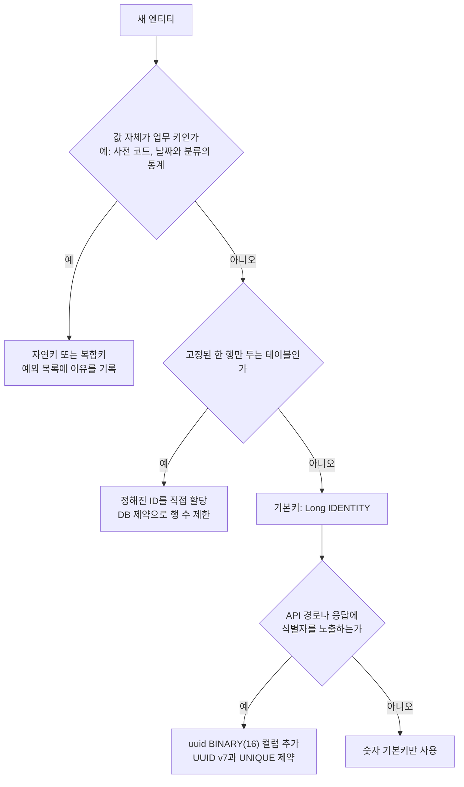
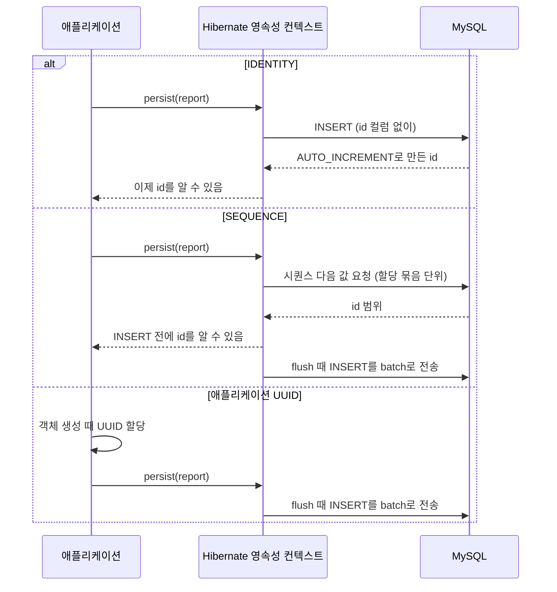
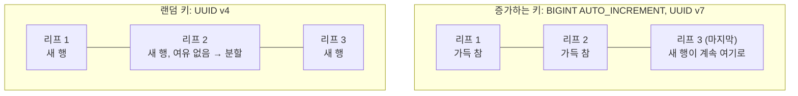
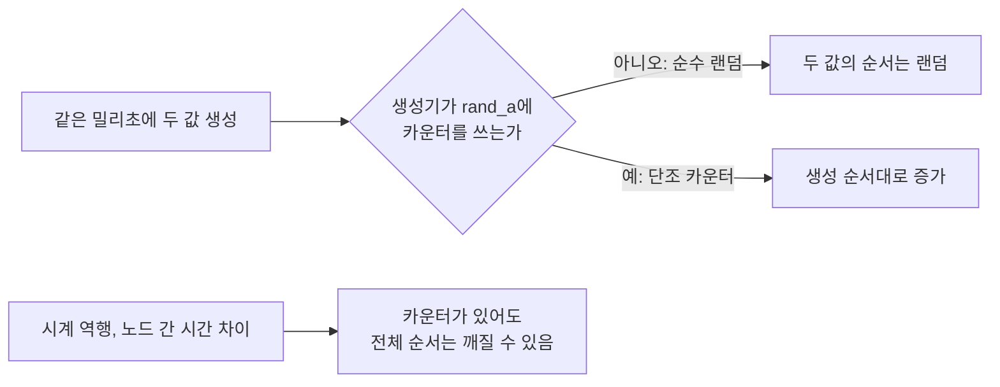
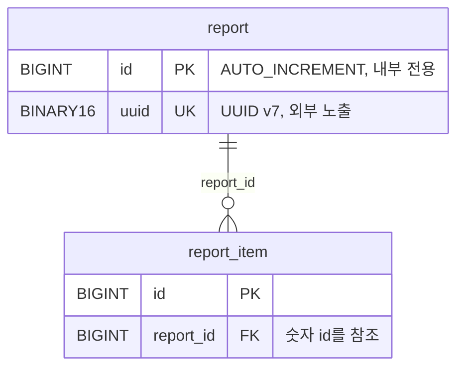
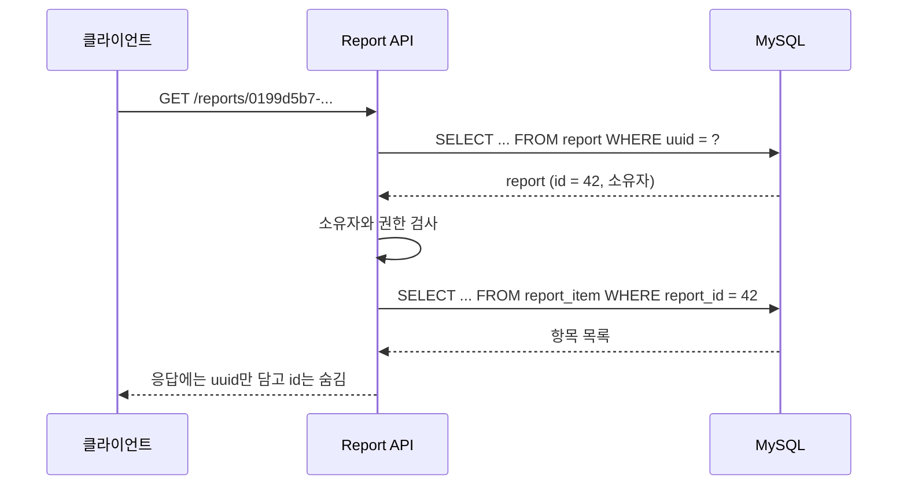
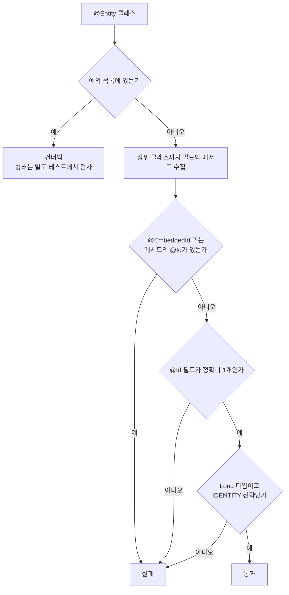

# JPA 식별자 전략: Long IDENTITY와 외부용 UUID v7

JPA 엔티티의 기본키를 정할 때는 INSERT 성능, 인덱스 크기와 외부 API의 식별자를 함께 봐야 한다.
이 글에서 다루는 선택은 **일반 엔티티의 기본키를 `Long IDENTITY`로 통일하고, 외부에 노출할 식별자가 필요한 엔티티에만 UUID v7 컬럼을 추가하는 방식**이다.
분석 결과를 저장하는 서비스에서 검토한 판단을 일반화했으며, 특정 업무의 구현 과정과 운영 수치는 다루지 않는다.

기술 설명은 Jakarta Persistence 3.1, Hibernate ORM 6.6, MySQL 8.4와 Java 21을 기준으로 한다.
Hibernate 7과 Java 26에서 달라진 UUID v7 지원은 해당 절에서 따로 밝힌다.
아래 결정은 이 조건에서의 선택이며, 분산 환경에서 INSERT 전에 기본키가 필요하거나 대량 삽입이 핵심이라면 다른 전략이 더 적합할 수 있다.

## 결론부터 보는 선택 흐름

새 엔티티를 만들 때 아래 순서로 식별자를 정한다.
각 분기의 이유는 뒤의 절에서 하나씩 설명한다.



| 판단 | 이 글의 절 |
| --- | --- |
| IDENTITY를 기본으로 삼아도 되는가 | 생성 전략과 식별자가 생기는 시점 |
| UUID를 기본키로 쓰면 무엇이 비싼가 | InnoDB 기본키의 비용 |
| 왜 v4가 아니라 v7인가 | UUID v4와 v7의 차이 |
| 내부 키와 외부 키를 어떻게 나누는가 | 내부 숫자 키와 외부 UUID의 분리 |
| 규칙을 어떻게 지키게 하는가 | ArchUnit으로 기본 규칙 검사 |

## 생성 전략과 식별자가 생기는 시점

`@Id`는 엔티티 식별자를 지정하고, `@GeneratedValue`는 그 값을 생성하는 전략을 지정한다.
기본키가 있다는 사실과 자동으로 생성된다는 사실은 별개다.
애플리케이션에서 UUID를 직접 할당하거나 업무 키를 쓰면 `@GeneratedValue` 없이 `@Id`를 사용할 수 있다.

| 전략 | INSERT 전에 ID 확보 | Hibernate JDBC INSERT batch | 장점 | 비용과 이식성 |
| --- | --- | --- | --- | --- |
| `IDENTITY` | 불가. DB INSERT 후 확보 | 해당 엔티티는 비활성화 | 짧은 숫자 키, DB가 생성 책임 보유 | DB identity 지원 필요, 배치 제약 |
| `SEQUENCE` | 가능. 시퀀스에서 먼저 할당 | 가능 | ID 선할당, 할당 묶음으로 호출 감소 | DB 시퀀스 지원과 할당 크기 설정 필요 |
| `TABLE` | 가능. 생성용 테이블에서 먼저 할당 | 가능 | 시퀀스 없는 DB에서도 구현 가능 | 추가 조회·갱신과 잠금 경합 |
| 애플리케이션 UUID | 가능. 객체 생성 때 할당 가능 | 가능 | DB와 독립적으로 생성, 분산 생성에 유리 | 키 크기, 정렬 특성과 저장 형식 검토 필요 |
| 자연키·복합키 | 가능. 업무 값이 확정되어야 함 | 가능 | 업무상 유일성을 식별자에 표현 | 키 변경과 넓은 외래키, 매핑 복잡도 |

### ID를 언제 받는가

표의 차이는 결국 "ID를 누가, 언제 만드는가"에서 나온다.
아래 그림은 같은 `persist()` 호출이 전략마다 어떤 SQL 흐름이 되는지 보여 준다.



IDENTITY는 DB가 INSERT를 처리해야 ID가 생긴다.
Hibernate는 영속성 컨텍스트에 엔티티를 ID로 등록해야 하므로, IDENTITY 엔티티의 INSERT를 모아 두지 못하고 바로 실행한다.
그래서 Hibernate 사용자 가이드는 IDENTITY 생성기가 INSERT의 JDBC batch를 끈다고 명시한다.
이 제약을 DB의 다중 행 INSERT 자체가 불가능하다는 뜻으로 읽으면 안 된다.

더 읽을 글: [Spring Data JPA 트랜잭션 흔한 실수들](./jpa-transaction.md)의 「save() 시점」 절.
`save()`가 SQL을 바로 보내지 않고 flush까지 모아 두는 기본 동작과, IDENTITY만 예외로 INSERT가 바로 나가는 이유를 예제로 보여 준다.

표의 ‘가능’은 생성 전략이 배치를 막지 않는다는 뜻이다.
`hibernate.jdbc.batch_size` 설정, SQL 형태와 flush 경계 등 실제 배치 조건도 맞아야 한다.
`saveAll()`을 호출한다고 곧바로 JDBC batch가 되는 것은 아니다.

‘INSERT 전’과 ‘`persist()` 호출 전’도 다르다.
SEQUENCE와 TABLE의 값은 보통 영속화 과정에서 생성기에 요청해 받는다.
애플리케이션 UUID는 영속화 요청 전에 직접 생성할 수 있다.
IDENTITY의 실제 INSERT 시점은 트랜잭션과 구현체 동작에 영향을 받으므로 모든 `save()`가 같은 시점에 SQL을 보낸다고 가정하지 않는다.

### MySQL에서 고를 수 있는 전략

MySQL의 `AUTO_INCREMENT`는 IDENTITY에 대응한다.
MySQL 8.4에는 PostgreSQL처럼 독립적인 사용자 시퀀스 객체가 없으므로 SEQUENCE를 그대로 쓰는 선택은 맞지 않는다.
Hibernate의 `SequenceStyleGenerator`는 시퀀스가 없는 DB에서 테이블로 대체해 동작하지만, 그 테이블을 읽고 갱신하는 SQL과 잠금 비용을 확인해야 한다.

`AUTO_INCREMENT` 값은 연속을 보장하지 않는다.
MySQL 8.4의 기본 잠금 모드(`innodb_autoinc_lock_mode=2`)에서는 동시 삽입과 롤백 때문에 번호에 빈 곳이 생길 수 있다.
숫자 ID의 연속성에 업무 의미를 두지 않는다.

### 자연키와 복합키

자연키는 코드처럼 업무 의미를 가진 값을 기본키로 사용하는 방식이다.
복합키는 여러 값을 하나의 식별자로 묶으며, `@EmbeddedId`나 `@IdClass`로 매핑한다.
일별 통계의 ‘날짜와 분류 코드’처럼 조합 자체가 행의 의미인 경우에는 자연스럽다.
반면 변경 가능한 이메일 등을 기본키로 쓰면 관련 외래키까지 변경해야 할 수 있다.
복합키 클래스에는 Jakarta Persistence 규격이 요구하는 `equals()`와 `hashCode()` 등이 필요하다.

### GenerationType.UUID와 AUTO

Jakarta Persistence 3.1의 `GenerationType.UUID`도 선택지다.
다만 이 선언만으로 UUID v7 생성이 보장되지는 않는다.
Hibernate 6.6의 `@UuidGenerator`가 고를 수 있는 방식은 `RANDOM`(v4)과 `TIME`(v1 계열)뿐이고, 기본값은 `RANDOM`이다.
버전이 계약의 일부라면 실제 생성기를 확인한다.
`AUTO` 역시 특정 DB에서 항상 IDENTITY를 선택한다는 선언이 아니다.

## InnoDB 기본키의 비용

### 클러스터드 인덱스와 삽입 위치

InnoDB는 기본키를 클러스터드 인덱스로 사용하고, 그 리프 페이지에 행 데이터를 저장한다.
행은 B-tree 안에서 기본키 순서로 조직된다.
이것은 디스크 파일 전체가 기본키 순서대로 연속 배치된다는 뜻도, `ORDER BY` 없는 조회 결과가 정렬된다는 뜻도 아니다.

새 행이 어느 리프 페이지에 들어가는지는 기본키 값이 정한다.
아래 그림은 키의 성질에 따라 삽입 위치가 어떻게 달라지는지 단순화해 보여 준다.



증가하는 숫자 키는 대체로 인덱스의 끝부분에 삽입된다.
랜덤 UUID v4는 여러 기존 페이지에 삽입을 분산시킨다.
페이지에 여유가 없으면 분할이 필요하고, 여러 페이지를 읽고 변경하면서 버퍼 풀의 지역성이 떨어질 수 있다.
버퍼 풀은 Java 애플리케이션의 로컬 캐시와 비슷하게, 자주 쓰는 페이지를 메모리에 두는 영역이다.
새 행이 몇 개 페이지에 몰리면 그 페이지가 캐시에 남아 있지만, 흩어지면 디스크에서 다시 읽어야 할 페이지가 늘어난다.

순차 키도 페이지 분할을 없애지는 않으며, 높은 동시성에서는 끝부분의 경합이 생길 수 있다.
따라서 UUID v7을 쓰면 모든 삽입이 빨라진다고 단정하지 않고, 실제 인덱스 구성과 부하로 비교한다.

더 읽을 글:

- [MySQL / InnoDB 인덱스 허브](../../database/mysql/b-tree-index.md)의 「PK 선택의 3원칙」 절
  - 기본키를 단조 증가하고, 바뀌지 않고, 짧게 두라는 원칙을 정리했다. 이 절의 결론을 세 줄로 요약한 것에 가깝다.
- [InnoDB 스토리지 엔진 아키텍처](../../database/mysql/innodb-storage-architecture.md)의 「InnoDB 버퍼 풀」 절
  - LRU 리스트와 플러시 리스트로 페이지를 관리하는 방식을 다룬다. 랜덤 삽입이 왜 캐시에 불리한지 이해하는 바탕이다.

### 보조 인덱스에도 붙는 기본키

InnoDB의 보조 인덱스 레코드에는 기본키가 포함된다.
보조 인덱스에서 찾은 기본키로 클러스터드 인덱스의 행을 조회하기 때문이다.


이 구조에서 기본키는 모든 보조 인덱스 레코드에 한 번씩 복사된다.
기본키가 커지면 기본키 인덱스뿐 아니라 여러 보조 인덱스의 공간과 캐시 사용량에도 영향을 준다.
보조 인덱스가 다섯 개인 테이블이라면 기본키 크기 차이가 다섯 번 더 반영된다.

더 읽을 글: [MySQL 복합 인덱스 완전 정복](../../database/mysql/composite-index.md)의 「커버링 인덱스」 절.
보조 인덱스 리프에 PK가 들어 있어서, 필요한 컬럼이 모두 인덱스에 있으면 클러스터드 인덱스를 다시 읽지 않는 원리를 설명한다.
위 그림의 두 번째 화살표를 없애는 방법이다.

| 저장 형식 | 값의 크기 기준 | 주의점 |
| --- | --- | --- |
| `BIGINT` | 8바이트 | Java `Long`과 대응하는 숫자 키 |
| `CHAR(36)` | utf8mb4 선언상 최대 144바이트 | 36문자와 문자당 최대 4바이트의 곱 |
| `BINARY(16)` | 16바이트 | UUID 128비트를 문자열 없이 저장 |

144바이트는 문자 집합에 따른 최대 길이 계산이다.
일반 UUID 문자열의 영문 숫자와 하이픈은 ASCII 문자이므로, utf8mb4라는 이유만으로 모든 값이 실제로 144바이트를 차지한다고 계산하면 틀린다.
실제 레코드 크기에는 행 형식과 인덱스 메타데이터도 관여한다.
이 표는 인덱스 전체 크기나 성능 배수를 제시하는 표가 아니다.

UUID를 저장할 때는 `BINARY(16)`을 우선 검토한다.
문자열의 편의가 필요하면 ASCII 문자 집합과 비교 규칙도 검토할 수 있다.
Hibernate 6.6은 MySQL처럼 UUID 전용 타입이 없는 DB에서 `UUID`를 바이너리로 저장하는 것이 기본이다.
다만 `hibernate.type.preferred_uuid_jdbc_type` 설정으로 문자열 저장으로 바뀔 수 있으므로, ORM 매핑과 실제 DDL을 함께 확인한다.

## UUID v4와 v7의 차이

두 버전 모두 128비트다.
v4는 버전·variant 비트를 제외한 122비트를 랜덤 값으로 사용한다.
v7은 앞부분에 시간을 넣고, 나머지 부분에 랜덤 값 등을 넣는다.

| UUID v7 필드 | 비트 수 | 내용 |
| --- | --- | --- |
| `unix_ts_ms` | 48 | Unix epoch 기준 밀리초 |
| `ver` | 4 | 버전 7 |
| `rand_a` | 12 | 랜덤 값 또는 규격이 허용하는 순서 보강 값 |
| `var` | 2 | UUID variant |
| `rand_b` | 62 | 랜덤 값 또는 규격이 허용하는 순서 보강 값 |

### 문자열로 읽어 보기

`0199d5b7-8c00-7abc-8123-456789abcdef`는 2025-10-12 00:00:00 UTC에 만든 v7 값의 예다.
16진수 한 글자가 4비트이므로 문자열의 위치로 각 필드를 읽을 수 있다.

| 문자열 부분 | 필드 | 읽는 방법 |
| --- | --- | --- |
| `0199d5b7-8c00` | `unix_ts_ms` | `0x0199d5b78c00` = 1760227200000밀리초 |
| `7` (세 번째 묶음의 첫 글자) | `ver` | 버전 7 |
| `abc` | `rand_a` | 랜덤 12비트 |
| `8` (네 번째 묶음의 첫 글자) | `var`와 `rand_b`의 앞 2비트 | 이진 `1000`의 앞 `10`이 variant |
| `123-456789abcdef` | `rand_b`의 나머지 | 랜덤 60비트 |

같은 방법으로 v4 값을 읽으면 세 번째 묶음의 첫 글자가 `4`이고 나머지는 모두 랜덤이다.
v7은 앞 12글자가 시각이므로, 문자열이나 바이트를 사전순으로 비교하면 대체로 생성 시각 순서가 된다.

### 순서가 보장되지 않는 경우

일반적인 v7 구현은 시간 외 74비트를 랜덤 값으로 채운다.
규격은 같은 밀리초 내 순서를 보강하기 위한 카운터와 더 세밀한 시간의 사용도 허용한다.
따라서 **v7이라는 사실만으로 같은 밀리초 안에서 생성 순서가 보장되지는 않는다**.



v7의 정렬성은 표준 바이트 순서에서 시간 필드가 앞에 있다는 특성이다.
DB에 바이트 순서를 바꿔 저장하면 이 이점을 잃을 수 있다.
MySQL의 `UUID_TO_BIN(uuid, 1)`은 v1의 시간 부분 재배열을 위한 옵션이므로 v7에 그대로 적용하지 않는다.
v7은 기본 바이트 순서를 유지하고 읽기와 쓰기에 같은 변환을 사용한다.

### 노출되는 정보

외부에 v7을 노출하면 앞의 48비트에서 생성 시각을 읽을 수 있다.
위 예시처럼 문자열 앞부분만 잘라 10진수로 바꾸면 밀리초 시각이 나온다.
랜덤 부분 때문에 다음 식별자를 순차적으로 알아내기는 어렵지만, 시각을 숨기는 식별자는 아니다.
RFC 9562도 UUID를 다른 정보가 담기지 않은 값으로 취급하지 말고, 보안 수단으로 쓰지 말라고 권고한다.
또한 UUID의 유일성은 확률과 생성기 품질에 의존하므로 DB의 UNIQUE 제약도 유지한다.

### Java에서 생성하는 방법

| 방법 | v7 생성 | 같은 밀리초 단조 증가 | 비고 |
| --- | --- | --- | --- |
| `UUID.randomUUID()` (Java 21) | 아니오, v4 | 해당 없음 | 표준 라이브러리 |
| `UUID.ofEpochMillis(long)` (Java 26) | 예 | 보장하지 않음 | 호출자가 단조 증가하는 시각을 넘겨야 함 |
| `UuidCreator.getTimeOrderedEpoch()` | 예 | 라이브러리 정책을 확인 | `uuid-creator` 라이브러리 |
| `Generators.timeBasedEpochGenerator()` | 예 | 라이브러리 정책을 확인 | Java UUID Generator 4.1 이상 |
| Hibernate `@UuidGenerator(style = VERSION_7)` | 예 | 구현을 확인 | Hibernate 7.0부터, incubating |

Java 21의 `UUID.randomUUID()`는 v4를 만든다.
`UUID` 생성자로 v7 비트를 담을 수는 있지만, `randomUUID()`를 v7 생성기로 사용할 수는 없다.
Java 26부터는 `UUID.ofEpochMillis(long)`이 v7을 만든다.
이 메서드는 시간 외 74비트를 랜덤으로 채우므로, 같은 밀리초 안의 순서가 필요하면 호출자가 시각과 순서를 관리해야 한다.

직접 구현할 때 필요한 비트 배치는 다음과 같다.
아래 코드는 RFC 구조를 설명하기 위한 일반화한 예제이며, 같은 밀리초 내 단조 증가와 시계 역행 처리는 제공하지 않는다.

```java
import java.security.SecureRandom;
import java.util.UUID;

public final class UuidV7Example {
    private static final SecureRandom RANDOM = new SecureRandom();

    public static UUID create() {
        long timestamp = System.currentTimeMillis();
        long most = ((timestamp & 0xFFFFFFFFFFFFL) << 16)
                | 0x7000L
                | (RANDOM.nextLong() & 0x0FFFL);
        long least = (RANDOM.nextLong() & 0x3FFFFFFFFFFFFFFFL)
                | 0x8000000000000000L;
        return new UUID(most, least);
    }
}
```

`most`는 앞 64비트로, 시각 48비트를 왼쪽으로 16비트 밀고 버전 `0x7`과 `rand_a` 12비트를 채운다.
`least`는 뒤 64비트로, 맨 앞 2비트를 variant `10`으로 고정하고 나머지 62비트를 랜덤으로 채운다.

직접 만든 생성기에는 버전 7, variant 2, 시간 필드 복원과 바이트 변환 왕복 검사가 필요하다.
정렬 순서가 계약이라면 동일 시각, 시계 역행과 동시 호출 테스트를 별도로 추가해야 한다.
충돌을 못 봤다는 테스트만으로 유일성을 증명할 수는 없다.

운영에서는 검증된 라이브러리를 먼저 검토할 수 있다.
생성기의 단조 증가 범위, 시계 역행 정책, 스레드 안전성, 라이선스와 지원 Java 버전을 채택 버전에서 확인한다.

## 내부 숫자 키와 외부 UUID의 분리

내부 `id`는 조인과 외래키에 사용하고, 외부 `uuid`는 API 경로와 응답에서 사용한다.
Java로 비유하면 `id`는 패키지 내부에서만 쓰는 구현 세부이고, `uuid`는 공개 API의 계약이다.



아래 DDL은 위 관계 중 `report` 테이블을 설명하는 예제다.

```sql
CREATE TABLE report (
    id BIGINT NOT NULL AUTO_INCREMENT,
    uuid BINARY(16) NOT NULL,
    PRIMARY KEY (id),
    UNIQUE KEY uk_report_uuid (uuid)
);
```

엔티티에서는 두 필드를 함께 둔다.
UUID는 새 객체를 만들 때 한 번만 할당하고, DB에서 읽어 올 때는 다시 만들지 않는다.

```java
@Entity
public class Report {
    @Id
    @GeneratedValue(strategy = GenerationType.IDENTITY)
    private Long id;

    @JdbcTypeCode(SqlTypes.BINARY)
    @Column(nullable = false, unique = true, updatable = false)
    private UUID uuid;

    protected Report() {
    }

    public Report(UUID uuid) {
        this.uuid = uuid;
    }
}
```

`@JdbcTypeCode(SqlTypes.BINARY)`는 전역 설정과 관계없이 이 필드를 바이너리로 저장하도록 고정한다.
생성기는 생성자 밖에서 주입한다.
테스트에서 고정된 값을 넣을 수 있고, 생성기를 바꿔도 엔티티를 고치지 않는다.

### 요청 흐름

`GET /reports/{uuid}` 요청은 UUID로 행을 찾지만, 다른 테이블은 그 행의 숫자 ID를 참조한다.



### 분리해서 얻는 것

숫자 ID를 외부에 그대로 내보내면 값을 하나씩 바꾸는 열거가 쉬워지고, 데이터 규모나 생성 순서를 추정하는 단서도 생긴다.
UUID를 외부 식별자로 고정하면 DB 이관이나 데이터 통합 때 내부 숫자 키를 다시 배정할 여지도 생긴다.
이때 기존 UUID와 새 내부 ID의 대응은 보존해야 한다.

UUID는 접근 권한을 대신하지 않는다.
사용자는 UUID를 알더라도 해당 행을 조회할 권한이 있어야 하며, 서버는 소유자나 권한 범위를 함께 검사해야 한다.
위 요청 흐름에서 권한 검사가 UUID 조회 다음에 따로 있는 이유다.
v7의 생성 시각 노출을 허용할 수 없는 데이터라면 외부 식별자에 v4 등 다른 방식을 검토한다.

### 분리해서 치르는 비용

UUID 컬럼과 UNIQUE 인덱스가 추가되고, 애플리케이션에는 두 식별자가 공존한다.
UUID 보조 인덱스에는 숫자 기본키도 포함되며, 앞의 인덱스 그림처럼 UUID로 찾은 뒤 클러스터드 인덱스를 한 번 더 읽는다.
API DTO, 로그와 서비스 메서드가 어느 식별자를 받는지 명확히 정해야 한다.

## 선택한 규칙과 예외

우리의 선택은 일반 엔티티 기본키를 `Long`과 `GenerationType.IDENTITY`로 통일하는 것이었다.
외부 식별자가 필요한 엔티티에만 UUID v7을 추가하고, 내부 외래키는 숫자로 유지한다.
이는 특정 테이블만 UUID 기본키로 바꾸는 것보다 서비스 전체의 관계 매핑과 식별자 취급을 일관되게 유지하려는 판단이다.

| 항목 | 선택안: `Long` 기본키와 외부 UUID 컬럼 | 대안 B: UUID v7 기본키 |
| --- | --- | --- |
| 기본키 크기 | 8바이트 | 16바이트 |
| 보조 인덱스에 붙는 키 | 8바이트 | 16바이트 |
| INSERT 전 ID 확보 | 불가 (UUID는 가능) | 가능 |
| Hibernate INSERT batch | 불가 | 가능 |
| 외래키 타입 | 모든 테이블이 `BIGINT` | 엔티티마다 `BIGINT`와 `BINARY(16)`이 섞임 |
| 추가 컬럼과 인덱스 | UUID 컬럼과 UNIQUE 인덱스 | 없음 |

대안 B는 외부 식별자가 필요한 엔티티의 기본키 자체를 v7으로 바꾸는 방식이었다.
UUID 컬럼을 중복으로 두지 않고 INSERT 전에 기본키를 확보할 수 있다.
반면 UUID가 기본키인 엔티티와 숫자가 기본키인 엔티티가 섞이고, 외래키 타입과 공통 코드의 전제가 달라진다.
v7이어도 기본키는 16바이트이므로 숫자 키와 같은 인덱스 비용은 아니다.
이 조건에서는 서비스 전체의 일관성을 우선해 대안 B를 선택하지 않았다.

IDENTITY의 JDBC batch 제약은 남는다.
대량 저장이 핵심인 경로라면 별도 JDBC 삽입, 다른 저장 모델이나 생성 전략을 검토하고 실제 부하로 판단해야 한다.
UUID 컬럼을 추가한다고 IDENTITY의 배치 제약이 해결되지는 않는다.

더 읽을 글: [JPA 벌크 변경과 트랜잭션 정합성](./jpa-bulk-update-isolation-and-consistency.md)의 「JDBC batch가 적합한 경우」 절.
Hibernate batch를 쓸 수 없을 때 JDBC batch와 bulk update 가운데 무엇을 고를지, flush와 clear를 어떤 단위로 할지 다룬다.

예외는 값 자체가 업무 키인 사전·통계 테이블과 고정된 한 행을 표현하는 테이블로 한정한다.
사전은 불변 코드, 통계는 날짜와 분류의 조합처럼 의미가 분명한 키를 사용할 수 있다.
고정 한 행 테이블은 정해진 ID를 직접 할당할 수 있지만, 그것만으로 두 번째 행의 생성을 막지는 못한다.
필요하면 DB 제약도 함께 둔다.
각 예외에는 키 형태, 자동 생성하지 않는 이유와 변경 조건을 기록한다.

## ArchUnit으로 기본 규칙 검사

문서만으로는 새 엔티티의 다른 타입이나 기본 전략 `AUTO`를 발견하기 어렵다.
ArchUnit으로 `@Entity`를 수집하고 사용자 정의 `ArchCondition`으로 식별자 규칙을 검사하면 CI에서 위반을 찾을 수 있다.
Java 개발자에게 익숙한 비유로는, 코드 리뷰 체크리스트를 JUnit 테스트로 바꿔 빌드 때마다 돌리는 것이다.

더 읽을 글: [AI 코딩 에이전트의 코드 컨벤션은 규칙 문서와 결정적 검사로 지킨다](../../AI/practice/coding-agent-code-convention-with-checks.md)의 「ArchUnit 기초」 절.
`that`과 `should` 문법, 사용자 조건, 빈 대상 설정(`allowEmptyShould`)과 기존 위반 동결을 같은 ArchUnit 1.4.1 기준으로 정리했다.
이 절의 예제가 쓰는 `ArchCondition`이 낯설면 먼저 읽는다.

아래 그림은 다음 예제의 `check()` 메서드가 엔티티 하나를 판정하는 순서다.



다음 코드는 **필드 접근을 쓰는 프로젝트**를 위한 일반화한 JUnit 5 예제다.
예제 검증 환경은 Java 21, ArchUnit 1.4.1, Jakarta Persistence API 3.1.0과 JUnit 5.11.4다.
상속한 ID 필드도 확인하고, 예외가 아닌 엔티티의 프로퍼티 ID와 `@EmbeddedId`는 실패시킨다.
프로퍼티 접근을 허용하는 프로젝트라면 getter의 반환 타입과 애너테이션을 검사하는 조건을 별도로 작성한다.
XML 매핑을 사용하는 프로젝트에는 그 매핑까지 검사하는 추가 검증이 필요하다.

```java
import com.tngtech.archunit.core.domain.JavaClass;
import com.tngtech.archunit.core.importer.ClassFileImporter;
import com.tngtech.archunit.lang.ArchCondition;
import com.tngtech.archunit.lang.ConditionEvents;
import com.tngtech.archunit.lang.SimpleConditionEvent;
import jakarta.persistence.EmbeddedId;
import jakarta.persistence.Entity;
import jakarta.persistence.GeneratedValue;
import jakarta.persistence.GenerationType;
import jakarta.persistence.Id;
import org.junit.jupiter.api.Test;

import java.lang.reflect.Field;
import java.util.ArrayList;
import java.util.Arrays;
import java.util.Map;

import static com.tngtech.archunit.lang.syntax.ArchRuleDefinition.classes;

class EntityIdRuleTest {
    // 일반화한 예외 이름이다. 실제 코드에서는 완전한 클래스명으로 관리한다.
    private static final Map<String, String> EXCEPTIONS = Map.of(
            "example.domain.DictionaryEntry", "불변 업무 코드",
            "example.domain.DailyStatistic", "날짜와 분류의 복합키",
            "example.domain.GlobalSettings", "고정 한 행의 명시적 ID"
    );

    @Test
    void entitiesUseLongIdentity() {
        var imported = new ClassFileImporter().importPackages("example.domain");
        classes().that().areAnnotatedWith(Entity.class)
                .should(new ArchCondition<JavaClass>("use one Long IDENTITY field") {
                    @Override
                    public void check(JavaClass entity, ConditionEvents events) {
                        if (EXCEPTIONS.containsKey(entity.getName())) {
                            return;
                        }
                        var ids = new ArrayList<Field>();
                        boolean unsupported = false;
                        for (Class<?> type = entity.reflect();
                             type != null && type != Object.class;
                             type = type.getSuperclass()) {
                            for (Field field : type.getDeclaredFields()) {
                                if (field.isAnnotationPresent(Id.class)) {
                                    ids.add(field);
                                }
                                unsupported |= field.isAnnotationPresent(EmbeddedId.class);
                            }
                            unsupported |= Arrays.stream(type.getDeclaredMethods())
                                    .anyMatch(method -> method.isAnnotationPresent(Id.class)
                                            || method.isAnnotationPresent(EmbeddedId.class));
                        }
                        boolean valid = !unsupported && ids.size() == 1;
                        if (valid) {
                            Field id = ids.get(0);
                            GeneratedValue generated = id.getAnnotation(GeneratedValue.class);
                            valid = id.getType() == Long.class && generated != null
                                    && generated.strategy() == GenerationType.IDENTITY;
                        }
                        events.add(new SimpleConditionEvent(entity, valid,
                                entity.getName() + " must declare one Long IDENTITY field"));
                    }
                }).check(imported);
    }
}
```

ArchUnit의 `reflect()`를 사용하므로 테스트 실행 시 엔티티와 관련 타입이 클래스패스에 있어야 한다.
패키지 범위도 실제 모든 엔티티를 포함하도록 지정한다.
빈 범위가 검사 성공으로 처리되지 않도록 기본 빈 규칙 실패 동작을 유지한다.

예외 목록은 전체 검사의 무조건 면제 목록으로 끝내지 않는다.
각 예외가 여전히 존재하는지 확인하고, 자연키·복합키·고정 ID의 기대 형태를 별도 테스트로 검사한다.
사용하지 않는 예외는 삭제하며, 새 예외를 추가할 때 이유도 함께 리뷰한다.

규칙 테스트가 실제로 위반을 잡는지 확인하려면 아래 경우를 하나씩 넣어 본다.

| 넣어 볼 엔티티 | 기대 결과 |
| --- | --- |
| `Long id`와 `IDENTITY` | 통과 |
| `UUID id` 또는 primitive `long id` | 실패 |
| `@GeneratedValue`가 빠진 `Long id` | 실패 |
| `GenerationType.AUTO` | 실패 |
| 상위 클래스에 선언한 `Long IDENTITY` | 통과 |
| `@EmbeddedId` 복합키 (예외 목록 밖) | 실패 |
| getter에 붙인 `@Id` | 실패 |

외부 UUID의 v7 생성과 UNIQUE 제약, 실제 DB의 `BINARY(16)` 매핑은 이 구조 검사만으로 증명되지 않으므로 생성기 테스트와 DB 통합 테스트에서 확인한다.

## 참고 자료

본문의 주장을 확인한 공식 자료다.
각 항목 아래에 그 자료에서 무엇을 확인할 수 있는지 적었다.

### JPA와 Hibernate

- [Jakarta Persistence 3.1 규격: 2.4 Primary Keys and Entity Identity](https://jakarta.ee/specifications/persistence/3.1/jakarta-persistence-spec-3.1.html#a132)
  - 기본키 클래스가 갖춰야 할 `equals()`와 `hashCode()`, `@EmbeddedId`와 `@IdClass`의 규칙을 정의한다.
- [Hibernate ORM 6.6 사용자 가이드: Using IDENTITY columns](https://docs.hibernate.org/orm/6.6/userguide/html_single/#identifiers-generators-identity)
  - IDENTITY는 행을 INSERT해야 ID를 알 수 있고, 그래서 INSERT의 JDBC batch가 꺼진다고 설명한다.
- [Hibernate ORM 6.6 사용자 가이드: Using sequences](https://docs.hibernate.org/orm/6.6/userguide/html_single/#identifiers-generators-sequence)
  - `SequenceStyleGenerator`가 시퀀스를 지원하지 않는 DB에서 테이블로 대체해 동작한다는 내용이 있다.
- [Hibernate ORM 6.6 사용자 가이드: JDBC batching](https://docs.hibernate.org/orm/6.6/userguide/html_single/#batch-jdbcbatch)
  - `hibernate.jdbc.batch_size`가 batch를 켜고 끄는 조건을 설명한다.
- [Hibernate ORM 6.6 사용자 가이드: UUID as binary](https://docs.hibernate.org/orm/6.6/userguide/html_single/#_uuid_as_binary)
  - UUID 전용 타입이 없는 DB에서 바이너리 저장이 기본이고, `hibernate.type.preferred_uuid_jdbc_type`으로 바꿀 수 있다고 설명한다.
- [Hibernate ORM 6.6 Javadoc: UuidGenerator.Style](https://docs.hibernate.org/orm/6.6/javadocs/org/hibernate/annotations/UuidGenerator.Style.html)
  - 6.6에서 고를 수 있는 방식이 `AUTO`, `RANDOM`, `TIME`뿐이라는 근거다.
- [Hibernate ORM 7.0 Javadoc: UuidGenerator.Style](https://docs.hibernate.org/orm/7.0/javadocs/org/hibernate/annotations/UuidGenerator.Style.html)
  - 7.0에서 incubating 상태로 추가된 `VERSION_6`, `VERSION_7`을 확인할 수 있다.

### MySQL InnoDB

- [MySQL 8.4: Clustered and Secondary Indexes](https://dev.mysql.com/doc/refman/8.4/en/innodb-index-types.html)
  - 클러스터드 인덱스가 행 데이터를 담고, 보조 인덱스 레코드에 기본키가 포함된다는 설명의 근거다.
- [MySQL 8.4: The Physical Structure of an InnoDB Index](https://dev.mysql.com/doc/refman/8.4/en/innodb-physical-structure.html)
  - 순차 삽입과 랜덤 삽입에서 페이지가 채워지는 방식이 다르다는 내용이 있다.
- [MySQL 8.4: Data Type Storage Requirements](https://dev.mysql.com/doc/refman/8.4/en/storage-requirements.html)
  - `BIGINT`, `CHAR`, `BINARY`의 저장 크기 계산 기준이다.
- [MySQL 8.4: UUID_TO_BIN](https://dev.mysql.com/doc/refman/8.4/en/miscellaneous-functions.html#function_uuid-to-bin)
  - 두 번째 인자 `1`이 v1의 시간 필드를 재배열하는 옵션이라는 설명이 있다.
- [MySQL 8.4: AUTO_INCREMENT Handling in InnoDB](https://dev.mysql.com/doc/refman/8.4/en/innodb-auto-increment-handling.html)
  - 기본 잠금 모드가 `innodb_autoinc_lock_mode=2`이고, 롤백과 동시 삽입으로 번호에 빈 곳이 생기는 경우를 설명한다.

### UUID 규격과 Java 생성기

- [RFC 9562: 5.4 UUID Version 4](https://www.rfc-editor.org/rfc/rfc9562.html#section-5.4)
  - v4의 122비트 랜덤 구조를 정의한다.
- [RFC 9562: 5.7 UUID Version 7](https://www.rfc-editor.org/rfc/rfc9562.html#section-5.7)
  - v7의 필드 배치와 비트 수를 정의한다. 본문의 필드 표가 이 절을 옮긴 것이다.
- [RFC 9562: 6.2 Monotonicity and Counters](https://www.rfc-editor.org/rfc/rfc9562.html#section-6.2)
  - 같은 밀리초 안의 순서를 카운터나 더 세밀한 시각으로 보강하는 방법과 시계 역행 처리를 다룬다.
- [RFC 9562: 6.12 Opacity](https://www.rfc-editor.org/rfc/rfc9562.html#section-6.12)와 [8 Security Considerations](https://www.rfc-editor.org/rfc/rfc9562.html#section-8)
  - UUID에서 정보를 읽어 낼 수 있으며, UUID를 보안 수단으로 쓰지 말라는 권고가 있다.
- [Java 21 API: UUID.randomUUID()](https://docs.oracle.com/en/java/javase/21/docs/api/java.base/java/util/UUID.html#randomUUID())
  - `randomUUID()`가 v4를 만든다는 근거다.
- [Java 26 API: UUID](https://docs.oracle.com/en/java/javase/26/docs/api/java.base/java/util/UUID.html)
  - Java 26에 추가된 `ofEpochMillis(long)`의 설명이 있다. 같은 밀리초 안의 단조 증가는 호출자 책임이라고 적혀 있다.
- [uuid-creator](https://github.com/f4b6a3/uuid-creator)
  - `UuidCreator.getTimeOrderedEpoch()`로 v7을 만드는 예제와 단조 증가 정책이 README에 있다.
- [Java UUID Generator](https://github.com/cowtowncoder/java-uuid-generator)
  - 4.1부터 `Generators.timeBasedEpochGenerator()`로 v7을 만든다.

### 구조 검사

- [ArchUnit 사용자 가이드: Creating Custom Rules](https://www.archunit.org/userguide/html/000_Index.html#_creating_custom_rules)
  - `ArchCondition`을 직접 구현해 규칙을 만드는 방법을 설명한다. 본문 예제의 뼈대다.

## 관련 문서

이 블로그에서 이 글과 이어지는 글이다.
읽을 부분을 절 이름으로 적었다.

### JPA와 Spring

- [Spring Data JPA 트랜잭션 흔한 실수들](./jpa-transaction.md)
  - 「save() 시점」 절: flush 전까지 SQL이 나가지 않는 기본 동작과 IDENTITY의 예외를 본다.
- [JPA 벌크 변경과 트랜잭션 정합성](./jpa-bulk-update-isolation-and-consistency.md)
  - 「JDBC batch가 적합한 경우」 절: IDENTITY 때문에 Hibernate batch가 꺼진 경로에서 고를 수 있는 대안을 본다.
- [Hexagonal / Clean Architecture를 Spring 백엔드에 적용하기](../../architecture/patterns/hexagonal-clean-architecture-spring.md)
  - 「JPA 엔티티 = 도메인 모델? 분리해야 하나?」 절: 내부 `id`와 외부 `uuid`를 나누는 판단을 엔티티와 DTO의 경계로 넓혀 볼 때 읽는다.

### MySQL InnoDB

- [MySQL / InnoDB 인덱스 허브](../../database/mysql/b-tree-index.md)
  - 「InnoDB 인덱스의 핵심 사실」과 「PK 선택의 3원칙」 절: 클러스터드 인덱스와 PK 선택 기준을 요약한다.
  - 「운영 관점에서 반드시 아는 포인트」 절: 랜덤 PK가 만드는 페이지 분할과 단편화를 운영 관점에서 다룬다.
- [InnoDB 스토리지 엔진 아키텍처](../../database/mysql/innodb-storage-architecture.md)
  - 「프라이머리 키에 의한 클러스터링」 절: 행이 PK 순서로 묶여 저장되는 구조를 본다.
  - 「InnoDB 버퍼 풀」 절: 삽입 위치가 흩어질 때 캐시 효율이 떨어지는 이유의 바탕이다.
- [MySQL 복합 인덱스 완전 정복](../../database/mysql/composite-index.md)
  - 「커버링 인덱스」 절: 보조 인덱스에 PK가 붙는 구조를 조회 성능 쪽에서 활용하는 방법이다.
- [InnoDB Gap Lock & Next-Key Lock 심층 분석](../../database/mysql/innodb-gap-next-key-lock.md)
  - 「인덱스 종류가 바꾸는 잠금 범위」 절: `uuid` 같은 UNIQUE 컬럼으로 한 건을 찾을 때와 아닐 때 잠금 범위가 어떻게 다른지 본다.

### 구조 검사

- [AI 코딩 에이전트의 코드 컨벤션은 규칙 문서와 결정적 검사로 지킨다](../../AI/practice/coding-agent-code-convention-with-checks.md)
  - 「ArchUnit 기초」 절: 이 글의 ArchUnit 예제를 이해하는 데 필요한 문법을 정리했다.
  - 「자주 틀리는 부분」 절: 빈 대상 설정이 검사를 무력화하는 사례가 이 글의 주의점과 같다.
