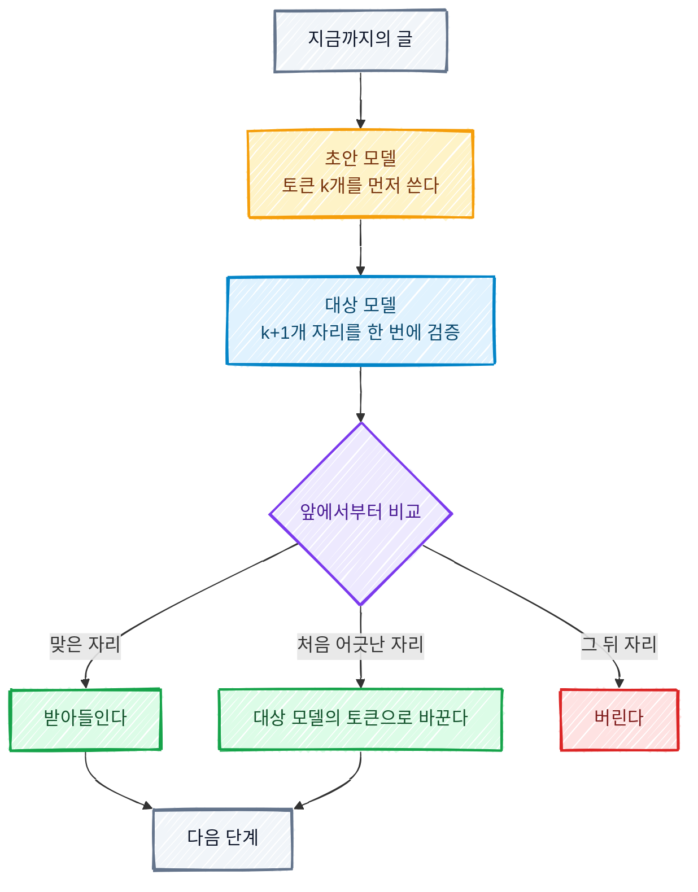
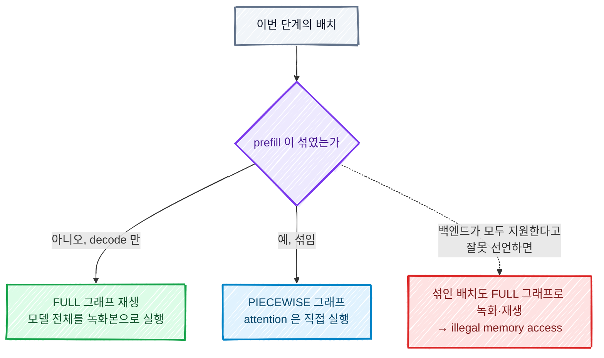

# 추측 디코딩과 vLLM 적응형 검증

> [GPU로 LLM을 서빙한다는 것](./gpu-llm-serving-basics.md)과 [배칭과 GPU 활용률](./continuous-batching-gpu-utilization.md)을 먼저 읽으면 쉽다. 「decode 는 메모리 대역폭이 병목이라 연산이 남는다」 는 결론을 전제로 쓴다.

추측 디코딩은 작은 모델이 토큰 여러 개를 먼저 쓰고, 큰 모델이 그것을 한 번에 검사해 맞은 데까지만 받아들이는 기법이다.
남는 연산으로 토큰을 여러 개 미리 계산해 응답을 빠르게 한다.
그런데 동시 요청이 몰려 연산이 남지 않게 되면 같은 기법이 처리량을 깎는다.
vLLM 의 적응형 검증은 이 지점을 다루는 기능으로, 초안 가운데 맞을 가능성이 높은 자리만 골라 검증한다.

이 글은 다음 순서로 정리한다.

- 추측 디코딩이 속도, 메모리, 정확도에 주는 영향
- 초안을 길게 쓸수록 뒤 자리가 버려지는 이유와 손해가 시작되는 지점
- 적응형 검증이 아끼는 것과 그 동작
- 이 기능이 GPU 오류와 엮인 사례(vLLM 이슈 #59970)
- 운영에서 무엇을 끄고 무엇을 잴지 정하는 방법

vLLM 의 동작은 2026년 11월 14일의 main 브랜치 문서와 소스, 그리고 v0.31.0 에서 보고된 이슈를 읽고 확인한 범위에서 쓴다.
확인하지 못한 것은 그렇게 적는다.

## 추측 디코딩이란

LLM 은 토큰을 한 번에 하나씩 만든다.
토큰 하나를 만들 때마다 큰 모델의 가중치 전체를 메모리에서 읽어야 해서, 요청이 적을 때는 GPU 의 연산 유닛 대부분이 논다.

**Speculative decoding**(추측 디코딩)은 그 노는 연산을 쓴다.
등장하는 역할은 둘이다.

- **Draft model**(초안 모델): 작고 빠른 모델. 다음 토큰 k개를 먼저 써 본다.
- **Target model**(대상 모델): 실제로 서빙하려는 큰 모델. 초안 k개를 한 번의 실행으로 검증한다.

대상 모델은 원래 「지금까지의 글」 을 넣으면 다음 토큰 하나의 확률을 낸다.
여기에 초안 k개를 붙여 넣으면 k+1개 자리의 확률을 한 번에 낸다.
가중치를 읽는 횟수는 그대로 한 번이고 계산만 k+1배가 된다.
그 결과를 초안과 앞에서부터 비교해, 처음 어긋난 자리 직전까지를 받아들인다.
어긋난 자리에는 대상 모델이 직접 고른 토큰을 넣는다.
그래서 초안이 전부 틀려도 한 단계에 토큰 하나는 나온다.



### 백엔드 개념에 빗대면

| 백엔드 개념 | 추측 디코딩에서 대응하는 것 |
| --- | --- |
| 낙관적 잠금 | 충돌이 없으리라 보고 먼저 진행한 뒤 커밋 시점에 버전을 확인한다. 초안을 먼저 쓰고 검증에서 어긋나면 그 뒤를 버리는 것과 같다. 충돌이 잦으면 재시도 비용이 이득을 넘는 점도 같다. |
| 배치 검증 | 건마다 왕복하지 않고 여러 건을 한 번의 호출로 검사한다. 대상 모델의 실행 한 번에 k+1개 자리를 태운다. |
| 미리 읽기(read-ahead) | 다음에 쓸 것 같은 블록을 미리 읽어 둔다. 예측이 맞으면 대기가 사라지고, 틀리면 읽은 만큼이 낭비다. |
| CPU 분기 예측 | 분기 결과를 추측해 먼저 실행하고 틀리면 되돌린다. 결과는 언제나 같고 속도만 달라진다. |

### 속도, 메모리, 정확도에 주는 영향

| 항목 | 영향 |
| --- | --- |
| 속도 | 요청이 적을 때는 토큰 사이 지연이 준다. 한 단계에 평균 몇 토큰이 나오느냐가 이득의 크기다. 요청이 많아 GPU 연산이 꽉 차면 버려지는 초안만큼 처리량이 줄 수 있다. |
| 메모리 | 초안 모델의 가중치와 초안용 KV cache 가 GPU 메모리에 더 올라간다. 그만큼 대상 모델의 KV cache 로 쓸 공간이 준다. |
| 정확도 | 원 논문의 검증 규칙(rejection sampling)을 따르면 출력 분포가 대상 모델만 쓸 때와 같다. 품질을 내주고 속도를 얻는 기법이 아니다. 다만 구현에서는 여러 자리를 한 번에 계산하면서 생기는 수치 차이로 토큰이 드물게 달라진다는 보고가 있다([PR #62535](https://github.com/vllm-project/vllm/pull/62535)의 Notes). |

vLLM 문서도 추측 디코딩을 「QPS 가 중간 이하이고 메모리가 병목인 부하에서 토큰 사이 지연을 줄이는 기법」 으로 소개한다.
언제 이득인지가 부하에 달려 있다는 뜻이고, 뒤에서 다룰 적응형 검증이 나온 이유다.

## 수락률과 추측 토큰 수

### 뒤 자리 수락률이 급하게 떨어지는 이유

**Acceptance rate**(수락률)는 초안 토큰이 검증을 통과한 비율이다.
자리별로 보면 뒤로 갈수록 급하게 떨어진다.
3번째 자리가 받아들여지려면 1번째와 2번째가 먼저 맞아야 하기 때문이다.
한 자리라도 어긋나면 그 뒤는 맞았더라도 버린다.
앞 토큰이 달라지면 뒤 토큰의 전제가 바뀌기 때문이다.

호출 일곱 개를 순서대로 이어 붙인 체인에서 각 호출의 성공률이 55%라면, 일곱 번째까지 성공할 확률은 0.55를 일곱 번 곱한 1.5%다.
자리마다의 실력은 비슷해도 연달아 맞을 확률은 곱으로 줄어든다.

사내에서 대형 MoE 모델을 추측 토큰 7개로 서빙하며 잰 자리별 수락률이 이 모양이었다.

| 자리 | 그 자리까지 수락된 비율 | 앞 자리가 맞았을 때 이 자리도 맞은 비율 |
| --- | --- | --- |
| 1 | 43.7% | 43.7% |
| 2 | 22.0% | 50.3% |
| 3 | 11.9% | 54.1% |
| 4 | 6.8% | 57.1% |
| 5 | 4.3% | 63.2% |
| 6 | 2.7% | 62.8% |
| 7 | 1.6% | 59.3% |

가운데 열이 잰 값이고 오른쪽 열은 그 값을 앞 자리 값으로 나눈 것이다.
오른쪽 열을 보면 초안 모델이 뒤 자리에서 못 쓰는 것이 아니다. 자리마다 50%에서 60% 사이로 비슷하다.
가운데 열이 급락하는 것은 그 비율이 계속 곱해지기 때문이다.

### 평균 수락 길이

**Mean acceptance length**(평균 수락 길이)는 검증 한 단계에 나오는 평균 토큰 수다.
vLLM 문서의 정의는 `1 + 수락된 초안 토큰 수 / 검증 단계 수` 이고, 앞의 1은 대상 모델이 직접 고르는 토큰이다.
위 표의 가운데 열을 모두 더하면 0.93이므로 평균 수락 길이는 1.93이다.
검증 한 번에 8개 자리를 계산해 평균 1.93개를 얻는다는 뜻이다.

### 토큰 수를 늘리면 손해인 지점

같은 자리별 수락률에서 추측 토큰 수 k만 줄였다고 가정하고 계산한 표다.
k를 바꿔 직접 잰 값이 아니다. 초안 모델이 k에 따라 앞 자리를 다르게 쓰면 실제 값은 달라진다.

| k | 한 단계에 계산하는 자리 수 | 평균 수락 길이 | 계산한 자리당 얻는 토큰 | 마지막 자리가 보탠 토큰 |
| --- | --- | --- | --- | --- |
| 0 (추측 없음) | 1 | 1.00 | 1.00 | |
| 1 | 2 | 1.44 | 0.72 | 0.437 |
| 2 | 3 | 1.66 | 0.55 | 0.220 |
| 3 | 4 | 1.78 | 0.44 | 0.119 |
| 4 | 5 | 1.84 | 0.37 | 0.068 |
| 5 | 6 | 1.89 | 0.31 | 0.043 |
| 6 | 7 | 1.91 | 0.27 | 0.027 |
| 7 | 8 | 1.93 | 0.24 | 0.016 |

이 표는 부하에 따라 다르게 읽는다.

- **요청이 적을 때**: GPU 연산이 남아서 자리를 더 계산하는 비용이 거의 없다. 평균 수락 길이 열을 본다. k가 7이면 단계 수가 1.93분의 1로 줄어 응답이 빨라진다. 다만 5에서 7로 늘려 얻는 것은 1.89에서 1.93으로 약 2%뿐이다.
- **요청이 많아 연산이 꽉 찼을 때**: 계산한 자리 수가 곧 비용이다. 계산한 자리당 얻는 토큰 열을 본다. k가 7이면 자리당 0.24토큰으로, 추측 없이 자리당 1토큰을 얻을 때보다 같은 출력에 연산을 약 4배 쓴다. 초안 모델을 돌리는 비용은 여기에 더해진다.

두 번째 경우에 「연산을 4배 쓴다」 는 것은 검증 비용이 자리 수에 비례한다고 단순하게 본 계산이다.
실제 손익은 GPU 가 얼마나 찼는지에 따라 그 사이 어딘가에 놓인다.
방향은 분명하다. 수락률이 이 정도일 때 뒤쪽 서너 자리는 한가할 때도 얻는 것이 거의 없고 바쁠 때는 비용만 낸다.

vLLM 에 이 기능을 넣은 [PR #47808](https://github.com/vllm-project/vllm/pull/47808)도 같은 현상을 측정해 보고했다.
평균 수락 길이가 3.9 정도로 훨씬 좋은 구성에서도, 동시 요청 256에서는 초안 7개를 고정으로 검증하는 쪽이 추측을 아예 안 쓰는 쪽보다 처리량이 33% 낮았다.

## 적응형 검증

### 무엇을 아끼는가

고정된 k는 부하가 낮을 때 맞춘 값이 부하가 높을 때 손해가 되고, 반대로 맞추면 한가할 때 이득을 버린다.
vLLM 문서의 표현으로는 「손익이 바뀌는 지점이 부하와 수락률에 따라 움직여서, 어떤 고정값도 모든 동시 요청 수에서 옳지 않다」.

**Adaptive verification**(적응형 검증)은 초안은 그대로 k개를 쓰게 두고, 대상 모델이 **검증할 자리 수**를 단계마다 정한다.
아끼는 것은 대상 모델의 연산이다. 맞을 가능성이 낮은 자리를 검증에서 빼서 그 연산을 다른 요청의 토큰에 쓴다.

커넥션 풀에 빗대면 이렇다.
풀이 한가할 때는 성공 가능성이 낮은 미리 읽기 쿼리도 보낸다. 어차피 노는 커넥션이기 때문이다.
풀이 꽉 차면 성공 가능성이 높은 쿼리만 보내고 나머지는 접는다.
이 판단을 요청마다 따로 하지 않고 배치 전체에서 순위를 매겨서 한다.

### 동작

vLLM 문서와 `vllm/v1/worker/gpu/spec_decode/adaptive_verification.py` 에서 확인한 순서다.

1. **자리마다 점수를 매긴다.** 점수는 그 자리까지 연달아 맞을 확률인 생존 확률(survival probability)이고, 요청의 자리별 수락 추정값을 앞에서부터 곱한 값이다. 앞 절 표의 가운데 열과 같은 종류의 값을 요청마다 실시간으로 추정한다.
2. **배치 전체에서 점수가 높은 자리부터 뽑는다.** 요청끼리 경쟁한다. 자신 있는 요청의 5번째 자리가 자신 없는 요청의 1번째 자리보다 먼저 뽑힐 수 있다. 생존 확률은 뒤로 갈수록 줄기만 하므로 뽑힌 자리는 언제나 각 요청의 앞쪽 연속 구간이 된다.
3. **몇 자리까지 뽑을지는 비용 모델이 정한다.** 서버가 뜰 때 배치 크기별로 한 단계의 실행 시간을 재어 표로 만들어 둔다. 단계마다 「예상 수락 토큰 수 ÷ 예상 실행 시간」 이 가장 큰 자리 수를 고른다. 소스의 `get_num_tokens` 가 이 계산을 한다.

자리별 수락 추정값의 출처는 초안 방식에 따라 다르다.

| 초안 방식 | 추정값의 출처 |
| --- | --- |
| confidence head 가 있는 DSpark 체크포인트 | 함께 학습된 confidence head 의 예측값 |
| 그 밖의 모델 기반 초안(EAGLE, MTP, DFlash 등) | 초안의 logit 으로 수락 여부를 예측하는 작은 로지스틱 모델. 서빙 중에 실제 검증 결과로 계속 보정한다 |
| suffix decoding | 초안 logit 이 없어, 같은 출처·일치 길이·자리의 과거 수락률을 쓴다 |

### 켜는 방법과 제약

기본값은 꺼짐이고 추측 설정에 `enable_adaptive_verification` 을 넣어 켠다.

```bash
vllm serve <대상 모델> \
  --speculative-config '{
    "method": "dspark",
    "model": "<초안 모델>",
    "num_speculative_tokens": 7,
    "enable_adaptive_verification": true
  }'
```

문서가 밝힌 제약 가운데 뒤의 사례와 이어지는 것은 둘이다.

- **full CUDA graph 가 필요하다.** 단계 비용을 캡처한 그래프로 재기 때문에 `--enforce-eager` 는 시작할 때 거부된다.
- **attention 백엔드가 GPU 에서 정해지는 길이를 견뎌야 한다.** 요청마다 몇 자리를 검증할지가 GPU 에서 정해지고, CPU 가 아는 길이는 그 상한일 뿐이다. CPU 쪽 길이로 실행 계획을 짜는 백엔드는 쓸 수 없다.

LoRA 와 pipeline parallelism 은 함께 쓸 수 없다.

### 언제 이득인가

| 상황 | 적응형 검증의 효과 |
| --- | --- |
| 동시 요청이 적다 | 예산이 초안 전부를 덮어 고정 k와 같게 동작한다. PR #47808 의 측정으로는 동시 요청 64 이하에서 고정 k와 ±3% 안이었다. |
| 동시 요청이 많다 | 가능성 낮은 자리를 빼서, 고정 k라면 추측 없음보다 느려질 구간에서도 추측의 이득을 지킨다. |
| 부하가 오르내린다 | 설정 하나가 전 구간에서 버틴다. 배포마다 k를 따로 맞출 필요가 줄어든다. |
| 수락률이 원래 낮다 | 낮은 자리가 알아서 빠지므로 k를 크게 잡은 손해가 줄어든다. 그래도 초안 모델은 k개를 다 쓰므로 초안 비용은 남는다. |

마지막 줄은 문서와 소스를 읽고 내린 추론이다.
수락률이 낮은 구성에서 이 기능이 처리량을 얼마나 올리는지 직접 잰 수치는 찾지 못했다.

## 적응형 검증이 GPU 오류와 엮인 사례

사내에서 대형 MoE 모델을 서빙하다가, 동시 요청이 몰릴 때 vLLM 이 `CUDA error: an illegal memory access was encountered` 로 멈춘 일이 있었다.
한 번은 오류 스택이 `adaptive_verification.py` 의 `record_confidences` 를 가리켰다.
같은 위치와 조건으로 보고된 것이 [vLLM 이슈 #59970](https://github.com/vllm-project/vllm/issues/59970)이다.
이 사례를 이해하려면 개념 셋이 필요하다.

### CUDA graph: 녹화해 두고 재생하는 실행

GPU 연산은 CPU 가 「이 연산을 이 주소의 데이터에 실행하라」 는 명령을 하나씩 보내서 돌아간다.
모델 한 번 실행에 이런 명령이 수천 개고, 보내는 일 자체가 지연이 된다.
**CUDA graph** 는 이 명령 열을 한 번 녹화해 두었다가 통째로 재생하는 기능이다.
매번 SQL 을 파싱하지 않고 실행 계획을 캐시해 재사용하는 것과 비슷하다.

대가는 **녹화한 모양 그대로만 재생한다**는 것이다.
녹화할 때의 배치 크기, 버퍼 주소, 분기 결과가 그래프에 굳는다.
그래서 vLLM 은 배치 크기별로 그래프를 여러 개 녹화해 두고, 들어온 배치에 맞는 것을 골라 재생한다.

vLLM 의 `cudagraph_mode` 는 무엇을 녹화할지 정한다.

| 실행 방식 | 녹화 범위 | 특징 |
| --- | --- | --- |
| FULL | attention 을 포함한 모델 전체 | 가장 빠르다. attention 백엔드가 그 배치 모양의 녹화를 지원해야 한다 |
| PIECEWISE | attention 을 뺀 나머지 조각들 | attention 은 매번 직접 실행한다. 어떤 백엔드와도 맞는다 |
| 녹화 없음(eager) | 없음 | 가장 느리고 가장 유연하다 |

기본값인 `FULL_AND_PIECEWISE` 는 둘을 섞는다.
모양이 고른 decode 배치는 FULL 그래프로, 그 밖의 배치는 PIECEWISE 그래프로 보낸다.
`FULL_DECODE_ONLY` 는 decode 배치만 FULL 그래프로 돌리고 나머지는 녹화 없이 실행한다.

### prefill 과 decode 가 섞인 배치

요청 하나는 프롬프트 전체를 읽는 **prefill** 과 토큰을 하나씩 만드는 **decode** 를 차례로 거친다.
continuous batching 은 단계마다 배치를 새로 짜므로, 동시 요청이 많으면 새 요청의 prefill 과 진행 중인 요청의 decode 가 한 배치에 섞인다.

decode 만 있는 배치는 요청마다 자리 수가 같아서(추측 디코딩이면 1+k) 모양이 고르다.
prefill 이 섞이면 어떤 요청은 수천 자리, 어떤 요청은 몇 자리여서 모양이 제각각이다.
vLLM 문서는 앞의 것을 uniform decode, 뒤의 것을 non-uniform 배치라고 부르며, 여러 attention 백엔드가 uniform 배치에서만 FULL 그래프를 지원한다고 적는다.



### illegal memory access 와 엉뚱한 스택

illegal memory access 는 GPU 코드가 자기 것이 아닌 메모리 주소를 건드렸다는 오류다.
JVM 이라면 `ArrayIndexOutOfBoundsException` 으로 그 자리에서 멈췄을 일인데, GPU 커널에는 경계 검사가 없어서 네이티브 코드의 segfault 에 가깝게 터진다.
녹화한 모양과 다른 배치를 그래프로 재생하면 그래프 안의 길이와 주소가 실제 데이터와 맞지 않아 이런 접근이 생길 수 있다.

스택이 가리키는 자리는 원인이 아닐 수 있다.
GPU 연산은 비동기다. CPU 는 명령을 큐에 넣고 바로 다음 줄로 넘어가고, 오류는 CPU 가 GPU 를 기다리는 다음 지점에서 보고된다.
`CompletableFuture` 안에서 난 예외가 `join()` 을 부른 줄의 스택으로 나오는 것과 같다.

`record_confidences` 는 이번 단계의 자리별 추정값을 CPU 로 복사하기 시작하는 함수이고, 첫머리에서 지난 단계의 복사가 끝났는지 `synchronize()` 로 기다린다.
여기가 그 「기다리는 지점」 이다.
이슈 작성자도 「오류가 비동기여서 이 프레임은 보고된 자리일 뿐」 이라고 적었다.

### 이슈 #59970 의 내용

v0.31.0, DeepSeek-V4.1-Flash, GPU 2장 구성에서 보고됐다.
동시 스트림 96개, 프롬프트 0.6K에서 118K 토큰의 멀티턴 부하를 걸면 30초에서 60초 사이에 엔진이 죽었고, 4번 시도해 4번 재현됐다.
작성자가 조건을 하나씩 바꿔 잰 결과가 원인을 좁힌다.

| 적응형 검증 | cudagraph_mode | 결과 |
| --- | --- | --- |
| 켬 | `FULL_AND_PIECEWISE` | 동시 96에서 1분 안에 오류 (4/4) |
| 끔 | `FULL_AND_PIECEWISE` | 안정. 동시 96에서 30분, 128에서 15분 |
| 켬 | `FULL_DECODE_ONLY` | 안정. 동시 128에서 15분 |

기능을 꺼도, prefill 이 섞인 배치를 그래프 밖으로 빼도 안정됐다.
처리량은 동시 128에서 GPU 당 초당 1,643토큰과 1,608토큰으로, 작성자는 오차 범위 안에서 같다고 적었다.
어느 수치가 어느 조건인지는 문장만으로는 분명하지 않다. 꺼서 잃는 처리량이 2% 안팎이었다는 것까지가 확인된 내용이다.

원인은 수정 PR 인 [#59986](https://github.com/vllm-project/vllm/pull/59986)에 적혀 있다.
이 모델 전용 attention 메타데이터 빌더 다섯 개가 「어떤 배치든 FULL 그래프를 지원한다」(`AttentionCGSupport.ALWAYS`)고 선언하고 있었다.
그래서 prefill 이 섞인 배치까지 FULL 그래프로 녹화됐는데, prefill 쪽 메타데이터는 녹화해도 안전한 형태가 아니었다.
수정은 선언을 「고른 배치만 지원」(`UNIFORM_BATCH`)으로 내리고, 길이가 1+k 이하인 decode 배치만 FULL 그래프에 남기는 것이다.
앞서 일반 백엔드에 같은 수정을 한 [PR #59751](https://github.com/vllm-project/vllm/pull/59751)을 따랐다.
PR #59986 은 2026년 10월 27일에 병합됐다. v0.32.0 릴리스(10월 18일)보다 뒤여서 그 뒤 릴리스부터 들어간다.

확인하지 못한 것도 있다.

- 같은 `FULL_AND_PIECEWISE` 에서 적응형 검증만 끄면 왜 안정되는지는 이슈와 PR 이 설명하지 않는다. 적응형 검증이 길이가 제각각인 decode 그래프를 쓰고 그 조건으로 `ALWAYS` 선언을 요구한다는 점(PR #47808 의 설계 설명)까지는 확인했다. 그것이 어떻게 오류로 이어지는지는 추론의 영역이다.
- 수정 PR 의 작성자는 이슈의 하드웨어에서 재현 검증을 하지 못했다고 밝혔다. 단위 테스트로 선언이 바뀐 것만 확인했다.
- 다른 기여자는 10월 23일의 main 과 후속 체크포인트로 같은 설정을 10분간 돌렸는데 재현하지 못했다고 댓글을 남겼다. 수정이 병합되기 전이므로, 다른 변경으로 이미 조건이 바뀌었을 수 있다.

### 우리 증상과 대조

| 항목 | 이슈 #59970 | 우리가 겪은 것 |
| --- | --- | --- |
| 오류 | illegal memory access | 같다 |
| 스택 위치 | `record_confidences` 의 동기화 지점 | 두 번 가운데 한 번이 같다 |
| 발생 조건 | 동시 요청이 많고 prefill 과 decode 가 섞일 때 | 동시 요청이 몰릴 때 |
| 추측 설정 | DSpark, 추측 토큰 5개, 적응형 검증 켬 | DSpark 계열 초안, 추측 토큰 7개, 적응형 검증 켬 |
| 모델 | DeepSeek-V4.1-Flash | 다른 대형 MoE 모델 |

닮은 점이 많지만 같은 원인이라고 단정할 근거는 아직 없다.

- 스택 위치가 같다는 것은 근거가 약하다. 그 자리는 GPU 오류가 보고되는 지점이어서, 원인이 무엇이든 적응형 검증을 켠 서버에서는 여기에 걸리기 쉽다.
- 수정 PR 은 이슈의 모델 전용 빌더 다섯 개만 고쳤다. 다른 모델은 다른 빌더를 쓰므로, 수정이 들어간 버전으로 올려도 우리 경로가 고쳐졌다는 보장이 없다. 우리 모델의 빌더가 무엇을 선언하는지 따로 확인해야 한다.
- 두 번 가운데 나머지 한 번은 스택이 달랐다. 원인이 둘일 가능성을 열어 둔다.

그래서 운영 판단은 「이슈와 같으니 이렇게 고친다」 가 아니라 「이슈가 쓴 방법으로 우리 환경에서 조건을 하나씩 확인한다」 로 잡는다.

## 운영 판단

### 바꿀 수 있는 것

| 선택지 | 기대하는 것 | 치르는 것 |
| --- | --- | --- |
| 적응형 검증만 끈다 | 이슈에서 안정된 조건이다 | 초안 7개를 전부 검증한다. 우리 수락률에서는 바쁠 때 자리당 0.24토큰이어서 처리량이 떨어질 수 있다 |
| 추측 토큰 수를 줄인다(7 → 2나 3) | 버려지는 검증이 준다. 수락 길이는 1.93에서 1.7 안팎으로 조금 준다 | 한가할 때의 지연 이득이 약간 준다. 오류가 사라지는지는 알 수 없다 |
| `FULL_DECODE_ONLY` 로 바꾼다 | 이슈에서 안정된 또 하나의 조건이다. 적응형 검증을 유지한다 | prefill 과 섞인 배치가 녹화 없이 실행돼 그 구간이 느려진다 |
| 추측 디코딩을 끈다 | 기준선이다. 초안 모델의 메모리도 돌려받는다 | 한가할 때의 지연 이득을 모두 잃는다 |
| 수정이 들어간 버전으로 올린다 | 원인이 같다면 근본 해결이다 | 우리 모델의 경로가 수정 범위에 드는지 먼저 확인해야 한다. 버전을 올리면 다른 것도 함께 바뀐다 |

수락률을 보면 첫 두 선택지를 함께 쓰는 쪽으로 기운다.
적응형 검증을 끄면 낮은 자리를 빼 주는 장치가 사라지므로, 고정 k를 수락률에 맞게 내려야 한다.
자리별 수락률이 43.7%, 22.0%로 시작하는 구성에서 3번째 뒤로는 얻는 것이 한 자리 0.1토큰 안팎이다.
다만 이것은 계산이고, 정하는 것은 측정이다.

### 한 번에 하나씩 바꾸고 잰다

둘을 한꺼번에 바꾸면 오류가 사라져도 무엇 덕인지 알 수 없고, 처리량이 변해도 무엇 탓인지 알 수 없다.
이슈 작성자의 표가 설득력이 있는 이유도 같은 노드, 같은 부하에서 조건 하나만 바꿨기 때문이다.

1. **부하를 고정한다.** 동시 요청 수를 고정한 closed-loop 부하를 쓴다. 프롬프트 길이 분포, 출력 길이, 난수 시드를 기록해 매번 같게 건다. prefill 과 decode 가 섞이도록 긴 프롬프트와 멀티턴을 넣는다.
2. **기준선을 먼저 잰다.** 지금 설정으로 오류가 재현되는지와 재현까지 걸리는 시간을 잰다. 재현되지 않는 부하로는 「고쳐졌다」 를 말할 수 없다.
3. **조건을 하나만 바꾼다.** 아래 표에서 한 줄씩 진행한다.
4. **같은 지표를 본다.** GPU 당 초당 출력 토큰, 첫 토큰까지의 시간과 토큰 사이 지연의 p99, 자리별 수락률과 평균 수락 길이, 오류 없이 버틴 시간이다.
5. **충분히 오래 돌린다.** 이슈에서는 1분 안에 죽었지만 안정 확인에는 15분에서 30분을 썼다. 재현에 걸린 시간의 몇 배를 버텨야 안정됐다고 본다.

| 순서 | 바꾸는 것 하나 | 답하려는 질문 |
| --- | --- | --- |
| 0 | 없음(현재 설정) | 이 부하로 오류가 재현되는가 |
| 1 | 적응형 검증 끔 | 이 기능이 오류의 조건인가. 처리량은 얼마나 변하는가 |
| 2 | 1에서 추측 토큰 수 7 → 3 | 고정 k를 줄이면 처리량이 돌아오는가 |
| 3 | 0에서 `FULL_DECODE_ONLY` 만 | 섞인 배치의 FULL 그래프가 조건인가 |
| 4 | 추측 디코딩 끔 | 추측 디코딩이 이 부하에서 이득이기는 한가 |

4번은 빼기 쉬운데 가장 중요한 기준선이다.
평균 수락 길이가 1.93인 구성이라면 동시 요청이 많은 구간에서 추측 디코딩이 없는 쪽이 빠를 수 있다.
PR #47808 의 측정에서 수락 길이가 두 배인 구성도 고정 k로는 그랬다.

수락률은 부하의 종류에 따라 달라진다. 코드 생성처럼 반복이 많은 출력은 높고 자유로운 글은 낮다.
측정에 쓴 부하가 실제 트래픽과 닮았는지 확인하고, 설정을 정한 뒤에도 수락률 지표를 계속 본다.
vLLM 은 서버 집계 지표를 `/metrics` 로 내고, 요청별 값은 `--per-request-spec-decode-metrics` 로 켠다(문서에 실험 기능이라고 적혀 있다).

## 마무리

- 추측 디코딩은 남는 연산으로 토큰을 미리 계산하는 기법이다. 원 논문의 검증 규칙에서는 출력 분포가 바뀌지 않는다. 이득은 연산이 남을 때만 온전하다.
- 뒤 자리 수락률은 곱으로 줄어든다. 평균 수락 길이와 함께 「계산한 자리당 얻는 토큰」 을 봐야 바쁠 때의 손익이 보인다.
- 적응형 검증은 검증할 자리를 배치 전체에서 골라 대상 모델의 연산을 아낀다. 부하가 오르내리는 서버에서 설정 하나로 버티게 해 준다.
- 이 기능은 길이가 제각각인 배치를 FULL CUDA graph 로 재생하는 경로를 쓴다. attention 백엔드의 지원 선언이 틀리면 GPU 메모리 오류로 이어질 수 있고, 스택은 원인이 아닌 동기화 지점을 가리킨다.
- 같은 증상이 같은 원인이라는 보장은 없다. 같은 부하에서 조건을 하나씩 바꿔 재는 것이 원인과 설정을 함께 정하는 방법이다.

## 참고 링크

vLLM 문서와 소스(2026년 11월 14일의 main 기준)

- [Speculative Decoding](https://docs.vllm.ai/en/latest/features/speculative_decoding/)
- [Adaptive Verification](https://github.com/vllm-project/vllm/blob/main/docs/features/speculative_decoding/adaptive_verification.md)
- [Per-Request Acceptance Metrics](https://github.com/vllm-project/vllm/blob/main/docs/features/speculative_decoding/acceptance_metrics.md)
- [CUDA Graphs](https://docs.vllm.ai/en/latest/design/cuda_graphs/)
- [`adaptive_verification.py`](https://github.com/vllm-project/vllm/blob/main/vllm/v1/worker/gpu/spec_decode/adaptive_verification.py)

이슈와 PR

- [이슈 #59970](https://github.com/vllm-project/vllm/issues/59970): 적응형 검증과 `FULL_AND_PIECEWISE` 에서 동시 prefill 중 illegal memory access
- [PR #59986](https://github.com/vllm-project/vllm/pull/59986): 이슈 #59970 의 수정. 모델 전용 빌더의 prefill 을 FULL 그래프에서 뺀다
- [PR #59751](https://github.com/vllm-project/vllm/pull/59751): 일반 백엔드에 먼저 들어간 같은 종류의 수정
- [PR #47808](https://github.com/vllm-project/vllm/pull/47808): 적응형 검증을 도입한 PR. 동시 요청 수별 처리량 측정이 있다

논문

- [Fast Inference from Transformers via Speculative Decoding](https://arxiv.org/abs/2211.17192) (Leviathan 외, 2023)
- [Accelerating Large Language Model Decoding with Speculative Sampling](https://arxiv.org/abs/2302.01318) (Chen 외, 2023)
