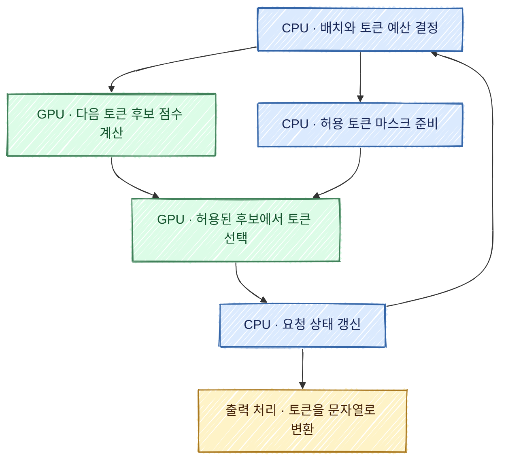

# vLLM의 스케줄러 루프가 CPU에 묶이면 왜 GPU가 쉬는가

**이전 글** [vLLM 서버 옵션 지도](./vllm-serving-options.md) · **다음 글** [vLLM prefix cache를 살리는 프롬프트 배치](./vllm-prefix-cache-prompt-layout.md) · [시리즈 목차](../README.md)

GPU에서 다음 토큰을 계산할 준비가 됐어도 CPU가 배치 구성이나 문법 마스크를 늦게 넘기면 계산 사이에 빈 시간이 생긴다. 같은 반복을 기다리는 자유 텍스트 요청도 다음 토큰을 늦게 받는다. 이 글은 vLLM v0.23.0의 V1 엔진을 기준으로 그 지연이 어디에서 생기는지 살펴본다.

## 한 반복에서 CPU와 GPU가 하는 일

모델은 입력을 읽는 **prefill**(입력 계산)을 거쳐 **decode**(출력 생성)를 시작한다. 스케줄러는 매 반복마다 요청별로 계산할 토큰과 필요한 KV cache 블록을 정한다. GPU가 모델을 실행하는 동안 엔진은 구조화 출력 요청에 쓸 **grammar mask**(문법 마스크)를 준비할 수 있다. JSON 스키마가 허용하는 다음 토큰만 남긴 뒤 GPU가 토큰을 고른다. 엔진은 반환된 토큰을 반영해 요청을 계속 실행할지 결정한다. [vLLM 엔진 루프](https://github.com/vllm-project/vllm/blob/v0.23.0/vllm/v1/engine/core.py#L443)

구조화 출력은 응답을 받은 뒤 Jackson으로 파싱하는 작업보다 앞에서 일어난다. 예를 들어 허용된 값이 `"ok"`와 `"retry"`라면, 모델이 값을 쓰는 중간에도 문법 상태를 따라 다음 후보를 제한한다. 스키마에서 문법을 준비하는 초기 비용과 토큰마다 문법 상태를 갱신하는 비용이 각각 든다. 추론이 끝난 뒤에만 문법을 적용하는 설정에서는 모델별 파서가 추론 종료를 확인한다. vLLM은 스트리밍 검사에 전체 토큰과 새 구간을 모두 넘기므로, 비용은 파서가 어느 구간을 얼마나 살피는지에 달려 있다. [구조화 출력 상태 전이](https://github.com/vllm-project/vllm/blob/v0.23.0/vllm/v1/structured_output/__init__.py#L302)

**Detokenization**(디토크나이즈)은 토큰 ID를 스트리밍할 문자열로 바꾸는 일이다. V1의 출력 처리기가 이 일과 종료 문자열 검사를 맡는다. 출력 처리기가 느리면 GPU가 쉬지 않아도 클라이언트에 토큰이 늦게 보일 수 있다. 엔진의 토큰 생성 시간과 클라이언트의 스트림 도착 시간을 따로 보면 두 경우를 구별할 수 있다. [V1 출력 처리기](https://github.com/vllm-project/vllm/blob/v0.23.0/vllm/v1/engine/output_processor.py#L639)

## 한 요청의 비용이 배치로 퍼지는 조건

모델 계산이 끝나도 마스크가 준비되지 않으면 토큰 선택이 기다린다. 다음 배치에 필요한 상태 갱신이나 스케줄링이 늦어져도 GPU에 보낼 작업이 비는 구간이 생길 수 있다. 같은 반복에 들어간 응답은 그 구간을 같이 통과한다. Java 이벤트 루프에서 한 콜백이 오래 걸리면 같은 루프의 다른 연결까지 차례를 기다리는 모습과 비슷하다.

출력이 길면 반복 횟수가 늘고, KV cache 슬롯과 배치 자리를 더 오래 쓴다. 반복마다 새 토큰만 검사한다면 CPU 누적 비용은 대체로 반복 수에 비례한다. 반대로 파서나 문자열 변환이 매번 지금까지의 출력 전체를 다시 훑는다면 출력 후반으로 갈수록 반복 비용도 커질 수 있다. 어떤 경우인지 보려면 같은 요청의 초반과 후반을 나눠 CPU 스택과 토큰 간격을 비교한다.

## 지표로 범위를 좁히고 프로파일로 확인하기

| 관측 | 확인할 것 |
| --- | --- |
| 실행 중인 요청은 많은데 GPU 사용률과 초당 출력 토큰이 떨어지고 토큰 사이 지연(ITL)이 늘었다 | 엔진 CPU 스택과 GPU 타임라인을 같은 부하에서 확인한다. 마스크, 상태 갱신 또는 스케줄링 사이에 GPU 작업이 비는지 본다. |
| 대기열과 첫 토큰 시간(TTFT)이 늘었다 | 실행 요청이 동시 처리 상한에 닿았는지, prefill이 오래 걸리는지 본다. KV cache 사용률과 선점 횟수도 확인한다. |
| 클라이언트 토큰 간격만 늘었다 | 출력 처리기의 디토크나이즈와 종료 문자열 검사, 스트리밍 전송 구간을 본다. |

vLLM의 `inter_token_latency_seconds`, `request_queue_time_seconds`, `num_requests_running`, `iteration_tokens_total`과 GPU 사용률을 같은 시간축에 놓는다. p50과 p95를 함께 보며 짧은 자유 텍스트 요청만 보내는 경우와 구조화 출력 요청을 섞은 경우를 비교한다. 입력 길이, 출력 상한, 동시 요청 수, 캐시 예열 조건을 맞춘다. 스키마 첫 사용과 재사용 구간을 구분하고 실제 생성 토큰 수와 종료 사유를 함께 기록한다. [vLLM 지표](https://docs.vllm.ai/en/v0.23.0/usage/metrics/)

`py-spy`로 엔진 프로세스와 API 프로세스를 따로 샘플링하면 Python 호출 스택에서 시간을 쓰는 위치를 좁힐 수 있다. GPU 트레이스에서는 커널 뒤에 다음 작업이 비는 구간을 찾는다. CPU 샘플과 GPU의 빈 구간이 같은 부하에서 함께 늘어나는지 봐야 GPU 사용률 하락을 CPU 병목으로 설명할 수 있다. [vLLM 프로파일링 안내](https://docs.vllm.ai/en/v0.23.0/contributing/profiling/)

## 원인에 맞춰 반복 비용을 줄이기

- 출력이 길어 자리가 오래 점유되면 요청별 출력 상한을 둔다. 상한에서 잘린 JSON은 성공으로 처리하지 않고, 같은 입력을 자동으로 반복하는 경로에도 횟수 제한을 둔다.
- JSON 필드 사이의 선택적 공백처럼 불필요한 출력을 문법으로 제한한다. 사용하는 백엔드가 스키마를 지원하는지, 실제 문자열 값과 정상 응답을 유지하는지 확인한다.
- 긴 prefill이 decode를 밀어내면 `--max-num-batched-tokens`를 조정한다. `--max-num-seqs`는 한 반복에 드는 요청별 작업과 대기열 사이의 균형을 바꾸므로 ITL, TTFT와 전체 처리량을 함께 비교한다.
- CPU 준비와 GPU 실행을 겹칠 여지가 있다면 `--async-scheduling`의 실제 적용 여부를 시작 로그에서 확인하고 같은 부하로 비교한다. 구조화 출력은 앞선 토큰을 알아야 다음 문법 상태를 정할 수 있어 배치 큐를 써도 기다리는 경로가 남는다. [배치 큐를 쓰는 엔진 루프](https://github.com/vllm-project/vllm/blob/v0.23.0/vllm/v1/engine/core.py#L484)

## 우리 서버에서는

구조화 출력만 느렸던 별도 튜닝 기록에는 자유 텍스트 대비 약 3배 느렸고 `py-spy`로 엔진 메인 스레드를 살폈다고 남아 있다. 당시 표본과 스택별 비중은 확인하지 못했다.

공유 서버의 다른 사례에서는 JSON 필드 사이에 공백만 수만 자 생성한 요청이 있었다. 요청별 출력 상한을 적용하고, XGrammar가 JSON 문자열 바깥의 선택적 공백을 허용하지 않도록 설정했다. 적용 뒤 개발 환경에서 모델 응답이 기록된 111건은 모두 한 번의 모델 호출로 끝났고, JSON 문자열 밖 공백과 상한 도달은 각각 0건이었다. 함께 시도한 3건은 모델 응답 없이 실행에 실패했다.

빈 항목을 반복하는 응답은 배열 길이 상한과 필수 필드로 제한했다. 운영 이미지로 검사한 사례 10개에서 정상 빈 배열과 정상 항목은 통과하고, 빈 객체 반복과 상한 초과는 거부됐다. 공백 제한과 스키마 보강이 같은 배치의 다른 요청에 준 ITL 변화는 측정하지 않음. [LLM 응답이 공백과 빈 항목을 반복했을 때 바꾼 설정](../../task/ai-service-team/llm-server-structured-output-tuning.md)

동시 처리 상한을 24에서 32로 바꾼 별도 부하 테스트에서는 동시 32건의 전체 출력 처리량이 약 1,743에서 2,051토큰/초로 늘었고, 토큰 간격 p50은 약 12.4ms에서 14.3ms로 길어졌다. 설정과 나머지 측정값은 [vLLM 서버 옵션 지도](./vllm-serving-options.md)의 「스케줄링과 동시 처리」에 있다.
