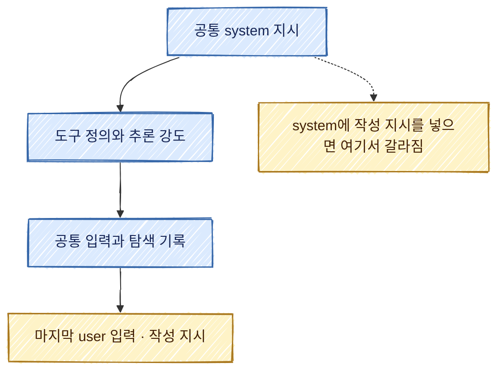

# vLLM prefix cache를 살리는 프롬프트 배치

**이전 글** [vLLM의 스케줄러 루프가 CPU에 묶이면 왜 GPU가 쉬는가](./vllm-cpu-bound-scheduler.md) · **다음 글** [추측 디코딩과 vLLM 적응형 검증](./speculative-decoding-adaptive-verification.md) · [시리즈 목차](../README.md)

에이전트가 탐색을 마치고 결과를 쓸 때, 작성 지시를 system 메시지 끝에 한 줄 추가하면 뒤에 붙은 도구 정의와 탐색 기록까지 다시 계산할 수 있다. vLLM은 요청 JSON의 필드가 아니라, 모델에 들어갈 토큰 열의 앞부분을 비교한다. 이 글은 vLLM v0.23.0을 기준으로 토큰이 갈라지는 위치를 찾고 공통 입력을 재사용하는 방법을 다룬다.

## KV cache에서 입력 블록을 재사용하는 방법

**KV cache**에는 모델이 앞선 토큰에 대해 계산한 Key와 Value가 들어 있다. 한 요청이 다음 토큰을 만들 때 앞 토큰을 다시 계산하는 비용을 줄인다. **Prefix caching**을 켜면 이후 요청도 입력 앞부분이 같을 때 이미 계산한 블록을 재사용할 수 있다. 절약하는 비용은 prefill(입력 계산)이고, 새 출력은 요청마다 생성한다. [vLLM Automatic Prefix Caching](https://docs.vllm.ai/en/v0.23.0/features/automatic_prefix_caching/)

vLLM은 꽉 찬 블록을 캐시에 넣는다. 키에는 현재 블록 토큰과 직전 블록의 해시가 들어간다. 멀티모달 입력의 해시나 캐시 공유 범위를 나누는 salt 같은 값도 키에 들어갈 수 있다. 예를 들어 블록 크기를 4토큰으로 두고 6번째 토큰만 바꾸면 첫 블록은 재사용할 수 있다. 두 번째 블록부터는 키가 달라지고, 세 번째 블록의 토큰이 같아도 직전 해시가 달라 재사용할 수 없다. 재사용할 블록은 같은 인스턴스의 캐시에 남아 있어야 한다. [vLLM 블록 해시와 제거 정책](https://docs.vllm.ai/en/v0.23.0/design/prefix_caching/)

## system 메시지를 바꾸면 왜 도구 목록도 달라지는가

**Chat template**(채팅 템플릿)은 역할이 붙은 메시지와 도구 정의를 모델이 읽는 한 줄의 토큰 열로 바꾼다. Java 서버에서 같은 객체라도 어떤 직렬화기를 쓰느냐에 따라 결과 바이트 배열이 달라지는 것과 비슷하다. 아래는 공통 지시 뒤에 도구 정의와 추론 강도를 배치하는 템플릿의 예다. 실제 순서는 모델과 템플릿에 따라 달라진다.

탐색과 작성이 공유할 system 지시, 도구 정의의 순서와 설명, 추론 강도를 유지하면 뒤에 이어진 탐색 기록까지 재사용할 수 있다. 작성 단계만 읽을 필드 설명은 마지막 user 입력에 붙이고, 서버가 JSON 스키마를 강제하는 옵션은 별도로 유지한다. 요청마다 달라지는 시각이나 실행별 메타데이터도 모델에 필요할 때 공통 입력 뒤에 둔다. 단, 단계에 따라 권한이나 추론 강도가 달라야 하면 그 요구를 먼저 충족하고 공유할 수 있는 앞부분만 남긴다.

도구 호출을 막으면서 정의를 남기려면 해당 API 경로와 템플릿이 `tool_choice: none`을 어떻게 처리하는지 확인한다. 설정에 따라 정의가 렌더링에서 빠질 수 있다. 정의를 남겨 캐시에 적중해도 입력 토큰 수와 컨텍스트 사용량에는 잡힌다. 도구를 실제로 실행하는 쪽에서도 작성 단계에 도구 호출이 오면 실행하지 않도록 검증한다. [vLLM 서버 설정](https://docs.vllm.ai/en/v0.23.0/cli/serve/)

## 캐시가 어디까지 맞았는지 확인하기

- 서버와 같은 모델, 토크나이저, 템플릿, API 경로로 탐색과 작성 요청을 렌더링한다. 토큰 ID에서 처음 갈라지는 위치를 찾아 system, 도구, 추론 설정, 대화 기록 중 어디에서 바뀌었는지 확인한다.
- 같은 인스턴스에서 탐색을 먼저 실행해 캐시를 채운 뒤 작성 요청을 보낸다. 입력 토큰 수와 요청별 `cached_tokens`, 첫 토큰 시간(TTFT)을 기록한다. 스키마 유효성과 결과 내용, 도구 호출 여부도 같이 비교한다.
- 대시보드에서는 같은 구간의 `vllm:prefix_cache_hits_total` 증가량을 `vllm:prefix_cache_queries_total` 증가량으로 나눠 토큰 적중률을 본다. 요청 성공률이나 특정 단계의 적중률은 요청별 기록으로 확인한다. 서버가 여러 대라면 인스턴스별 유입과 적중도 살펴본다. [vLLM 지표](https://docs.vllm.ai/en/v0.23.0/usage/metrics/)

## 우리 서버에서는

탐색과 작성을 나눠 호출한다. 저장소의 템플릿은 system 블록에 공통 지시, 도구 정의와 추론 강도를 넣고 뒤에 사용자 입력과 탐색 기록을 보낸다. 변경 전 개발 환경의 한 사례에서 탐색 마지막 호출은 44,336토큰을 캐시에서 읽었지만 작성 호출은 전체 43,967토큰 중 2,208토큰만 읽었다.

작성에서도 탐색에 썼던 도구 목록을 유지하고 `tool_choice: none`으로 호출을 막았다. 작성에만 필요한 출력 필드 설명은 마지막 user 입력으로 옮기고 엄격한 JSON 스키마 적용은 유지했다. 두 단계의 추론 강도도 같게 뒀다. 후속 조사에서 작성 단계의 변경 전후 적중률과 첫 토큰 시간은 다시 측정하지 않음.

서버 전체 누적 토큰 적중률은 약 77.7%였다. 한 서버의 시작 로그에 나온 KV cache 용량은 약 742만 토큰이었다. 동시 32건이 각각 약 6만 토큰을 쓴다고 놓으면 약 192만 토큰이라 계산상 여유가 있었다. 동시 32건 부하 테스트에서도 선점은 관측되지 않았다. 입력 분포가 달라지면 같은 동시 처리 상한에서도 여유가 달라진다.
