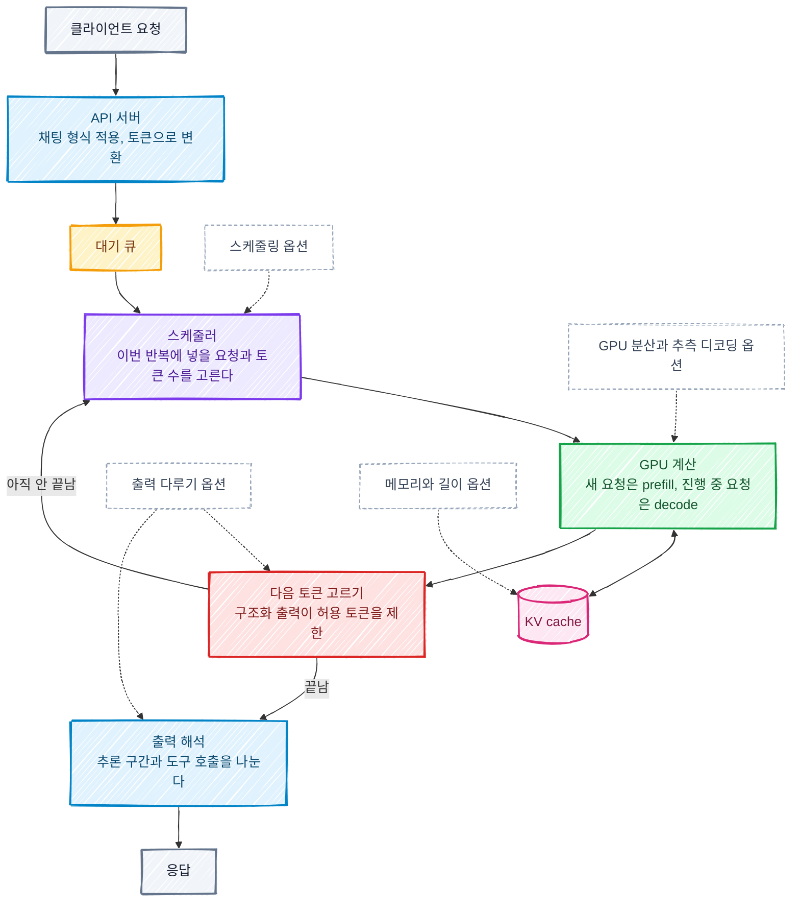

# vLLM 서버 옵션 지도: 요청 흐름으로 읽는 기동 옵션

**이전 글** [배칭과 GPU 활용률](./continuous-batching-gpu-utilization.md) · **다음 글** [vLLM의 스케줄러 루프가 CPU에 묶이면 왜 GPU가 쉬는가](./vllm-cpu-bound-scheduler.md) · [시리즈 목차](../README.md)

`vllm serve` 의 기동 옵션은 백 개가 넘는다. 하나씩 외우기보다 요청 하나가 서버 안에서 지나가는 길을 먼저 그려 두면, 각 옵션이 그 길의 어느 지점을 조이는지 보인다. 이 글은 요청 흐름을 먼저 설명하고, 옵션을 흐름의 위치별로 묶어 설명한다. 옵션마다 처음 보는 사람을 위한 설명, 값을 바꿨을 때 생기는 일, 기본값, 그리고 우리 서버에서 고른 값과 그 이유를 적었다.

기본값과 동작은 공개 vLLM v0.23.0 소스와 문서로 확인했다. 우리 서버는 digest를 고정하고 일부 파일을 패치한 이미지를 쓰기 때문에 공개 릴리스와 기본값이 다를 수 있다. 실제로 적용된 값은 서버 시작 로그에서 다시 확인한다. 구조화 출력 사례는 XGrammar 0.2.8에서 확인했다. 운영 중 겪은 일은 [LLM 응답이 공백과 빈 항목을 반복했을 때 바꾼 설정](../../task/ai-service-team/llm-server-structured-output-tuning.md)에 따로 적었다.

## 요청이 서버 안에서 지나가는 길

먼저 낱말 몇 개를 정리한다.

- **토큰**: 모델이 글을 다루는 단위다. 영어 단어 하나, 한글 한두 글자, 쉼표 하나가 각각 토큰 하나쯤 된다. 모델은 응답을 한 번에 쓰지 않고 토큰을 하나씩 고르며 이어 쓴다.
- **prefill**: 요청에 들어 있는 입력 토큰 전체를 한 번에 읽어 들이는 계산이다. 입력이 길수록 오래 걸리고, 첫 토큰이 나오기까지의 시간(TTFT)을 정한다.
- **decode**: 출력 토큰을 하나씩 만드는 반복이다. 출력이 길수록 반복이 많아진다. 토큰 사이의 시간을 ITL(inter-token latency)이라 부른다.
- **KV cache**: prefill과 decode 중에 계산한 중간 결과를 GPU 메모리에 쌓아 두는 공간이다. 다음 토큰을 만들 때 앞 토큰을 다시 계산하지 않으려고 둔다. 요청 하나가 쓰는 KV cache는 입력과 지금까지의 출력을 합친 길이에 비례한다.
- **연속 배칭**(continuous batching): 여러 요청을 묶어 GPU에서 함께 계산하되, 한 요청이 끝나면 다음 반복에서 곧바로 대기 중인 요청을 끼워 넣는 방식이다. 고정 크기 스레드 풀이 작업 큐에서 일을 꺼내 쓰는 모습과 비슷하다. 스레드 수에 해당하는 것이 동시에 처리할 요청 수 상한이고, 큐에 남은 작업이 대기 요청이다.

스케줄러는 한 반복마다 어떤 요청을 GPU에 넣을지 고른다. 진행 중인 요청의 decode를 먼저 넣고, 남은 토큰 예산 안에서 새 요청의 prefill을 넣는다. GPU가 한 반복을 계산하면 요청마다 다음 토큰이 하나씩 정해지고, 끝나지 않은 요청은 다음 반복에 다시 들어간다. 이 반복이 쌓여 응답 하나가 완성된다.

> [!TIP]
> **더 읽을 글**: [GPU로 LLM을 서빙한다는 것](./gpu-llm-serving-basics.md)과 [배칭과 GPU 활용률](./continuous-batching-gpu-utilization.md).
> prefill과 decode가 왜 다른 자원을 쓰는지, 요청을 묶으면 왜 처리량이 늘어나는지 설명한다.

아래 표는 이 글에서 다루는 옵션을 흐름의 위치로 묶은 것이다.

| 묶음 | 흐름에서 건드리는 곳 | 옵션 |
| --- | --- | --- |
| 모델을 여러 GPU에 나눠 올리기 | GPU 계산 | `--tensor-parallel-size`, `--enable-expert-parallel` |
| 메모리와 문맥 길이 | KV cache | `--gpu-memory-utilization`, `--max-model-len`, `--kv-cache-dtype` |
| 스케줄링과 동시 처리 | 대기 큐와 스케줄러 | `--max-num-seqs`, `--max-num-batched-tokens`, chunked prefill, prefix caching |
| 빠르게 생성하기 | GPU 계산 | `--speculative-config` |
| 출력 다루기 | 다음 토큰 고르기, 출력 해석 | `--structured-outputs-config`, `--reasoning-parser`, `--enable-auto-tool-choice`, `--tool-call-parser` |
| 운영 | 서버 바깥 | 헬스체크, `HF_HUB_OFFLINE`, 로그와 지표 |

## 모델을 여러 GPU에 나눠 올리기

모델 가중치가 GPU 한 장의 메모리보다 크면 여러 장에 나눠 올려야 한다. 나누는 방식에 따라 GPU 사이에 오가는 데이터의 양과 시점이 달라진다.

### `--tensor-parallel-size`

텐서 병렬(TP)은 각 층의 큰 행렬을 GPU 수만큼 쪼개 나눠 계산하고, 층이 끝날 때마다 GPU끼리 부분 결과를 합친다. 큰 테이블을 샤드로 나눠 여러 DB에 두고, 질의 하나를 모든 샤드에 보내 결과를 합치는 구조와 비슷하다.

값을 키우면 GPU 한 장이 맡는 가중치가 줄어 그만큼 KV cache에 쓸 메모리가 늘어난다. 대신 층마다 GPU 사이 통신이 생기므로, GPU를 잇는 연결(NVLink 같은)이 느리면 오히려 느려질 수 있다. 그래서 TP는 보통 한 서버 안의 GPU끼리만 쓴다. 기본값은 1이라 나누지 않는다.

우리 서버는 8이다. 큰 MoE 모델을 한 서버의 GPU 8장에 올리던 기존 구성을 그대로 유지했다.

### `--enable-expert-parallel`

MoE(Mixture of Experts) 모델은 층 안에 작은 신경망(expert)을 여러 개 두고, 토큰마다 그중 몇 개만 골라 계산한다. 전체 가중치는 크지만 토큰 하나가 실제로 쓰는 가중치는 일부다. 요청 종류에 따라 담당 서버로 보내는 라우팅과 비슷하다.

이 옵션을 켜면 MoE 층은 텐서 병렬 대신 expert 단위로 GPU에 나눠 둔다. 각 GPU가 expert 몇 개를 통째로 맡고, 토큰은 자기가 고른 expert가 있는 GPU로 보내졌다가 결과가 모인다. 병렬 정도는 `--tensor-parallel-size` 값을 그대로 따른다. 행렬을 잘게 쪼개 매번 합치는 통신이 줄어드는 대신, 토큰을 보내고 모으는 통신이 생긴다. 특정 expert에 토큰이 몰리면 그 GPU만 바빠진다. 기본값은 꺼짐이고 MoE가 아닌 모델에는 의미가 없다.

우리 서버는 켜 둔다. MoE 모델을 GPU 8장에 나누던 기존 구성이다. 끄거나 켰을 때의 처리량은 따로 비교하지 않았다. [vLLM 최적화와 튜닝 문서](https://github.com/vllm-project/vllm/blob/v0.23.0/docs/configuration/optimization.md)

## 메모리와 문맥 길이

GPU 메모리는 모델 가중치, 계산 중 잠깐 쓰는 공간, KV cache가 나눠 쓴다. 가중치는 모델이 정하므로, 운영자가 조절하는 것은 주로 KV cache에 얼마를 줄지다. KV cache가 클수록 긴 요청과 많은 동시 요청을 받을 수 있다.

### `--gpu-memory-utilization`

vLLM 인스턴스 하나가 GPU 메모리 중 몇 할을 쓸지 정하는 비율이다. vLLM은 기동할 때 이 예산에서 가중치와 계산 공간을 빼고, 남은 공간을 전부 KV cache로 미리 잡아 둔다. JVM 힙을 `-Xmx`로 정해 두고 그 안을 쓰는 것과 비슷하다.

비율을 높이면 KV cache가 커져 동시에 더 많은 요청을 담는다. 대신 같은 GPU를 쓰는 다른 프로세스나 순간적으로 늘어나는 메모리에 남는 여유가 줄어, 메모리 부족 오류 위험이 커진다. 낮추면 반대다. 이 값은 인스턴스 하나의 상한이라, 한 GPU에 두 인스턴스를 띄우면 각자 0.45처럼 나눠 줘야 한다. v0.23.0 기본값은 0.92다. 예전 버전 문서에 자주 나오는 0.9와 다르다.

우리 서버는 기본값을 쓴다. 시작 로그 기준 KV cache는 약 741만 토큰이다. 입력 6만 토큰짜리 요청 32건이 동시에 돌아도 약 190만 토큰이라 여유가 있다.

### `--max-model-len`

요청 하나가 쓸 수 있는 입력과 출력의 합, 곧 문맥 길이 상한이다. 이보다 긴 요청은 거절된다.

값을 크게 두면 긴 문서를 넣을 수 있다. 다만 긴 요청 하나가 KV cache를 크게 차지하므로, 그런 요청이 몰리면 동시에 처리할 수 있는 요청 수가 줄어든다. 값을 줄이면 KV cache가 그 길이 하나도 담지 못하는 문제를 피할 수 있어서, 메모리가 빠듯한 GPU에서 모델을 띄우려고 줄이기도 한다. 기본값은 지정하지 않음이고, 그러면 모델 설정 파일에 적힌 최대 길이를 쓴다.

우리 서버는 기본값을 쓴다. 모델이 지원하는 최대 길이를 그대로 받는다는 뜻이다.

### `--kv-cache-dtype`

KV cache에 숫자를 어떤 형식으로 저장할지 정한다. 기본값 `auto`는 모델 가중치와 같은 형식을 쓴다. `fp8`로 바꾸면 값 하나를 8비트로 저장해 같은 메모리에 더 많은 토큰을 담는다.

KV cache가 커지니 동시 처리 수와 문맥 길이에 여유가 생긴다. 대신 숫자를 거칠게 저장하므로 출력 품질이 조금 달라질 수 있고, 지원하는 GPU와 어텐션 구현이 정해져 있다. 바꾼다면 같은 평가 데이터로 품질을 비교한다.

우리 서버는 기본값 `auto`를 쓴다. KV cache가 부족하지 않아 바꿀 이유가 없었다. [vLLM 양자화 KV cache 문서](https://docs.vllm.ai/en/v0.23.0/features/quantization/quantized_kvcache/)

| 옵션 | v0.23.0 기본값 | 우리 서버 |
| --- | --- | --- |
| `--gpu-memory-utilization` | 0.92 | 기본값 |
| `--max-model-len` | 모델 설정의 최대 길이 | 기본값 |
| `--kv-cache-dtype` | `auto` | 기본값 |

[vLLM 캐시 설정 구현](https://github.com/vllm-project/vllm/blob/v0.23.0/vllm/config/cache.py), [vLLM 모델 설정 구현](https://github.com/vllm-project/vllm/blob/v0.23.0/vllm/config/model.py)

## 스케줄링과 동시 처리

이 묶음은 스레드 풀 설정에 해당한다. 동시에 몇 개를 돌릴지, 한 번에 얼마만큼 계산할지 정한다.

### `--max-num-seqs`

한 반복에서 함께 계산할 요청(시퀀스) 수의 상한이다. 상한을 넘은 요청은 실패하지 않고 vLLM 대기 큐에서 기다린다. HTTP 연결 수를 막는 옵션이 아니라는 점에 주의한다. 연결은 받아 두고, GPU에 넣는 수만 제한한다.

상한을 올리면 GPU가 한 번에 더 많은 요청을 계산해 전체 출력 처리량이 늘 수 있고, 기다리는 요청이 줄어 첫 토큰이 빨리 나온다. 대신 함께 도는 요청이 많아질수록 한 반복이 길어져 요청 하나의 토큰 사이 지연은 늘어난다. KV cache도 그만큼 필요하다. KV cache가 모자라면 vLLM은 진행 중인 요청을 잠시 빼고(선점) 나중에 다시 계산하는데, 이때 지연이 크게 튄다. 상한을 내리면 요청 하나는 빨라지지만 대기가 길어진다.

기본값은 GPU에 따라 다르다. v0.23.0의 OpenAI 호환 서버는 메모리 70GiB 이상인 GPU(A100 제외)에서 1024, 그 밖에서는 256이다. [vLLM 기본값 구현](https://github.com/vllm-project/vllm/blob/v0.23.0/vllm/engine/arg_utils.py)

우리 서버는 32다. 처음에는 24로 두었는데, 정기 작업 시간에 대기 요청이 최대 18건까지 쌓였다. 여러 턴 대화를 동시 32개로 보내는 부하에서 24와 32를 비교했다.

| 상한 | 출력 처리량 | 첫 토큰 p50 | 토큰 사이 p50 | 대화 완료 p50 |
| --- | --- | --- | --- | --- |
| 24 | 약 1,743토큰/초 | 약 5초 | 약 12.4ms | 약 24.7초 |
| 32 | 약 2,051토큰/초 | 약 0.45초 | 약 14.3ms | 약 22.2초 |

토큰 사이 지연은 약 15% 늘었지만, 8건이 기다리던 시간이 사라져 대화 완료는 오히려 빨라졌다. 동시 24 이하 부하에서는 두 값의 차이가 없었다. 실패와 선점은 두 값 모두 0건이었다. 기본값 1024를 쓰지 않은 이유는 상한 없이 받으면 긴 요청이 겹칠 때 KV cache 부족과 선점이 생길 수 있고, 측정한 범위 밖이기 때문이다.

### `--max-num-batched-tokens`

한 반복에서 계산할 토큰 수의 상한이다. decode 중인 요청은 반복마다 토큰 하나씩, prefill 중인 요청은 입력 토큰 여러 개를 쓴다. 요청 수 상한(`--max-num-seqs`)과 별개로 이 예산이 차면 나머지는 다음 반복으로 밀린다.

값을 키우면 긴 입력을 한 번에 더 많이 읽어 첫 토큰이 빨라지고 처리량이 늘 수 있다. 반대로 큰 prefill이 반복 하나를 길게 만들어 그 사이 decode 중인 요청의 토큰 사이 지연이 늘어난다. vLLM 문서는 2048 같은 작은 값이 토큰 사이 지연에 유리하고, 큰 GPU에서 처리량을 노린다면 8192보다 크게 두라고 안내한다. v0.23.0 OpenAI 호환 서버의 기본값은 메모리 70GiB 이상 GPU(A100 제외)에서 8192, 그 밖에서 2048이다.

우리 서버는 기본값을 쓴다. 공개 v0.23.0 규칙대로라면 8192이고, 실제 값은 시작 로그로 확인한다.

### chunked prefill

긴 입력을 `--max-num-batched-tokens` 예산에 맞는 조각으로 나눠 여러 반복에 걸쳐 읽는 기능이다. 조각을 나누지 않으면 10만 토큰짜리 입력 하나를 읽는 동안 다른 요청의 decode가 멈춘다. 큰 파일 업로드를 청크로 나눠 다른 요청과 번갈아 처리하는 것과 비슷하다.

v0.23.0에서는 모델이 지원하면 기본으로 켜진다. 켜져 있으면 스케줄러는 decode 요청을 먼저 넣고 남은 예산에 prefill 조각을 넣는다. 그래서 긴 입력이 들어와도 진행 중인 응답이 덜 끊긴다. 대신 긴 입력 하나의 첫 토큰은 여러 반복에 걸쳐 나온다. 지원 모델에서 끄면 엔진 오류나 잘못된 출력이 날 수 있다는 경고가 나온다.

우리 서버는 따로 지정하지 않아 기본 동작을 따른다. [vLLM 최적화와 튜닝 문서의 Chunked Prefill](https://github.com/vllm-project/vllm/blob/v0.23.0/docs/configuration/optimization.md)

> [!TIP]
> **더 읽을 글** [vLLM의 스케줄러 루프가 CPU에 묶이면 왜 GPU가 쉬는가](./vllm-cpu-bound-scheduler.md)
> 같은 배치에 든 응답들의 토큰 간격이 함께 늘어날 때 CPU와 GPU에서 무엇을 확인하는지 살펴본다.

### prefix caching

앞부분이 같은 요청이 다시 오면, 그 앞부분의 KV cache를 재사용해 prefill을 건너뛰는 기능이다. 시스템 지시문이 같은 요청이나 여러 턴 대화에서 앞 턴이 그대로인 요청이 여기에 해당한다. 같은 질의의 결과를 캐시해 두는 것과 비슷하지만, 결과가 아니라 중간 계산을 블록 단위로 저장한다.

적중하면 첫 토큰이 빨라지고 GPU 계산이 준다. 캐시는 KV cache 공간을 같이 쓰므로, 메모리가 부족하면 오래 안 쓴 블록부터 지운다. 출력에는 영향이 없다. v0.23.0에서는 모델이 지원하면 기본으로 켜진다. 토큰이 처음 달라지는 블록부터 재사용이 끊긴다.

우리 서버는 기본 동작을 따른다. 서버 누적 지표로 보면 조회한 토큰의 약 78%가 캐시에 적중했다. [vLLM prefix caching 문서](https://docs.vllm.ai/en/v0.23.0/features/automatic_prefix_caching/)

> [!TIP]
> **더 읽을 글** [vLLM prefix cache를 살리는 프롬프트 배치](./vllm-prefix-cache-prompt-layout.md)
> 채팅 템플릿이 system 지시와 도구 정의를 펼치는 순서에 맞춰 공통 토큰을 재사용하는 방법을 설명한다.

## 빠르게 생성하기

### `--speculative-config`

추측 디코딩(speculative decoding)은 작고 빠른 초안 모델이 토큰 몇 개를 먼저 쓰고, 큰 모델이 한 번에 검증하는 방식이다. 맞은 만큼은 큰 모델의 decode 반복을 건너뛴다. 결과는 큰 모델이 혼자 쓴 것과 같은 분포를 유지하고, 속도만 달라진다.

초안 토큰 수(`num_speculative_tokens`)를 늘리면 맞을 때 많이 건너뛰지만, 뒤로 갈수록 맞을 확률이 떨어지고 검증 계산은 그대로 늘어난다. GPU가 이미 바쁠 때는 이 추가 계산이 부담이 된다. 기본값은 지정하지 않음이고, 그러면 추측 디코딩을 쓰지 않는다.

우리 서버는 DSpark 초안 모델로 초안 4개를 쓴다. 초안 샘플링은 확률적으로(`probabilistic`), 검증은 블록 단위(`block`)로 한다. 적응형 검증(`enable_adaptive_verification`)은 그 경로에서 서버 종료가 관찰된 뒤 꺼 두었다. 초안 수를 7에서 4로 줄인 과정과 이유는 아래 글에 있다.

> [!TIP]
> **더 읽을 글**: [추측 디코딩과 vLLM 적응형 검증](./speculative-decoding-adaptive-verification.md)의 「추측 토큰 수를 정하는 기준」 절.
> 수락률이 뒤 자리로 갈수록 떨어지는 이유와 초안 수를 고르는 기준, 적응형 검증이 GPU 오류와 엮인 사례를 다룬다.

## 출력 다루기

모델은 토큰을 이어 쓸 뿐이고, 그 글을 API 응답의 어느 칸에 넣을지는 서버가 정한다. 이 묶음의 옵션은 생성 중에 토큰 선택을 제한하거나, 생성이 끝난 글을 칸별로 나눈다.

### `--reasoning-parser`

추론 모델은 답을 쓰기 전에 생각하는 과정을 먼저 쓴다. 이 생각 구간은 모델마다 `<think>` 같은 표식으로 감싼다. 추론 파서는 그 표식을 찾아 생각 구간을 응답의 `reasoning_content` 칸으로, 나머지를 일반 `content` 칸으로 나눈다. 로그 한 줄을 정규식으로 필드별로 나누는 파서와 같은 역할이다.

모델이 쓰는 표식과 파서가 다르면 생각 구간이 본문에 섞이거나 본문이 사라진다. 구조화 출력과 함께 쓰면, 기본 설정에서는 생각 구간에는 스키마 제약을 걸지 않고 본문 구간에만 건다. 기본값은 지정하지 않음이고, 그러면 생각 구간도 그대로 본문에 들어간다.

우리 서버는 모델 전용 파서를 쓴다. 이미지에 없는 파서라 파일을 패치해 넣었다. [vLLM 추론 출력 문서](https://docs.vllm.ai/en/v0.23.0/features/reasoning_outputs/)

### `--enable-auto-tool-choice`, `--tool-call-parser`

도구 호출(function calling)은 모델이 "이 함수를 이 인자로 불러 달라"는 내용을 정해진 형식으로 쓰는 기능이다. 모델은 그 내용을 자기만의 텍스트 형식으로 쓰고, 도구 호출 파서가 이를 OpenAI API의 `tool_calls` 칸으로 바꾼다.

`--enable-auto-tool-choice`를 켜야 클라이언트가 `tool_choice: "auto"`로 "도구를 쓸지는 모델이 정하라"고 요청할 수 있다. 켤 때는 `--tool-call-parser`로 모델에 맞는 파서를 함께 지정해야 한다. 파서가 모델 형식과 맞지 않으면 도구 호출이 본문 텍스트로 새어 나온다. 두 옵션 모두 기본값은 꺼짐과 지정하지 않음이다.

우리 서버는 둘 다 켜고 모델 전용 파서를 쓴다. 다만 JSON 결과만 받으면 되는 요청에서는 도구 선택을 끄고 스키마를 보낸다. 도구 호출 표식이 JSON 앞에 붙어 응답을 읽지 못한 일이 있었기 때문이다. [vLLM 도구 호출 문서](https://docs.vllm.ai/en/v0.23.0/features/tool_calling/)

### `--structured-outputs-config`

응답을 JSON 스키마나 정규식에 맞추도록 강제하는 구조화 출력의 서버 기본 설정이다. 처음 보는 사람이 따라오려면 개념부터 설명해야 해서 아래 「구조화 출력」 절에 따로 정리했다. 우리 서버 값은 `{"backend":"xgrammar","disable_any_whitespace":true}`이고, 기본값은 `{"backend":"auto","disable_any_whitespace":false}`다.

## 구조화 출력

### LLM은 글자를 한 토큰씩 고른다

모델은 매 반복마다 사전에 있는 토큰 수만~수십만 개 각각에 점수(logit)를 매긴다. 서버는 그 점수를 확률로 바꿔 토큰 하나를 고르고, 응답 끝에 붙인 뒤 다음 반복으로 넘어간다. 모델은 "지금 JSON을 쓰는 중"이라는 사실을 규칙으로 아는 것이 아니라, 학습한 패턴대로 그럴듯한 다음 토큰을 고를 뿐이다.

### 그냥 두면 JSON이 깨질 수 있다

그래서 지시문에 "JSON으로만 답하라"고 써도 결과가 어긋날 수 있다. JSON 앞에 "다음은 결과입니다" 같은 설명을 붙이거나, 숫자 칸에 문장을 넣거나, 필수 칸을 빠뜨리거나, 괄호를 닫기 전에 출력 상한에 걸려 끊긴다. Java 서버라면 응답을 받은 뒤 역직렬화나 Bean Validation 단계에서야 실패를 알게 된다. 그때는 이미 출력 토큰을 다 쓴 뒤다.

### 구조화 출력은 스키마에 맞는 토큰만 고르게 막는다

구조화 출력은 검사를 생성이 끝난 뒤가 아니라 토큰을 고르는 순간으로 옮긴다. 호출자가 요청에 JSON 스키마를 넣으면 서버는 그 스키마를 문법으로 바꾸고, 매 반복마다 "지금 위치에서 이어 써도 문법이 깨지지 않는 토큰"만 남기고 나머지 토큰의 점수를 없앤다. 모델은 남은 토큰 안에서만 고를 수 있다.

1. 모델이 모든 토큰의 점수를 계산한다.
2. 문법 엔진이 지금까지 쓴 내용으로 문법 상태를 확인하고, 이어 붙일 수 있는 토큰만 표시한 비트마스크를 만든다. 예를 들어 `{"count":` 뒤라면 숫자를 시작하는 토큰만 남고 문장을 시작하는 토큰은 빠진다. 토큰 하나에 여러 글자가 들어 있어도 글자 전체를 검사한다.
3. 서버가 남은 토큰 중에서 하나를 고르고, 그 토큰으로 문법 상태를 한 칸 옮긴다.

입력 폼에서 숫자 칸에 글자를 아예 칠 수 없게 막는 것과 비슷하다. 제출 뒤에 오류를 보여 주는 서버 검증과 달리, 틀린 입력이 처음부터 생기지 않는다. 다만 막을 수 있는 것은 형식뿐이다. 내용이 사실인지, 업무 규칙에 맞는지는 응답을 받은 뒤 따로 검증한다.

비용도 있다. 스키마를 처음 쓸 때 문법으로 바꾸는 컴파일 시간이 들고, 매 토큰마다 마스크를 만드는 계산이 decode 반복에 더해진다. 스키마가 복잡할수록 커지고, 같은 스키마를 다시 쓰면 컴파일 결과를 캐시에서 꺼낸다. [vLLM 구조화 출력 문서](https://github.com/vllm-project/vllm/blob/v0.23.0/docs/features/structured_outputs.md)

### 막는 일을 하는 라이브러리, XGrammar

vLLM은 문법 엔진을 직접 구현하지 않고 외부 라이브러리를 백엔드로 골라 쓴다. JDBC 인터페이스 뒤에 드라이버를 바꿔 끼우는 구조와 비슷하다. v0.23.0에서 고를 수 있는 값은 `auto`, `xgrammar`, `guidance`, `outlines`, `lm-format-enforcer`다.

**XGrammar**는 MLC 팀이 만든 구조화 생성 라이브러리다. JSON 스키마와 정규식, 문맥 자유 문법을 받아 토크나이저에 맞춰 컴파일한다. 문법 상태 대부분에서 허용 토큰을 미리 계산해 두고, 문맥에 따라 달라지는 일부 토큰만 생성 중에 검사해서 토큰당 마스크 비용을 줄인다. [XGrammar 문서](https://xgrammar.mlc.ai/docs/), [XGrammar 논문](https://arxiv.org/abs/2411.15100)

| 백엔드 | 특징 |
| --- | --- |
| `auto` | 요청 내용과 각 라이브러리의 지원 범위를 보고 vLLM이 고른다. 고르는 규칙은 릴리스마다 바뀔 수 있다 |
| `xgrammar` | 고정하면 모든 요청이 XGrammar를 쓰고, XGrammar가 지원하지 않는 스키마는 요청 오류가 된다 |
| `guidance` | llguidance 기반이다. JSON 스키마를 지원하고 `disable_any_whitespace`도 쓸 수 있다 |
| `outlines`, `lm-format-enforcer` | 정규식과 JSON 스키마를 다룬다. 지원하는 스키마 키워드와 공백 처리가 구현마다 다르다 |

`auto`는 편하지만 vLLM을 올릴 때마다 실제로 쓰는 엔진이 바뀔 수 있다. 우리는 공백 제한 옵션이 필요했고, 같은 엔진으로 결과를 재현하려고 `xgrammar`로 고정했다. 백엔드를 바꿀 때는 쓰는 스키마를 그대로 넣어 컴파일이 되는지, 허용과 거부 결과가 같은지 먼저 확인한다. [vLLM 구조화 출력 설정 구현](https://github.com/vllm-project/vllm/blob/v0.23.0/vllm/config/structured_outputs.py)

### `disable_any_whitespace`

JSON 문법에서 `{`, `:`, `,` 주변의 공백과 줄바꿈은 몇 개를 넣어도 유효하다. 기본 문법은 이 선택적 공백을 허용하므로, 모델이 다음 칸을 쓰는 대신 공백이나 줄바꿈을 계속 골라도 문법 엔진은 막지 않는다. 모델이 이런 반복에 빠지면 출력 토큰을 공백에 쓰다가 괄호를 닫기 전에 출력 상한에 걸린다.

`disable_any_whitespace: true`는 구분 기호 주변의 선택적 공백을 문법에서 뺀다. `"hello world"`처럼 문자열 값 안의 공백은 그대로 허용한다. 공백 반복 경로가 문법에서 사라지고, 정상 응답도 공백만큼 토큰이 줄어 조금 짧아진다. 사람이 읽기에는 한 줄짜리 JSON이 되지만, 파서로 읽는 쪽에는 차이가 없다. 이 옵션은 `xgrammar`와 `guidance` 백엔드에서만 쓸 수 있고, 다른 백엔드와 함께 지정하면 서버가 기동하지 않는다.

XGrammar 0.2.8에는 쉼표 뒤의 공백을 없애도록 지정해도 공백 하나가 남는 버그가 있었고, 0.2.9에서 고쳐졌다. 반복 공백을 막는지와 공백이 전혀 없는 JSON을 만드는지는 서로 다른 확인이다. [vLLM XGrammar 백엔드 구현](https://github.com/vllm-project/vllm/blob/v0.23.0/vllm/v1/structured_output/backend_xgrammar.py), [XGrammar 공백 버그](https://github.com/mlc-ai/xgrammar/issues/945), [XGrammar 0.2.9 릴리스](https://github.com/mlc-ai/xgrammar/releases/tag/v0.2.9)

### 스키마 제약이 반복을 막는 이유

공백을 막아도 문법이 허용하는 반복은 남는다. 배열에 항목 개수 상한이 없으면 같은 객체를 계속 추가해도 유효한 JSON이다. 빈 객체 `{}`나 빈 문자열을 허용하는 스키마라면 모델은 의미 없는 항목을 짧게 반복할 수 있다. 문법 엔진은 스키마가 허용한 것만 막으므로, 막고 싶은 모양은 스키마에 직접 적어야 한다.

| 허용되던 출력 | 추가할 제약 | 바뀌는 동작 |
| --- | --- | --- |
| 배열에 같은 객체를 계속 추가 | `maxItems` | 상한에 도달하면 다음 항목을 시작할 수 없어 배열을 닫는다. 상한 안의 중복은 내용 검증으로 잡는다 |
| 근거가 있어야 하는 항목에 빈 근거 배열 | 근거 배열에 `minItems: 1` | 근거를 한 개 이상 써야 배열을 닫을 수 있다. 결과가 0건일 수 있다면 바깥 배열은 비울 수 있게 둔다 |
| 칸이 빠진 빈 객체, 빈 문자열 | `required`와 값의 타입, 필요하면 `minLength` | `required`는 칸이 있는지만 본다. 빈 문자열이나 `null`까지 막으려면 값에도 제약을 건다 |

제약을 너무 세게 걸면 다른 문제가 생긴다. 상한을 너무 낮추면 필요한 항목이 잘리고, 최소 개수를 무리하게 요구하면 근거가 없을 때도 모델이 무언가를 지어내 채운다. 정상 응답 기록에서 실제 최대 길이를 본 뒤 여유를 두고 상한을 정한다. 빈 결과, 최소와 최대 경계, 경계를 하나 넘는 입력을 실제 백엔드에 넣어 허용과 거부를 확인한다. [XGrammar 0.2.8 JSON 스키마 변환 구현](https://github.com/mlc-ai/xgrammar/blob/v0.2.8/cpp/json_schema_converter.cc)

### 우리가 겪은 두 문제

첫 번째는 공백 반복이다. 정해진 JSON을 받아 후속 처리를 하는 작업에서 모델이 칸 사이에 공백과 줄바꿈을 반복했다. 문법상 유효한 출력이라 구조화 출력이 막지 못했고, 출력 상한에 걸려 JSON이 닫히지 않았다. 서버 설정에 `disable_any_whitespace: true`를 넣은 뒤 비교 실행에서 기록이 남은 모델 응답 111건이 모두 JSON 바깥 공백 없이 상한 전에 끝났다.

두 번째는 빈 항목 반복이다. 변경 내역 배열에 빈 객체나 근거 없는 항목이 반복됐다. 배열마다 `maxItems`를, 근거 배열에 `minItems: 1`을, 칸마다 `required`와 값 제약을 넣었다. 운영 이미지의 XGrammar로 보강한 스키마를 컴파일하고 정상과 비정상 사례 10개를 넣어 허용과 거부가 기대와 같은지 확인했다.

자세한 경과는 [LLM 응답이 공백과 빈 항목을 반복했을 때 바꾼 설정](../../task/ai-service-team/llm-server-structured-output-tuning.md)에 있다.

## 운영에 쓰는 설정

vLLM 옵션은 아니지만, 서버를 띄우고 지켜볼 때 함께 정하는 것들이다.

### 헬스체크

vLLM의 OpenAI 호환 서버는 `/health`를 제공한다. 엔진이 살아 있으면 200을 돌려준다. 모델을 읽어 들이는 동안에는 실패할 수 있으므로, 큰 모델이면 기동 유예 시간을 넉넉히 둬야 한다. 우리 서버는 Docker Compose 헬스체크로 30초마다 `/health`를 부르고, 기동 유예를 20분으로 둔다. 상태 표시용이고, unhealthy만으로 컨테이너를 다시 띄우지는 않는다. 엔진 오류로 프로세스가 끝나면 Docker 재시작 정책이 다시 띄운다.

`/v1/models`는 서버가 응답하는 모델 이름을 돌려준다. 기동 뒤 `--served-model-name`으로 정한 이름이 있는지 함께 확인한다.

### `HF_HUB_OFFLINE`

vLLM은 모델을 Hugging Face Hub 형식으로 읽는다. 이 환경변수를 `1`로 두면 Hub에 접속하지 않고 로컬 캐시에 있는 파일만 쓴다. 기동할 때마다 외부에 새 버전을 확인하지 않으므로 네트워크가 막힌 서버에서도 뜨고, 모르는 사이 모델 파일이 바뀌지 않는다. 대신 캐시에 파일이 없으면 기동이 실패한다. 기본값은 꺼짐이다. [Hugging Face Hub 환경변수 문서](https://huggingface.co/docs/huggingface_hub/package_reference/environment_variables)

우리 서버는 `1`로 두고, 모델 파일이 있는 호스트 폴더를 컨테이너의 캐시 위치에 연결한다.

### 로그와 지표

vLLM은 기동할 때 적용된 설정 전체를 로그에 남긴다. 기본값을 쓰는 옵션의 실제 값은 이 시작 로그로 확인한다. 실행 중에는 처리량과 KV cache 사용률을 주기적으로 기록하고(`--disable-log-stats`로 끈다, 기본은 기록함), 요청마다 남기는 로그는 기본으로 꺼져 있다(`--enable-log-requests`로 켠다). 실행 중 요청 수, 대기 요청 수, KV cache 사용률, 선점 횟수는 `/metrics`에서 Prometheus 형식으로 읽는다.

우리 서버는 vLLM 로그 기본값을 쓰고, 컨테이너 표준 출력을 Docker `json-file`로 100MB씩 10개까지 순환 보관한다. 크래시가 나면 재시작 전에 로그를 따로 보관한다.

## 출력 상한과 해석 실패를 확인하는 법

출력 상한은 서버 옵션이 아니라 요청마다 정한다. Chat Completions에서는 `max_completion_tokens` 또는 예전 이름 `max_tokens`를, Responses에서는 `max_output_tokens`를 쓴다. 추론 모델은 생각 구간의 토큰도 이 예산에서 쓴다. 문맥 길이(`--max-model-len`)에서 입력을 뺀 나머지도 실제 출력 길이를 제한한다. [vLLM Chat Completions 요청 구현](https://github.com/vllm-project/vllm/blob/v0.23.0/vllm/entrypoints/openai/chat_completion/protocol.py), [vLLM Responses 요청 구현](https://github.com/vllm-project/vllm/blob/v0.23.0/vllm/entrypoints/openai/responses/protocol.py)

| 관찰한 현상 | 확인할 것 |
| --- | --- |
| 토큰 상한에 도달하고 JSON이 중간에서 끊김 | 종료 사유와 사용량을 먼저 본다. Chat Completions의 `finish_reason: length`가 대표 신호다. 끝부분을 보고 정상 데이터에 예산이 부족했는지, 공백이나 반복에 예산을 썼는지 구분한다 |
| 정상 종료했지만 JSON 앞에 설명이나 도구 표식이 붙음 | 응답 원문, 중간 프록시가 서버에 넘긴 스키마, 도구 선택과 추론 파서 설정을 확인한다. 스키마가 응답 구간에 적용됐다면 객체 앞 설명은 나올 수 없으므로, 어느 단계에서 붙었는지 찾는다 |
| JSON은 읽히지만 항목이 비거나 중복됨 | 스키마가 그 모양을 허용하는지 본다. 항목 수와 필수 칸을 제한하고, 사실 여부와 내용 중복은 애플리케이션에서 검증한다 |

상한을 높이기 전에 정상 응답의 출력 길이 분포와 실패한 응답의 끝부분을 대조한다. 정상 데이터 때문에 잘렸다면 예산을 늘리고, 공백이나 반복이 원인이면 문법이나 스키마에서 그 경로를 막는다.

## 옵션을 바꿀 때의 순서

한 번에 옵션 하나만 바꾼다. 둘을 함께 바꾸면 처리량이 달라져도 어느 쪽 때문인지 알 수 없다. 바꾸기 전과 뒤에 같은 부하를 보내고, 입력과 출력 길이, 동시 요청 수를 맞춘다. 같은 설정을 두 번 돌려 회차 사이 차이도 본다. 우리 측정에서는 같은 설정끼리도 3~13% 차이가 났으므로, 그보다 작은 차이는 개선으로 보지 않았다.

볼 값은 출력 처리량 하나가 아니다. 첫 토큰 시간, 토큰 사이 지연, 대기 요청 수, KV cache 사용률, 선점 횟수, 실패와 재시작을 함께 본다. 처리량이 늘어도 선점이 생기거나 토큰 사이 지연이 사용자가 느낄 만큼 늘었다면 되돌릴 이유가 된다.
