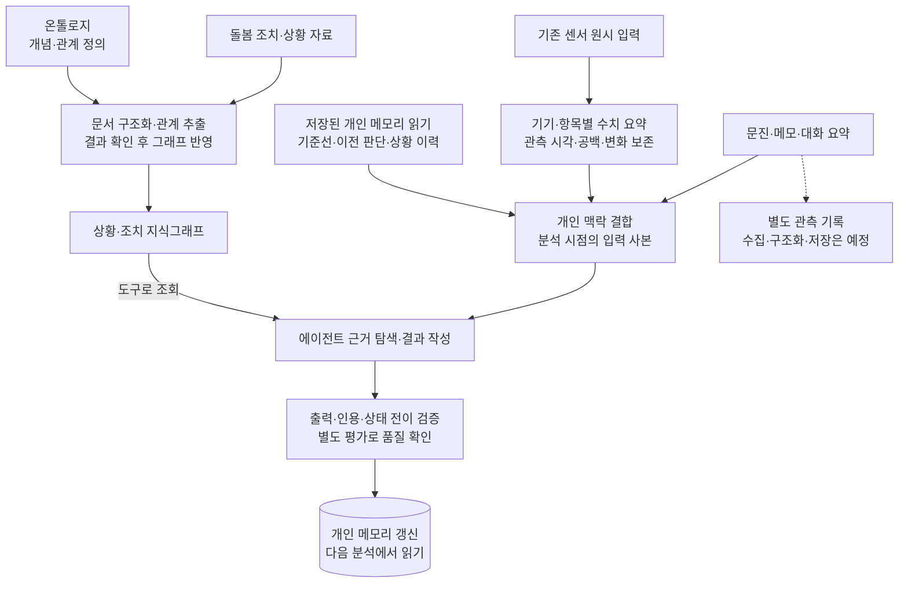

# AI 돌봄 분석 설계: 온톨로지·센서 요약·개인 메모리를 연결하기

**진행 기간**: 2026.09–현재

**상태**: 현재 담당 · 진행 중

AI 돌봄 분석은 센서 관측과 돌봄 맥락을 바탕으로 대상자의 상태와 돌봄 필요도를 분석하고, 담당자가 검토할 근거와 조치 가이드를 만드는 서비스다.
센서가 보낸 값을 보여 주는 데서 그치지 않고, 개인의 평소 상태와 비교해 무엇을 더 확인해야 할지 연결하는 것이 목표다.

나는 돌봄 조치 자료를 상황과 조치의 관계로 구조화하고, 실제 센서 관측과 개인 맥락을 결합하는 시스템의 개발·개선을 맡고 있다.
지금 집중하는 일은 온톨로지와 지식그래프, 센서 요약, 개인 메모리를 어떤 경계로 나누고 분석에 연결할지 정하는 것이다.
그 위에서 에이전트가 근거를 탐색하고 결과를 작성하도록 하며, 실행 성공과 결과의 정확성을 따로 확인하고 있다.

## 처음 방향: 돌봄 지식과 실제 관측을 연결한다

출발점은 돌봄 조치 데이터를 분석해 어떤 상황에 어떤 조치가 연결되는지 구조화하는 것이었다.
문서를 검색해 관련 문장을 찾는 데서 그치지 않고, 상황·증상·조치의 개념과 관계를 온톨로지로 정의하고 실제 지식을 그래프로 쌓는 방향이다.

하지만 돌봄 지식만으로는 지금 이 사람에게 무슨 일이 있는지 알 수 없다.
센서가 관측한 값, 문진과 메모 같은 배경, 이전 분석과 아직 해결되지 않은 상황을 함께 봐야 한다.
같은 수치라도 개인의 평소 범위와 최근 변화에 따라 해석할 맥락이 달라지기 때문이다.

그래서 현재 설계의 중심은 입력을 많이 넣는 것보다 **지식·관측·개인 맥락을 구분하면서 필요한 근거를 함께 읽게 하는 것**이다.
분석 결과는 사람이 검토할 판단과 조치의 근거이며, 임상 효과나 완전 자동 의사결정을 검증한 시스템으로 설명하지 않는다.

## 분석에 들어오는 데이터의 역할

| 입력 | 분석에서의 역할 | 현재 구분하는 경계 |
| --- | --- | --- |
| 돌봄 조치·상황 자료 | 개념과 관계를 정하고 상황에 연결된 조치를 탐색할 근거 | 온톨로지 정의, 문서에서 추출한 관계와 그래프 반영을 구분 |
| 관찰·상담·돌봄 기록 | 센서만으로 알 수 없는 배경과 대화 맥락 보완 | 배경 조회와 대화 요약 전달 경로가 있으며, 별도 관측 기록 수집·구조화·저장 경로는 예정 설계 |
| 센서 관측 | 분석 구간의 상태, 평소와의 차이와 관측 공백 제공 | 기존 원시 입력을 기기·항목별로 읽어 요약하며, 모든 장비의 수집 자체를 이 분석 시스템이 맡는 것은 아님 |
| 개인 메모리 | 이전 판단과 미해결 상황, 개인 기준선과 변화 이력 제공 | 지속 저장한 상태와 이번 분석에서 읽은 사본을 구분 |

구조는 지식을 준비하는 경로와 개인의 현재 상태를 분석하는 경로로 나뉜다.
분석은 센서 요약과 개인 맥락을 먼저 받고, 필요한 지식은 도구로 조회한다.
전체 흐름은 다음과 같다.
실선은 현재 구현된 처리 경로이고, 점선은 아직 구현하지 않은 별도 기록 수집 경로다.

## 온톨로지는 지식의 정의이고 관측은 시점의 사실이다

온톨로지는 어떤 개념과 관계를 사용할지 정하는 정의다.
지식그래프는 그 정의를 바탕으로 문서에서 추출한 상황과 조치의 관계를 담는다.
센서가 특정 시점에 측정한 값과 개인에게 이어지고 있는 상황은 이 둘과 수명이 다르다.
이들을 같은 데이터로 다루면 새 관측이 들어올 때마다 지식 정의까지 바뀌거나, 개인의 일시적 상태를 일반 지식으로 읽을 수 있다.

현재 구현은 문서의 관계 추출과 그래프 반영을 별도 단계로 둔다.
추출할 때 사용한 지시문과 온톨로지 정의를 사본으로 남기고, 추출 결과가 생겼다고 자동으로 그래프에 반영하지 않는다.
결과를 확인한 뒤 반영하거나 취소할 수 있다.
온톨로지 자체의 편집도 별도 경로라, 문서에서 새 표현이 나왔다는 이유만으로 스키마가 바뀌지는 않는다.

또 하나의 어려움은 그래프에 연결이 있다는 사실만으로 담당자가 할 일을 구체적으로 설명할 수 없다는 점이다.
너무 넓은 조치 개념을 연결하면 상황이 달라도 비슷한 권고만 나오기 쉽다.
그래프 설계에서는 개념과 관계의 수보다, 분석 결과에서 필요한 행동과 적용 조건을 구분할 수 있는지를 함께 봐야 한다.
이는 추출 프롬프트만 고쳐 해결할 문제가 아니라 지식의 표현 단위를 검토할 문제다.

개인의 이전 분석과 진행 중인 상황은 분석 쪽의 메모리로 관리한다.
별도 관측 기록을 수집해 구조화하는 경로는 아직 예정 설계이므로, 관찰·상담·조치 기록이 모두 이 흐름으로 적재된 상태로 보아서는 안 된다.
현재는 배경 조회와 이벤트에 실린 대화 요약을 분석에 연결하는 경로를 구분해서 보고 있다.

## 센서 압축은 평균을 남기는 작업으로 끝나지 않는다

다양한 센서를 한 분석 입력으로 만들 때 가장 먼저 부딪히는 문제는 측정 간격과 값의 의미가 다르다는 점이다.
계속 값을 보내는 기기와 가끔 측정하는 기기의 표본 수를 같은 기준으로 해석할 수 없고, 코드값과 숫자값도 같은 평균으로 묶을 수 없다.
원시값을 프롬프트에 모두 넣으면 입력량과 조회 비용이 커지고, 모델이 시간 구간과 단위를 직접 맞춰야 한다.

어려운 부분은 압축 비용을 줄이면서 시간 정보를 얼마나 남길지 정하는 것이다.
짧은 하락과 이후 회복이 하루 평균에서는 상쇄될 수 있고, 같은 변화가 여러 밤에 반복되는지도 일별 대표값만으로는 알기 어렵다.
반대로 모든 원시값을 늘리면 분석 비용과 재현에 필요한 입력량도 함께 커진다.

현재는 분석 구간의 원시 집계와 미리 저장한 일별·장기 요약을 결합한다.
장기 범위를 매번 원시 데이터에서 다시 읽지 않되, 저장 집계의 기준일과 준비 상태를 함께 전달한다.
집계가 늦었다면 오래된 요약을 최신 상태처럼 읽지 않게 하기 위해서다.
요약 길이도 분석 주기와 맞추고, 요청을 만들 때의 구간 끝과 길이를 보존한다.

압축 뒤에도 다음 정보는 구분해서 남긴다.

| 보존할 정보 | 평균만으로 놓치는 것 |
| --- | --- |
| 유효 표본 수, 마지막 관측 시각과 최대 관측 공백 | 최근 관측이 없는지, 드문 측정인지 |
| 최솟값·최댓값과 그 시각 | 짧게 나타난 큰 변화가 평균에 가려지는지 |
| 개인의 평소 범위 밖 표본 수와 연속 관측 구간 | 일시적인 값인지 여러 표본에 이어지는 변화인지 |
| 시간대별 비교와 장기 추이 | 낮과 밤의 변화가 상쇄되거나 며칠의 방향을 놓치는지 |
| 유효 측정과 별도로 센 미감지 표시값 | 실제 측정값과 기기의 미감지 응답을 혼동하는지 |

표본이 없다는 사실을 정상값이나 영으로 바꾸지 않는 것도 같은 이유다.
미감지 표시값은 해당 기기·항목의 규칙에 따라 유효 통계에서 제외하고 건수는 따로 남긴다.
다만 수신 공백이나 미감지 비율만으로 외출, 기기 이탈이나 건강 상태를 확정하지는 않는다.
다른 관측과 개인 맥락을 함께 확인해야 한다.

평소 범위 밖 표본의 연속 구간도 실제로 계속 그 상태였다는 증명은 아니다.
관측 간격이 긴 기기에서는 두 표본 사이를 알 수 없으므로, 표본 수·시각·공백과 함께 읽는 방향으로 검증해야 한다.

## 개인 메모리는 대화 이력보다 수명과 갱신이 중요하다

개인 맥락은 배경 정보, 이번 구간의 관측, 분석이 남긴 사건과 판단으로 나눈다.
그중 지속 저장하는 분석 메모리는 이전 판단, 아직 해결되지 않은 상황과 최근 해결 이력, 개인 기준선과 기준선 변경 이력이다.
센서 요약에 있는 통계적 평소 범위와 분석이 유지·갱신하는 기준선은 서로 다른 입력으로 둔다.
통계가 계산한 범위와 모델이 맥락을 보고 유지하려는 기준을 같은 값으로 오해하지 않게 하려는 것이다.

기준선 메모리는 기능 설정에 따라 읽기·반영 여부가 달라진다.
현재 구현은 대상자와 메모리 범위를 나누고, 분석 구간 끝보다 뒤의 정보를 읽지 않도록 조회 시점을 제한한다.
이번 분석에 사용한 배경과 메모리는 사본으로 남긴다.
나중에 기준선이 바뀌어도 당시 무엇을 보고 판단했는지 다시 볼 수 있어야 하기 때문이다.
다만 읽는 시점을 제한하는 것만으로 모든 과거 상태를 완전히 복원한다고 보장할 수는 없다.
변경·해결된 상황의 과거 재현 범위도 별도로 확인해야 한다.

갱신 역시 모델의 답을 그대로 덮어쓰는 방식으로 두지 않았다.
기준선 제안의 인용과 사실을 검사하고, 더 늦은 분석이 이미 정한 값이나 분석 도중 바뀐 버전을 오래된 결과가 덮어쓰지 않도록 한다.
분석 결과 저장 뒤 기준선은 별도로 반영하며, 기준선 반영이 실패하면 경고를 남긴다.
잘못된 기준선을 삭제해 다음 분석에서 새로 만들게 하는 경로도 있다.

이 방식은 상태를 나누어 관리하고 입력 사본과 갱신 이력을 보존하는 비용을 요구한다.
메모리를 프롬프트에 덧붙이는 기능으로만 보면 작아 보이지만, 실제로는 같은 결과를 다시 설명할 수 있어야 하는 저장·조회 설계다.

지금의 고민은 메모리를 오래 유지할수록 이전 판단의 오류도 다음 분석으로 이어질 수 있다는 점이다.
기기 변경, 긴 관측 공백이나 생활 변화가 있을 때 어떤 근거로 기준선을 유지·갱신·무효화할지 반복 검증할 필요가 있다.
이 모든 상황에 대한 자동 무효화 정책을 완성한 상태는 아니다.

## 모델의 추론과 코드 검증의 책임을 나눈다

상황과 조치를 연결하고 개인 맥락을 해석하는 일은 에이전트가 맡는다.
코드는 입력 구간, 출력 형식, 근거 인용과 상태 전이처럼 명시적으로 확인할 수 있는 계약을 검사한다.
모델은 기존 상황이 계속되는지, 나아졌는지 같은 관찰을 답하고, 코드는 현재 상태와 허용된 전이를 대조해 다음 상태를 정한다.
이렇게 나눠도 판단의 의미적 정확성까지 코드가 증명하는 것은 아니다.

업무 경계를 나누면 담당 영역을 독립적으로 개발할 수 있지만, 서로의 코드가 아니라 API 계약으로 맞물린다.
따라서 한쪽의 요약 필드나 상태 의미가 바뀌면 호출하는 쪽의 해석과 검증도 함께 맞춰야 한다.
현재 구조는 지식·센서·분석·실행 시점을 나누되, 같은 업무 안의 처리를 무조건 더 작은 서비스로 쪼개지는 않는 방향이다.

분석 시점과 중복·지연·복구는 실행을 요청하는 쪽의 책임으로 분리했다.
정기·이벤트 요청을 대기열에 남기고 대상자별 동시 실행을 제한하며, 중복 처리와 합치기·재시도를 구분한다.
분석 실행 중에는 탐색과 작성을 나누고 같은 시간 예산을 공유한다.
탐색 실패나 시간 소진 뒤에는 작성을 시작하지 않고, 작성 요청을 제출하지 못해도 앞선 탐색 식별 정보를 보존한다.

응답 형식 오류나 최소 위험도 제약 미달에는 제한된 재요청 경로를 둔다.
남은 시간이 부족하면 생략 사유를 남기고, 보정이 필요하면 그 사실도 표시한다.
이 보정은 출력 제약을 적용한 사실이며 의학적 정확성을 확인한 결과가 아니다.

별도 그래프 평가에서는 기대 조치의 누락, 그래프에 없는 조치와 도구 사용 여부를 나누어 본다.
현재 `passed`는 실행 완료·그래프 도구 사용·그래프에 없는 조치가 없다는 조건을 확인한다.
모든 기대 조치를 빠짐없이 답했는지와 조건 내용이 정확한지는 이 값만으로 알 수 없다.
실행 성공, 출력 계약 준수, 근거 탐색과 업무 정확도를 각각 확인해야 한다.

## 현재 담당 범위와 다음 검증

이 업무에서 내가 맡는 부분은 입력과 개인 맥락을 분석에 연결하는 설계, 분석 실행·실패 추적과 평가 경로의 개발·개선이다.
동료와 함께 구현하고 검토하며, 에이전트 실행에는 오픈소스 런타임을 활용하고 개발 과정에는 AI 도구를 사용한다.
장비 전체의 수집이나 돌봄 정책, 제품 전체를 혼자 만든 것으로 설명하지 않는다.

현재 코드에는 관계 추출과 그래프 반영의 분리, 센서 요약, 개인 메모리 조회·갱신, 실행 안정성과 평가 경로가 있다.
별도 관측 기록의 수집·구조화·저장은 예정 설계이며, 배경 정보의 외부 연동도 실제 제공 범위와 검증 환경의 대체 입력을 구분해야 한다.
이 글의 구현 설명은 이 경계를 기준으로 한다.

다음에는 센서 압축이 놓치는 짧은 변화와 결측 사례, 기준선 변경 전후의 과거 분석 재현성, 잘못된 메모리가 다음 판단에 미치는 영향을 사례로 나눠 확인하려고 한다.
기대 조치를 빠뜨린 답변과 잘못 인용한 근거, 시간 초과도 같은 입력으로 반복 비교할 대상이다.
실제 모델을 호출한 비교 평가와 운영 개선율은 이 글에서 새로 측정하지 않았고, 임상 효과·사고 예방·고객 성과도 검증한 성과로 제시하지 않는다.
